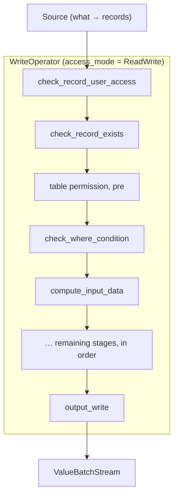

# ADR 0001: The streaming write path

**Status:** Proposed · **Scope:** `surrealdb/core/src/exec/operators/write/`

> A stage list below summarises the per-statement orders in
> `surrealdb/core/src/exec/operators/write/plan.rs` and the stages in
> `exec/operators/write/stages/`. The code is the authority; a stage list here is
> a summary of it, never a substitute.

ADRs live in `doc/adr/`, numbered sequentially, and record decisions whose rationale would otherwise
have to be reconstructed from the code. An ADR states the contract and the constraints that force
it; it is not a changelog.

## Context

`surrealdb_core::exec` plans every statement, and the write operator is the plan node that
executes `Expr::{Create, Update, Upsert, Delete, Insert, Relate}`: it consumes rows from a
`ValueBatchStream` and writes each through an ordered list of per-record stages.

This ADR fixes the interface by which mutations execute. Its subject is
the seam, not the individual stages: transaction lifecycle, where the KV write sits in the tree,
the ordering guarantees between reads and writes, and how a mutation nested inside a read query
behaves.

Four properties of the engine constrain every decision below, so they are
stated once here.

**The transaction is chosen before planning.** `dbs::Executor` picks `TransactionType` from
`TopLevelExpr::read_only()`, a syntactic predicate over the AST, and opens the transaction before
it plans, because the planner resolves catalog and index definitions through it. An explicit
`BEGIN` block always opens a write transaction. Commit, cancel, transaction timeout and conflict
classification are the executor's.

**Savepoints are a LIFO stack on the transaction.** `Transaction::{new_save_point,
release_last_save_point, rollback_to_save_point}` identify no savepoint; they act on the most
recent one. `UPSERT` and `INSERT` use them for create-then-update retry.

**The WHERE condition runs before the data clause, per record.** A data clause with side effects
runs only for records the condition accepts: `UPDATE person SET spawn = (CREATE log).id WHERE
false` updates nothing and creates nothing. This holds on every physical plan. An index-backed
plan never brings rejected records into the write pipeline at all, so the full-scan path checking
the condition first is what keeps the two plans observably equivalent; a plan whose side effects
depended on whether an index was selected would make adding an index a behaviour change. The data
clause, when it runs, is evaluated against the permission-reduced record image.

**Write-permission timing differs between the creating and updating shapes.** On the updating
shapes the table permission is evaluated before any user expression in the data clause or the
condition, so that neither can observe field values the check will then refuse. On the creating
shapes the pre-data-clause check is narrower: it short-circuits only when the table's create
permission is `NONE`, and a *conditional* create permission is evaluated after the data clause has
already run, necessarily: the predicate's subject is the record being created, which does not
exist until the data clause has produced it. So a creating statement whose data clause has side
effects performs them even when a conditional create permission denies the write. Both timings are
contracts, not properties to unify: a single pre-write permission stage that evaluated the
conditional create permission in full would need the record image the data clause has not yet
built.

## Decision 1: The write operator inherits the transaction; it never owns one

```
dbs::Executor                                    exec::operators::write
─────────────────────────────────────────────    ──────────────────────────────
TopLevelExpr::read_only()  ──► selects Read/Write
kvs.transaction(ty)        ──► opens
        │
        ├──► plan_statement  ──────────────────► plan built; access_mode() known
        │
        ├──► plan.execute(ctx) ────────────────► WriteOperator writes through ctx.txn()
        │
txn.commit() / txn.cancel() ──► owns the outcome
```

**R1, transaction ownership.** No operator begins, commits, or cancels a transaction. A write
operator obtains the transaction from its `ExecutionContext` and nothing else.

`AccessMode` cannot select the transaction type, because it is a property of a plan that does not
exist until after the transaction is open. Its role in the lifecycle is an assertion:

**R2, writable-transaction assertion.** A plan whose `access_mode()` is `ReadWrite` requires the
inherited transaction to be writable. A write operator checks this when its `execute()` is called
and returns an error, not a panic, when it does not hold.

R2 is reachable whenever `read_only()` under-approximates: it selects the transaction, so a clause
it fails to inspect puts a mutation on a read-only transaction. `SELECT`'s predicate now inspects
every clause, including the four that hold a bare `Expr` the grammar accepts a mutation in —
`limit`, `start`, `version`, `timeout` — and `dbs/read_only_test.rs` pins each position, so
`SELECT * FROM person LIMIT (CREATE log).n` opens a write transaction today. R2 remains reachable
because that is a property of the predicate's current coverage, not a structural guarantee.

R2 is not what makes an under-approximation safe. The storage layer already refuses the write with
a precise error ("Couldn't write to a read only transaction") and nothing is persisted. What R2
adds is a plan-level diagnosis instead of a storage-level one, raised before any of the statement's
work begins rather than partway through it. The behaviour worth removing is separate: the same
statement writes or does not depending on whether the caller wrapped it in `BEGIN`, because `BEGIN`
opens a write transaction unconditionally.

Removing that needs `read_only()` to be a conservative over-approximation of the statement's real
write behaviour. The obvious formulation is wrong, and the corpus is what shows it:

> ~~For every statement, `access_mode() == ReadWrite` implies `read_only() == false`.~~

The two predicates answer different questions. `read_only()` asks whether a statement writes
storage. `AccessMode::ReadWrite` means "may write **or have side effects**" and doubles as the
dependency barrier of Decision 3, so operators report it for reasons that are not writes. A sweep
of the language-test corpus
(`dbs::read_only_test::vm::access_mode_read_write_implies_not_read_only_NN`, twelve slices of the
corpus that together compile 8,469 statements through a transaction-less planner) finds 424 plans
reporting `ReadWrite`, of which 62 are called read-only by `read_only()` — and every one of the 62
originates at `Sleep`, whose side effect is the pause, or at a closure or user-defined function
whose body the planner could not see and must assume writes. Asserting the implication as stated
would force `SELECT sleep(1s)` onto a write transaction.

Both are the physical layer being *more* conservative than the AST predicate, which is the safe
direction: an over-approximating `access_mode()` never lets a write reach a read-only transaction.
The contract is therefore stated over the origin of the mode rather than over the mode:

> For every statement, if a plan's `ReadWrite` originates at an operator that writes storage, then
> `read_only()` is false.

That is what the corpus sweep asserts, against a documented list of operators whose `ReadWrite` is
known not to be a storage write. The list may shrink and must not grow without a decision, and a
write operator appearing in it is the failure it is shaped to expose. Closing the gap properly
needs `access_mode()` to separate a storage write from a barrier, which is left open below.

## Decision 2: One operator per statement, holding an ordered list of stages

A mutation is a single `ExecOperator`. The per-record work is a list of stages inside it. The stages
shown are `UPDATE`'s; each statement form has its own list (see below).



```rust
trait WriteStage: Debug + Send + Sync {
    fn name(&self) -> &'static str;
    fn apply<'a>(&'a self, row: &'a mut WriteRow, ctx: &'a WriteCtx)
        -> BoxFut<'a, Result<StageOutcome, ControlFlow>>;
    fn attrs(&self) -> Vec<(String, String)> { vec![] }
}

enum StageOutcome {
    /// Continue to the next stage.
    Continue,
    /// Abandon this record and emit nothing for it. The statement succeeds.
    SkipRow,
}
```

`StageOutcome` has no error variant. A stage that fails returns `Err(ControlFlow)`, which aborts the
statement: the record's own partial work and every record already written by that statement are
discarded when the transaction is cancelled. `SkipRow` is the distinct, non-failing outcome for a
record excluded by a condition, a permission predicate, or a missing-record check; the statement
succeeds and simply produces no row for it.

**`WriteRow`** carries the per-record state across stages: the record id and the table to generate
one from, the initial and current record images and their permission-reduced counterparts, the
computed input data, the statement-specific payload for `INSERT` and `RELATE`, whether a KV write
occurred, and the memoised modified flag.

**`WriteCtx`** carries what is resolved once per statement: the table, field, event, view, index
and subscription definitions, the computed-field dependency map, the id-field index, the
transaction, the `ExecutionContext`, and the statement's output clause.

### Why a single operator rather than a chain

A chain of `ExecOperator`s is the shape the read side uses, and it does not work here.

`ValueBatch` holds `Vec<Value>`. The state above is not a `Value`, so a chain would have to smuggle
`WriteRow` inside one, which makes the batch type a lie and every intervening operator a hazard.

More decisively, the security ordering is not expressible as a pipeline of independent operators.
On the updating shapes the table permission gate must run before the user-supplied condition, and
the gate is a per-record check over the loaded document, so hoisting the condition into an
upstream `Filter` evaluates it before the gate, which is the exfiltration that ordering exists to
prevent. (Where permission checks are statically known not to run, the condition *is* eligible for
pushdown into the source scan, and that is what makes index selection work for mutations; the
eligibility decision is the planner's, per plan, not a property a fixed operator chain can
express.)

A chain would also buy nothing even if it worked. Stages of one record cannot overlap: they mutate
`WriteRow` in sequence, and R3 below forbids overlapping records on one transaction.

### Why stages are values rather than method calls

The stage list is data, because there is no single order to hardcode. Six statement forms produce
**nine** per-record orders: `UPSERT`, `RELATE` and `INSERT` each have a distinct creating and
updating branch, selected per record by whether the record already exists. `RELATE` selects on the
loaded record before running any branch-specific stage, though `check_record_user_access` precedes
the selection on all three. `UPSERT` reads a record id it names and selects on it the same way, so a
stored record takes the updating branch and its data clause reads the stored record. A subject
`UPSERT` did not find stored, and every `INSERT` row, attempts the creating branch and falls
through to the updating branch on a record-exists or unique-index conflict, rolling back to a
savepoint first, which is where R3's single-write-in-flight constraint originates.

Those nine orders fall into three shapes, and the shapes differ in stage *position*, not only in
which stages they contain, so a shared sequence with per-form skips cannot express them. Holding the
order as data also makes each stage separately implementable, separately unit-testable against a
`WriteRow` fixture, and renderable by `EXPLAIN` as a sub-tree beneath the operator.

**Creating shape** for `CREATE`, `UPSERT` create, `RELATE` create, `INSERT` create:

```
  check_record_user_access      ← precedes the create/update selection on UPSERT, RELATE, INSERT
  check_table_type_*            ← UPSERT, INSERT here
  check_permissions_quick_create
  check_table_not_view
  compute_input_data            ← not INSERT: its one clause, ON DUPLICATE KEY UPDATE, is the
                                  updating branch's, evaluated only against a stored record
  process_record_data           ← INSERT: process_merge_data, placed after check_data_fields instead
  generate_record_id            ← INSERT: hoisted out, before the create/update split
  check_table_type_*            ← CREATE, RELATE here
  check_table_not_lightweight   ← RELATE only, and only when the statement carries a data clause
  check_data_fields             ← INSERT: here, before the data is applied
  default_record_data
  process_table_fields
  cleanup_table_fields
  check_create_permissions
  ─── shared tail ───
```

**Updating shape** for `UPDATE`, `UPSERT` update, `RELATE` update, `INSERT` update:

```
  check_record_user_access
  check_record_exists
  check_table_type_*            ← UPSERT, RELATE, INSERT; absent for UPDATE
  check_update_permissions
  check_table_not_view
  check_table_not_lightweight   ← UPDATE unconditionally; RELATE when it carries a data clause
  check_where_condition         ← UPDATE, UPSERT update only; RELATE and INSERT have no condition
  compute_input_data
  check_data_fields
  process_record_data
  default_record_data
  process_table_fields
  cleanup_table_fields
  recheck_update_permissions
  ─── shared tail ───
```

**Shared tail**, common to the eight forms above but not identical across them — two stages are
present in some and absent in others:

```
  store_record_data
  store_edges_data              ← RELATE, INSERT only
  store_inline_adjacency_data   ← UPDATE, UPSERT update, INSERT update only; not RELATE update,
                                  and not on any creating form
  store_index_data
  materialise_observed_fields
  process_table_references
  process_table_views
  process_table_events
  process_table_lives
  process_changefeeds
  check_select_permissions
  output_write
```

`materialise_observed_fields` is not optional and not a projection detail. Computed fields are
stripped before storage, so the five stages after it — references, views, events, live queries and
changefeeds — and the output projection would otherwise all observe the record without them. It
runs in `DELETE` too, after `purge_record_data`.

**`DELETE`** is its own shape: it has no data clause, and it orders reference cleanup before
storage.

```
  check_record_user_access
  check_record_exists
  check_delete_permissions
  check_table_not_view
  check_where_condition
  cleanup_table_references
  clear_record_data
  store_index_data              ← reports whether record-id removal was deferred
  defer_doc_id_removal / remove_doc_id   ← the caller acts on that report, before the purge
  purge_record_data
  materialise_observed_fields
  process_table_views
  process_table_events
  process_table_lives
  process_changefeeds
  check_select_permissions      ← reads `initial`, not `current`
  output_write
```

The record-id reclaim is a decision the caller makes between `store_index_data` and
`purge_record_data`, not something `store_index_data` performs. When an index build deferred the
removal, the builder's replay owns the mapping, and a durable marker is written in the same
transaction instead.

`core/src/doc/{create,upsert,update,delete,relate,insert}.rs` are the authority. Six divergences
between the shapes are load-bearing:

- **`check_data_fields` moves.** In the creating shape it runs *after* the data is applied and the
  record id generated; in the updating shape it runs *before* `process_record_data`. `INSERT`
  create follows the updating shape's position despite being a creating form.
- **`check_table_type_*` moves.** `UPSERT` and `INSERT` check it first, before the permission gate;
  `CREATE` and `RELATE` check it in the middle, after id generation.
- **The pre-write permission check is not the same check in both shapes.** On the creating shapes
  `check_permissions_quick_create` tests only for a `NONE` create permission; the conditional case
  is left to `check_create_permissions` after the data clause. On the updating shapes
  `check_update_permissions` evaluates the permission in full, before the data clause. A single
  stage that evaluated the permission in full in both positions would change creating-form
  behaviour.
- **`DELETE` orders references before storage,** and its record-id reclaim sits between
  `store_index_data` and `purge_record_data`, as described above — not after the purge, and not
  inside `store_index_data`, which only reports whether an index build deferred the removal.
- **`DELETE` checks its select permission against the initial image.** Its *output* does not
  follow: `output_write` dispatches on the `RETURN` clause alone, and its unspecified-`RETURN` arm
  names only the five creating and updating statements, so a bare `DELETE` emits no row rather than
  the before-image. `RETURN BEFORE`, `RETURN DIFF` and `RETURN <fields>` reach `initial` through
  paths that do not branch on the statement kind, so those behave the same for every statement.
- **Three update-shaped forms store inline adjacency and one does not.** `UPDATE`, `UPSERT` update
  and `INSERT` update call `store_inline_adjacency_data`; `RELATE` update does not, and no creating
  form does.

Two stages above are named for their role rather than for one function, because the role is what
the contract is about: the *pre* table permission is `check_permissions_quick_create` on creating
forms and `check_update_permissions` or `check_delete_permissions` otherwise; the *post* table
permission is `check_create_permissions` or `recheck_update_permissions`. The two post stages are
not symmetric — `recheck_update_permissions` returns immediately unless the table's update
permission is `Permission::Specific`, so on `Permission::Full` and `Permission::None` it is not a
second evaluation at all.

**Tenant confinement is a stage obligation, and it is first.** `check_record_user_access` is the
opening stage of all six statement forms, ahead of every permission gate and before the
create/update selection on the three that have one. It confines a record user to its own tenant
(GHSA-2v9j). The read path enforces this at the scan operators; a write performs no scan, so
nothing else applies it. A write operator whose stage list omits it reintroduces a fixed
vulnerability, which is why it heads all four lists above rather than being left implicit.

**Affected-row counting is a stage obligation.** A record that completes a real KV write increments
the statement's affected-row counter exactly once, and a record skipped before any write does not.
The counter is independent of the statement's returned value, so a `RETURN NONE` mutation still
reports its affected rows.

**Definer's-rights narrowing is a stage obligation.** Stages that evaluate a body recorded by a
`DEFINE` statement, meaning field `DEFAULT` / `VALUE` / `ASSERT` / `REFERENCE` bodies and
`DEFINE EVENT ... THEN`, evaluate it under the definer's recorded authorisation limit rather than
the writer's. On the write path the gap is sharp: a low-privileged definer plants the body, a
high-privileged writer supplies the privilege, and the body would otherwise cross a boundary the
definer cannot.

## Decision 2a: A mutation lowers like every other statement

All six of `Create/Update/Upsert/Delete/Insert/Relate` have a logical form, and no statement kind
is refused by lowering. Three consequences follow, and they bind every statement form.

**A mutation's row source is an ordinary `LogicalOp` subtree.** `UPDATE t WHERE …` inherits index
selection, filter pushdown and the projection-layer encoding from the read side. The condition-pushdown
eligibility that Decision 2 describes as "the planner's, per plan" is therefore an ordinary
planner decision over that subtree, not a mechanism the write operator supplies. This is the
`Rows` shape below; a creating form has no row source, so it inherits nothing here.

**Four of the stage lists above are already expressible as the layer encoding.**
`check_where_condition`, computed materialisation, `check_select_permissions` and `output_write`'s
reduce are the same `ProjectLayer` chain a read gets: a write's post-image projection is a
projection. Building them as separate write-side stages would duplicate the read side's evaluation. The
view-shaped stages consume the resolved table view rather than re-deriving it per record.

**Events and views are sub-plans of the write operator.** A stage evaluates them as plans and as
programs the VM runs, and no stage evaluates an `expr::Expr` through a separate per-record
evaluator.

The stage list stays the write operator's own. Lowering supplies the rows; the per-record order
above is not expressible as logical algebra, for the reasons Decision 2 gives.

`LogicalOp::Write` carries the statement whole alongside a `LogicalWriteSource`, which is either
`Targets(Vec<LogicalExpr>)` — scalars naming what to write — or `Rows(Box<LogicalOp>)`, an operator
feeding rows to write. The distinction is load-bearing rather than cosmetic: a creating statement's
subject does not exist yet, so carrying `CREATE person:tobie`'s target as a row-producing subtree
would compile it to a `SourceExpr`, which resolves each value to an existing document and emits
nothing when the record is absent — dropping the write instead of performing it. `CREATE` therefore
lowers to `Targets`, and `Rows` is what the forms that read before they write use. `node_read_only`
answers `false` without consulting either — the one arm in the enum that reads neither its source
nor its own fields, because a mutation writes by construction and `read_only()` is what selects the
transaction.

The gate on compiling one is not the operator. It is the write-side table permission check, which
*silently* drops a target the caller may not write, before any record is prepared: a target whose
table permission is `GrantedPermission::None` ingests nothing. An operator that built records
without that check would write records the caller may not write, so the check runs before the first
stage list, not after.

## Decision 3: Barrier semantics

**R3, at most one write in flight per transaction.** Savepoints are a LIFO stack with no handle,
so two records writing concurrently on one transaction interleave pushes and pops and roll back
each other's work. This is a correctness constraint, and convention does not enforce it. Three
mechanisms do:

1. **Any operator whose own `access_mode()` is `ReadWrite`** passes that mode to `buffer_stream`
   when buffering its input, rather than passing its input's mode. `buffer_stream` maps `ReadOnly`
   to a spawned task and `ReadWrite` to cooperative prefetch, so this keeps the read and the write
   on one task in a deterministic order. The rule cannot be narrowed to write operators: the
   operator that holds the write is often a read-side one, such as the `Compute` that owns a
   projection's mutation subquery (see Decision 4), and every operator today passes its input's
   mode. An operator whose own mode is `ReadOnly` continues to pass its input's mode.
2. **Every `Clause` fan-out across rows goes through one shared helper** that takes the
   fanned-out expression's `AccessMode` as an explicit argument and evaluates sequentially when it
   is `ReadWrite`. Scalar subqueries and graph lookups already do this by hand; routing every site
   through the helper removes the per-site choice. Two sites, field access and `[*]` expansion,
   report `ReadOnly` unconditionally because what they evaluate is a record fetch rather than a user
   expression. Each states that in a comment naming what it evaluates, because a mode that is
   hardcoded rather than derived cannot be caught by an assertion.
3. `spawn_buffered` asserts in debug builds that the mode it was given is `ReadOnly`.

**R4, reads and writes interleave batch-at-a-time, with bounded read-ahead.** A write operator
does not drain its input before writing. It consumes a batch, applies the stage list to each record
in order, and then consumes the next batch, so a mutation over a large table holds one batch rather
than the table.

R4 depends on one property the batching does not give by itself:

> A write statement never reads, as a subject, a record that it or a statement nested in it created
> after the statement began reading that record's table.

No backend's cursor supplies it. Every batch is read through the statement's own transaction,
so a batch read after a write sees what the write created, and a batch holds at most
`NORMAL_BATCH_SIZE` records and no more than the thread's fuel left (`fuel::batch`), so a table of
two records can already span two batches.

The engine enforces it. A write's first read of a table — a target naming the table or a range of
it, or a source of the write's pipeline as it opens, once it has evaluated the range it reads —
opens a creation watch on that table (`kvs::creations`), kept for every later read of the table
until the statement ends. Every record created in a watched table is noted in the transaction's log
— an edge of a lightweight relation too, which is created when its adjacency keys are written for an
edge the relation did not hold — and the statement gate passes over a record read from the table
that the log shows was created since the watch opened, before any stage runs for it, as though the
read had not reached it. A record created before the statement first reads its table is read, and a
record the statement names by its id is never passed over. The notes follow the transaction's save
points, so a rolled-back attempt hides nothing. The log notes creations only in watched tables, and
a table's notes go when the last watch on it closes, so a write that creates nothing pays a read of
one counter per record it reads. The log holds its notes in memory and cannot spill them: the query
charges what it holds to its memory at each batch the write hands on, as it charges the
transaction's write buffer, and releases the charge as the statement's watches close. Like any
memory a query cannot spill, the charge grows the query's lease, waits for other queries, or is
granted past the node's limit, and fails the statement only past its ceiling.

The property is checked where a record reaches the write rather than in the cursor, so it holds on
every backend and wherever the read runs, and it holds in both key directions: a record created
behind the cursor is never read again, and one created ahead of it is passed over. A language test
pins both directions on tables that span more than one batch, through a target, a condition, an
index, `UPSERT`, `DELETE` and a lightweight relation, and a core test pins them with batches of a
single record.

The property covers the records a statement creates, and no other record it writes. An update
creates nothing, so a record an update moves forward within an index the write is reading through
can be read again by a later batch: `UPDATE t SET n = n + 10000 WHERE n >= 1` through an index on
`n`, over more records than one batch of the index holds, moves each record it updates to an entry
ahead of the cursor. Such a record is outside R4's property, and nothing passes over it.

The GQL mutation operators in `exec/operators/mutate.rs` drain their input fully instead. That is
correct for them, because a binding table is bounded by the match that produced it, and it is not
the general rule, because a table scan is not bounded.

## Decision 4: A mutation nested in a read query

```
SELECT *, (UPSERT counter:x SET n += 1) AS bump FROM person

  SelectProject                    holds field names only; inherits ReadWrite
    └─ Compute                     = input ⊔ ⨆(computed exprs) = ReadWrite
         ├─ ScalarSubquery ──────► WriteOperator(Upsert)   ReadWrite
         └─ TableScan(person)      access_mode = ReadOnly

  Compute.access_mode() == ReadWrite  ─┬─► Compute buffers TableScan with ReadWrite:
                                       │   cooperative prefetch, no spawned task       (R3.1)
                                       ├─► the per-row fan-out evaluates sequentially   (R3.2)
                                       └─► writes occur in scan order, one at a time,
                                           on the scan's own transaction                (R3)
```

The operator that owns the mutation here is `Compute`, not a projection operator: the SELECT planner
pre-computes complex field expressions into a `Compute`, and the `SelectProject` above it carries
only field names. `Compute::access_mode()` combines its field expressions' modes, so the mutation
propagates; `SelectProject::access_mode()` inherits its input's mode, which is correct because it
holds no expressions.

This is also why R3.1 is stated over any `ReadWrite` operator. `Compute` is a read-side operator by
kind, and it is the one that must not spawn its input.

`AccessMode` propagates from a mutation up through every expression and operator that contains it,
so a syntactic `SELECT` containing a mutation is a `ReadWrite` plan. Two consequences follow:

- The plan's transaction must be writable, which is R2, and which requires `read_only()` to
  over-approximate `access_mode()` as stated in Decision 1.
- Every fan-out over rows collapses to sequential evaluation, which is R3.2. Side effects then
  occur in scan order: one per row, in the order the rows were produced.

## Decision 5: Write-path bindings are typed, not parameters

Stages evaluate bodies that reference `$before`, `$after`, `$value`, `$input`, `$event`,
`$reference` and `$parent`. `EvalContext` reaches expressions with a current value, a document
root, and an optional map of block-local parameters.

These bindings are a fixed, known set, and they change per field and per record. They are carried as
typed optional slots on `EvalContext`. Parameter resolution consults the block-local map first and
these slots second, so a `LET` inside the body being evaluated shadows them, and normal innermost-scope shadowing is
preserved. Routing them through the block-local map instead would
allocate a map per field per record, in the write path's innermost loop.

## Rejected alternatives

**A chain of `ExecOperator`s, one per stage.** Rejected by three independent constraints:
`ValueBatch` cannot carry the per-record state; the security ordering is not a fixed pipeline
order, because on the updating shapes the per-record permission gate must precede the user
condition while condition pushdown into the scan remains a per-plan planner decision; and stages
cannot overlap anyway under R3.

**Draining the input before writing, as the GQL mutation operators do.** Rejected because it makes
the memory a mutation holds proportional to the records it matches. It is the right choice for a
bounded binding table and the wrong default for a table scan. R4's soundness argument does not need
it.

**Selecting the transaction type from `access_mode()`.** Not available: the plan that carries
`access_mode()` is built through a transaction that must already exist.

**Scoping R3.1 to write operators.** Rejected because the operator holding a mutation is frequently
a read-side one, so the narrow rule leaves the scan on a spawned task in exactly the shape
Decision 4 describes.

**A single pre-write permission stage evaluating the permission in full.** Rejected because the
creating and updating shapes check different things at that point, and unifying them would evaluate
a conditional create permission before the data clause, which is a behaviour change.

**Carrying the write bindings as block-local parameters.** Rejected on allocation cost in the
innermost loop, for a fixed and known set of names.

**Deferring the stage-order question to the individual stages.** Rejected because the order is
where the security properties live; distributed across ten separate pieces of work it would be
reconstructed inconsistently.

## Invariants

| | Invariant | Enforced by |
|---|---|---|
| R1 | No operator begins, commits or cancels a transaction | Write operators read the transaction from their context and have no other handle |
| R2 | A `ReadWrite` plan requires a writable transaction | Checked at `execute()`; error, not panic. Complemented by `read_only()` over-approximating the statement's write behaviour, verified as a corpus property over the origin of the mode (Decision 1) |
| R3 | At most one write in flight per transaction | Any `ReadWrite` operator buffers its input with its own mode; every expression fan-out routes through one helper that serialises on a `ReadWrite` argument; debug assertion in `spawn_buffered` |
| R4 | Reads and writes interleave batch-at-a-time | Write operators consume batch by batch, and pass over every record the statement created while reading |

Alongside these, the epic's standing invariants apply: the language-test suite stays green, table and field permission behaviour is unchanged, no wire or SDK behaviour
changes for clients, and `revision.lock` discipline holds for any `#[revisioned]` change.

## Consequences

Mutations are plannable: no statement kind is refused by lowering, and every statement reaches the
VM. A statement or a clause the VM cannot lower fails with an error that names the construct
(ADR 0007), so a stage must be able to compile every clause it evaluates. A refusal that a running
plan cannot turn into anything else is a table made unwritable by its own schema, and the planner
declines before it opens the catalog, so it can never see which tables those would be.

The write operator family is the unit of ownership for the rest of the mutation foundation: the
shared infrastructure builds `WriteCtx`, `WriteRow` and the `WriteStage` seam; the data clause,
field schema, permissions, indexes, edges and references, views and events, changefeed and
live-event capture, and output each supply stages; and `EXPLAIN` renders the operator with its
stage list. The behaviours this ADR names as load-bearing, meaning the five shape divergences, the
condition-before-data-clause order, affected-row counting, and definer's-rights narrowing, are
acceptance criteria on those pieces rather than optional refinements.

Four of them are pinned by language tests. Under `language-tests/tests/language/write/`: the
condition running before the data clause with side-effect counts equal across full-scan and
index-backed plans (`where_cond_precedes_data_clause.surql`), a per-record failure aborting and
rolling back the whole statement, and a statement's own inserts not being re-observed by its scan.
Under `language-tests/tests/access/record/`: `create_permission_vs_data_clause.surql`, which pins
the `NONE` versus conditional create-permission timing described in the Context section. Those
tests pin the behaviour of the one engine through recorded expectations.

Two questions are deliberately left open, because neither blocks the interface.

**`AccessMode` conflates a storage write with a barrier.** `ReadWrite` means "may write or have
side effects", which is what makes Decision 1's contract unstatable over the mode itself and forces
it to be stated over the mode's origin. Separating the two — a plan that writes storage, versus a
plan that must not be reordered or spawned — would let the contract be asserted directly and would
narrow R3.1 to the operators that need it. It is left open because both R2 and R3 are sound under
the conflation, which is conservative in the safe direction.

**Per-stage dynamic dispatch is unmeasured.** The stage list costs one indirect call per stage per
record. If the measured cost matters, the list is type-erased only when the plan is built, so a static
dispatch is a mechanical substitution and not a change to this ADR.
