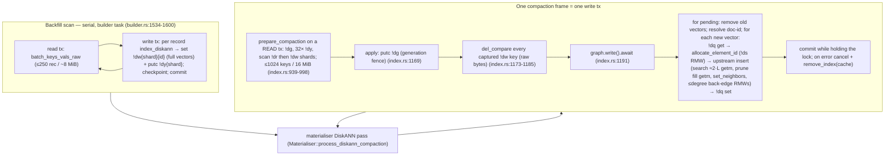

# DiskANN parallel index build — design

Status: design, not implemented. Drafted by Claude Fable 5.1; code recon and verification pass by
Claude Opus 5, then eight rounds of adversarial review. Anchors are `file:line`. Those in the
sections that describe the place grant, the read view, the single driver, the initial-batch sink
and the cache protection (§2.1's read-view, driver, scheduler and substrate rows, §2.5, §3.2.3,
§3.2.4, §3.3.2, §3.3.4's read-state rule, §3.3.5, §3.3.6, §3.4, §3.5, §4.1's facts and rules 3'
and 5', §4.1.1, §4.4's `!bs` and lock rows, §5.2) are verified against the tree this document
lives on; the others were
taken from an earlier tree and may have drifted, so resolve them by symbol. Upstream anchors are
into the vendored crate (`~/.cargo/registry/src/index.crates.io-*/diskann-<version>/src/`), written
below as `upstream/<path>:<line>`; `diskann-utils/<path>` resolves the same way. They were taken
from `diskann-0.56.0`; the workspace uses `0.59.0`, and every upstream anchor in the sections
listed above is the same in both.

Verification legend used throughout:

- **[V]** — verified by reading the code at the cited anchor.
- **[M]** — an estimate or model; needs measuring before it is relied on. Every number in
  the "expected speedup" sections is [M] unless marked otherwise.

Everything in §3 onwards that is marked neither is proposed: the target this design commits to,
not yet in the code.

**Companion design.** Index materialisation — how every index kind gets from `DEFINE INDEX` to
answering at index speed — is specified in a companion design,
`doc/design/index-build-and-materialisation.md`, and this design is DiskANN's part of it. This
design adds no scheduler, read model or driver of its own; it relies on four contracts from the
companion, summarised here so this document stands on its own. Where the two disagree, the
companion governs.

- **One driver.** One build protocol takes every index kind to `Online` and writes nothing after
  it. The compactor's per-index passes, one per queued kind, are the only code that folds a queue,
  and two callers run them: the background compaction task, and a blocking `DEFINE INDEX` /
  `REBUILD INDEX` waiting on its own index after its commit (phase 2). A pass is budgeted and
  requeues what it leaves; it retries a retryable conflict; a process-local mutex per index keeps
  two passes in one process from planning the same work, and the compaction generation keeps two
  plans from one state from both applying. For DiskANN the pass calls
  `DiskAnnIndex::apply_compaction` (§3.5).
- **One place budget.** Every materialiser worker runs in a *place* from the node-wide pool the
  query engine's morsel workers use, under the same OLTP reserve, per-ticket cap and fairness (a
  freed place goes to the waiting statement that holds fewest). Places are taken through a
  *ticket*:
  - *foreground:* a blocking statement's phase-2 pass carries that statement's registration, so
    its workers count as the statement's places;
  - *background:* the compaction task holds one compaction ticket, runs one index on its own task,
    and starts another only on a granted place;
  - *build:* a build's own parallel work during `Building`, which includes a sink frame (below),
    takes places through a build ticket the builder registers; when a blocking statement waits on
    the build, the builder carries that statement's registration instead, so the build's workers
    count as the statement's places.

  Work that is split across a fixed number of tasks before it starts takes an **up-front grant**:
  it never waits, returns between none and the requested number of places, sizes the work to one
  task per place plus the calling task, and lasts one bounded unit of work — the quantum — after
  which the places go back and the next unit asks again. A grant of none runs the unit on the
  calling task with the same result. How `surrealdb-idx` reaches the pool is not part of the
  contract. A DiskANN frame is such a unit (§3.3.6), and "the same result" holds for it as §4.5
  states: identical element, mapping and state bytes, and equivalent adjacency — valid, and at least as good; there is no DiskANN gate and no DiskANN
  parallelism setting (§6).
- **One read view per batch.** A batch's workers read committed state through one
  `kvs::Snapshot`, taken from one read transaction opened for them — never from the apply
  transaction, which has buffered writes by then: point reads through `get_many`, ranges through
  cursors. `get_many` through one view must not serialise its callers. Where the engine gives no view (mem, TiKV, or a SurrealKV writable transaction), the batch runs on the same
  tasks, every one reading through the batch's own transaction, with the same result. A DiskANN
  frame is such a batch (§3.3.2), with "the same result" as §4.5 states it.
- **One build protocol with kind hooks.** Kind-specific build behaviour lives in hooks inside the
  one protocol. One is the **initial-batch sink**: it lets a kind consume an initial-scan batch
  directly, in the build transaction of the batch that read it, and receives the key range the
  batch covers, keeping no state across batches beyond it, so a scan later split by key range can
  call it range by range. The default does nothing. DiskANN's sink is §3.4.

---

## 1. Problem statement and success criteria

### 1.1 Problem

A `DEFINE INDEX … DISKANN` over 200k rows of 768-dim `F32` vectors was killed after 65 minutes.
The build is single-threaded end to end [V]:

1. The backfill scan is a sequential loop over the table
   (`surrealdb/core/src/kvs/index/builder.rs:1713-1752`) that turns every record into a `!dw`
   pending entry carrying the full vector inline (`surrealdb/idx/src/trees/diskann/index.rs:867-943`,
   `surrealdb/datastore/src/values/diskann.rs:164-173`). Nothing touches the graph yet.
2. After the scan, the materialiser's DiskANN pass (`Materialiser::process_diskann_compaction`) folds those pendings in
   plans of ≤ 1024 keys / 16 MiB (`index.rs:77-78`) and applies each plan inside one write
   transaction under the exclusive graph lock (`index.rs:1259`), **one pending at a time**
   (`index.rs:1264-1266`), each through the upstream **single-vector** `insert`
   (`index.rs:458` → `upstream/graph/index.rs:226-341`).
3. Every graph read in that loop goes through the one writable `Arc<Transaction>` held by
   `DiskAnnProviderContext` (`provider.rs:59-65`). On an engine whose transaction runs its operations one at a time, every operation on one
   `Transaction` queues, and a writable transaction never publishes what it reads into
   the shared `DiskAnnCache` (`provider.rs:259,297`), so once the graph outgrows the 256 MiB cache
   nearly every read is a serialised KV round trip.

The upstream crate has task-parallel `multi_insert` / `set_elements` / bootstrap paths
(`upstream/graph/index.rs:815-1030`) that we never call; `max_minibatch_par` defaults to `1`
(`upstream/graph/config/defaults.rs:34`) [V].

### 1.2 What "fixed" means

Reference workload and hardware assumption (used for every target below):

- 200 000 rows × 768-dim `F32`, `DISKANN DIMENSION 768 DIST COSINE TYPE F32` at the DDL defaults
  for `DEGREE` / `L_BUILD` / `ALPHA` (parser: `surrealdb/parser/src/parse/stmt/define.rs:1443-1445`;
  the bench file added in PR 1 records the resolved values).
- Persistent file-backed backend, 8 physical cores / 16 hardware threads, NVMe, 32 GiB RAM, default
  configuration (`SURREAL_DISKANN_CACHE_SIZE` = 256 MiB) — i.e. the graph is **well past** the
  cache-miss regime (which starts around 80k rows at this dimension [V, brief §C]).

Targets (all [M] until PR 1's benches produce the baseline):

| Criterion | Target | How it is measured |
|---|---|---|
| Build wall-clock, reference workload | ≤ 15 min end to end (≥ 4× vs the > 65 min kill); stretch ≤ 8 min with Layer 3 | `diag_diskann_build_200k` (§7.3) — **the only instrument that reaches the cache-miss regime; the §7.2 benches do not (see §7's preamble)** |
| Recall, batched vs serial build | Recall@10 of the batched/parallel build ≥ serial build − 0.02 at equal `ef`, on every harness dataset; absolute floor pinned per dataset by PR 1 | DiskANN recall harness (§7.1) |
| Independence from parallelism | Given identical batches, across a frame granted 0 places (the sequential path, nothing spawned), one granted 1, one granted 4, and one on the no-view path: `!de`, `!dq`/`!dh`, `!dk`, `!di`/`!dd` and `!ds` byte-identical; `!dn` (adjacency) structurally valid for every inserted element; the recall of the batched builds (1 place, 4 places, no view) within 0.02 of each other, and each at least the sequential build's − 0.02; every build at or above the floor. The bound against the sequential build is one-sided: it builds the serial graph, which a batched build may beat. Adjacency bytes are not required to match: upstream's bootstrap step can break equal-distance ties differently across task counts (§4.5) | exact-structure and recall test (§7.1, T-3) |
| Read routing | Inside a frame with a read view, the writable tx serves **zero** `!de`/`!dn` point reads — only the rare entry-point repair cursor reads `!de` through it, counted in `reads_tx` — and the frame opens exactly one read transaction for its workers | exact-count accounting on `FrameStats` (§7.1, T-5) |
| Place accounting | A frame never holds more places than it was granted, and holds none after it ends; no DiskANN semaphore or parallelism setting exists | counted on the place pool's books (§7.1, T-13) |
| Cache/KV coherency | After any frame (committed or aborted), every cached `!de`/`!dn` value equals its KV value | coherency sweep (§7.1, T-6) |
| KNN latency | `knn_diskann*` benches unchanged within the noise floor of the untouched HNSW benches | `cargo make bench -- vector/knn_diskann` |
| Memory | Frame-local peak ≤ ~250 MiB at 16 tasks / 768-dim, `DEGREE 64`, **excluding** shared `DiskAnnCache` fill, which is separately capped by `diskann_cache_size` and reported as its own figure (§5.4 — derived, not measured; #1175 replaces both) | RSS sampling in the diag test, cache growth accounted separately |
| Failure semantics | No new class of durable `phase = Error`; shutdown mid-frame still classifies as shutdown; a cancellation or timeout ends the frame with `QueryCancelled`, and a typed `is_done` error such as the memory threshold survives unchanged; every suppressed failure that reaches our provider or unwinds a task fails the frame. **Not covered:** an upstream-internal error returned through `?` after a successful provider read in a back-edge task (§3.2.5); in candidate generation the same error leaves its item without a node and fails the frame, whose backstop is the recall harness | fault-injection tests (§7.1, T-7/T-7a/T-8/T-9/T-9a); recall floors (T-1) for the residual |

---

## 2. Current architecture

### 2.1 Components [V]

| Component | Anchor | Role |
|---|---|---|
| `DiskAnnIndexes` registry | `surrealdb/idx/src/trees/store/diskann.rs:25-61` | one `Arc<DiskAnnIndex>` per `(ns, db, tb, ix)` per process |
| `DiskAnnIndex` | `index.rs:308-336` | `graph: RwLock<DiskAnnGraph>`, `cache: DiskAnnCache`, `vec_docs` |
| `DiskAnnGraph` | `index.rs:368-370`, built at `:380-405` | owns `RawDiskAnnIndex<DiskAnnProvider>` **by value**; `RawDiskAnnIndex::new(config, provider, None)` at `:403` — `thread_hint = None` sizes the upstream scratch `ObjectPool` to 0/0 (`upstream/graph/index.rs:153-171`) |
| `DiskAnnProvider` | `provider.rs:164-171` | stateless besides the shared cache; `read_elements` `:239-271`, `read_nodes` `:277-309`, `allocate_element_id` `:312-321` (a full `!ds` read-modify-write per vector), `ensure_entry_point` `:324-335` |
| `DiskAnnProviderContext` | `provider.rs:59-67` | `{ tx: Arc<Transaction>, ikb }`, `impl ExecutionContext {}` (default `wrap_spawn` = identity, `upstream/provider.rs:86-91`) |
| `DiskAnnStrategy<T>` | `provider.rs:867-932` | implements `SearchStrategy`, `DefaultPostProcessor`, `PruneStrategy`, `InsertStrategy`; **not** `MultiInsertStrategy`; prune working set built without an overlay (`:918`) |
| `DiskAnnCache` | `cache.rs:97-111` | one weighted `quick_cache` budget shared by every family and every index in the process; bulk invalidation `remove_index` `:283-300` |
| Value types | `surrealdb/datastore/src/values/diskann.rs:38-45` (`DiskAnnState { enter_point, next_element_id }`), `:120-122` (`DiskAnnNode { neighbors }`), `:164-173` (pending update) | `ElementId = u64` (`values/vector.rs:31`) |
| `IndexEnv` | `surrealdb/idx/src/env.rs:45-76` | what the engines may ask of the query: `tx()`, `is_done()`, `index_stores()`, `node_id()`, `sequences()`, `config()`. Implemented by `Context` (`surrealdb/core/src/ctx/context.rs:1397-1421`) and `TestIndexEnv` (`surrealdb/idx/src/test_env.rs:144-176`) |
| Read transaction and read view | `surrealdb/datastore/src/tx.rs:1977-1990` (`Transaction::open_read_snapshot`), `:6160-6164` (`Transaction::snapshot`) | any transaction opens a read-only transaction on the same datastore, which sees none of the opener's uncommitted writes; a transaction's `snapshot()` is its owned `kvs::Snapshot` view, or `None` where the engine gives none. An engine that gives one does so only for a transaction that has buffered no write |
| Compaction driver | `surrealdb/core/src/kvs/index/materialise.rs` (`Materialiser::process_diskann_compaction`) | one prepare → apply → commit loop per plan, bounded by the pass's plan budget, run by background compaction and by a blocking statement's phase-2 wait. The builder stops at `Online` and folds nothing (§3.5) |
| Background scheduler | `ds.rs` (`index_compaction_loop`, `run_compaction_passes`) | passes of a queue batch run side by side under a compaction ticket, so places bound how many indexes compact at once. A pass leaves a vector index whose build owner is live (`fenced_by_build_owner`), and the per-index materialiser lock keeps two passes in one process off the same index |
| Parallel substrate | `surrealdb/idx/src/parallel.rs`; `surrealdb/core/src/exec/vm/morsel/places.rs` | the index crate bounds its parallel jobs with a process-wide semaphore of its own (`parallel.rs:47-52`); the query engine schedules morsel workers from a node-wide place pool with an OLTP reserve (`places.rs:111-168`). §3.3.6 puts DiskANN frames on the latter |

### 2.2 The build pipeline today



Every box inside `frame` runs on **one** task and every KV operation inside it goes through the
**one** writable transaction [V].

### 2.3 Per-insert cost model [M]

For one insert into a graph of degree `D` with build list `L`, reads via `DiskAnnSearchAccessor::expand_beam`
(`provider.rs:646-687`) are already batched per beam expansion: one `getm` for adjacency lists,
one `getm` for candidate vectors. The insert search uses the default beam width (`None`,
`upstream/graph/index.rs:277`, i.e. one expansion per step), so a search performs ≈ `L·(1+ε)`
expansions ⇒ ≈ `2L` `getm` round trips; the prune fill adds one `getm` of up to
750 vectors (`upstream/graph/config/defaults.rs:14`); `set_neighbors` one `set`; back-edges up to `D`
× (`get_neighbors` getm + optional prune fill + `set`/`append`). Total ≈ 300–450 serialised KV
round trips per vector. In the cache-miss regime each round trip is a multi-get of up to
`D` values of 3 KiB — 0.1–0.5 ms — so 30–200 ms per vector, i.e. hours for 200k vectors. This
matches the reported kill by order of magnitude but has not been profiled; PR 1 measures it.

### 2.4 Where the serialisation is [V]

| Point | Anchor | Nature |
|---|---|---|
| One task for the whole build | `builder.rs:227` | structural |
| One pending at a time under `graph.write()` | `index.rs:1259-1266` | structural |
| Upstream single-vector `insert` | `index.rs:458` | algorithmic (no intra-batch parallelism exists to exploit) |
| One `Arc<Transaction>` for all reads and writes | `provider.rs:59-65`, `index.rs:1262` | on an engine that guards the transaction with an exclusive lock, every op holds it for the whole blocking op |
| `!ds` read-modify-write per vector | `provider.rs:312-321` | one buffered `set` + one cache insert per vector |
| Build reads never warm the cache | `provider.rs:259,297` (`cache_misses = !context.tx.writeable()`) | every miss is re-fetched from KV on the next search |

Per-backend behaviour of one shared transaction [V]:

| Backend | Guard | Effect |
|---|---|---|
| SurrealKV | `RwLock<Tx>`, `get` takes `.read()` (`kvs-surrealkv/src/lib.rs:62,328`) | concurrent reads |
| mem | `RwLock<Tx>` (`kvs-mem/src/lib.rs:59`) | concurrent reads |
| TiKV | `RwLock<TransactionInner>` (`kvs-tikv/src/lib.rs:216`) | concurrent reads (network-bound) |

Separate transactions are bounded only by the shared KVS blocking pool
(`surrealdb/kvs/src/threadpool.rs:26-57`, `SURREAL_KVS_THREADPOOL_SIZE`, default `max(16, cores)`).


### 2.5 The cache coherency invariant today [V]

The provider module's invariant (`surrealdb/idx/src/trees/diskann/provider.rs:8-56`), over the
types in `cache.rs`:

- **Every graph entry carries a `Stamp`** (`cache.rs:54-62`): the wrapper that published it
  (`DiskAnnCache::new_owner`, `cache.rs:278`) and the `!dg` generation its value holds at. Every
  commit that writes `!de`/`!dn`/`!ds` or a vector's document mapping also advances `!dg` with a
  conditional put, so one generation identifies one committed state of all of them.
- **A transaction reads through a `CacheView`** (`cache.rs:64-79`; `DiskAnnProviderContext::view`,
  `provider.rs:99`). It is served only its own wrapper's entries, and only those stamped at its own
  generation, at a frame's commit generation, or inside the wrapper's continuity span
  (`CacheView::serves`, `cache.rs:114-131`).
- **The `Continuity` span** (`cache.rs:39-52`) is the run of generations every one of which this
  wrapper's own frames committed, each writing through or evicting every entry it changed. A frame
  opens it at its snapshot when `!dg` is anywhere but the span's head, extends it only after its
  commit succeeds, and closes it when its commit fails (`open_frame` / `commit_frame` /
  `abandon_frame`, `index.rs:471-507`).
- **Who publishes:** a read-only transaction publishes what it read, at its own generation, unless
  it is inside the span but behind its head (`CacheView::publication`, `cache.rs:133-148`); a
  writable transaction publishes nothing it read; a compaction frame writes through at its commit
  generation (`CacheView::write_through`, `cache.rs:150-157`), holds the graph write lock across
  its commit, and on failure closes the span and clears the index's entries
  (`DiskAnnCache::remove_index`) before releasing the lock (`index.rs:1671-1680`).
- **A read that will be written back comes from the transaction**: `!ds` for a read-modify-write
  is read with `read_state_for_update` (`provider.rs:305-321`), never from the cache.

§4.1 extends this to a frame with many tasks and a read view.

---

## 3. Proposed design

Four independently landable layers. Each has its own value, its own risk, and its own PR (§8).

| Layer | What changes | What it parallelises | Where the remaining floor is | Risk |
|---|---|---|---|---|
| **L0 — measurement** | recall harness, build benches, exact-count hooks | nothing | — | none (tests only) |
| **L1 — batched mutation** | the apply frame inserts a plan's fresh vectors through upstream `multi_insert` on `granted` tasks, where `granted` is the frame's up-front place grant, or one at a time on the calling task when `granted` is 0; element ids allocated once per batch | CPU (distance, prune) and cache hits; KV reads only where the engine's transaction allows concurrent reads (SurrealKV, mem, TiKV) (§3.2.4) | on an engine whose write tx serialises its operations: reads still serialise; expected 1.1–1.5× there [M] | graph shape changes (batched ≠ serial); upstream error suppression |
| **L2 — read concurrency** | per-frame `DiskAnnBuildFrame`: a dirty overlay of this frame's writes + one read view, a `kvs::Snapshot` from a read transaction opened for the frame's workers; reads of clean keys go to the view through `get_many` | KV reads on engines that give a view; build reads now warm the shared cache. On mem, SurrealKV and TiKV, which give none, the frame's tasks read through its write transaction | per-frame serialised writes + commit (≈ 1 s per 1024-vector frame [M]); the backfill scan; the `!dw` detour | cache coherency (§4.1); read-your-own-writes (§4.2) |
| **L3 — direct backfill** | DiskANN's initial-batch sink: each scan batch is inserted straight into the graph as a frame during `Building`, skipping `!dw` for the backfill; the materialiser folds the rest | nothing new; removes ~614 MB of pending writes + re-reads + deletes at 200k×768 [V for the volume, M for the time] | scan itself (left serial) | a hook inside the build protocol |

Evaluated and folded in or rejected (details in §3.6): batching element-id allocation (**in**, L1);
skipping `!dw` for backfill (**in**, L3, optional); parallelising the scan (**out of scope**: a
separate design, which the sink's key range leaves room for); steady-state compaction (**same
mechanism**, with a small-batch rule); a DiskANN parallelism setting or gate (**rejected**: frames
take places); a pool of read transactions per frame (**rejected**: one view per frame); DDL knob
(**rejected**).

### 3.1 Layer 0 — measurement (prerequisite)

Specified in §7. Nothing in L1–L3 lands without the recall harness and the build benches, because
batching changes graph quality and the current tree has zero DiskANN recall coverage [V].

### 3.2 Layer 1 — batch the graph mutation through `multi_insert`

#### 3.2.1 What `multi_insert` does and what it needs [V]

`upstream/graph/index.rs:815-1030`, with `num_tasks = config.max_minibatch_par()`:

1. **Set elements** (`:835`, `set_elements` `:482-534`): partitions the batch over `num_tasks`
   (`PartitionIter`, `upstream/utils/async_tools.rs:311-340`), `tokio::spawn(context.wrap_spawn(..))`
   per partition, each calling `provider.set_element`. Errors propagate (`:526`).
2. **Candidate generation** (`:844-909`): `strategy.finish()` builds the seed; `num_tasks − 1`
   spawned tasks plus the local task pull items from a `DynamicBalancer` and run
   `search_and_prune` (`:349-434`): greedy search over the *pre-batch* graph, then robust prune with
   `intra_batch_candidates` positional neighbours from the batch added to the pool (`:401-416`).
   **This phase performs no graph writes.** Task errors are logged and the partial results kept
   (`:888-909`).
3. **Bootstrap** (`:926-938`): when the batch is large relative to the unique back-edge targets
   (initial graph formation), prune each item against the whole batch (`:686-743`); parallel.
4. **Graph update** (`:946-1026`): `set_neighbors_bulk` for the new nodes (serial, default impl
   `upstream/provider.rs:390-404` = one `set_neighbors` per id), then back-edges partitioned across
   `num_tasks` so that **each task updates a disjoint set of source ids**, each via
   `add_edge_and_prune` (`:2264-2341`: `get_neighbors` → append or prune → `append_vector`/`set_neighbors`).
   Back-edge task errors are **swallowed** (`:1010-1026`). Every guard is completed; `Ok(())`.

Contract we rely on (`:748-750`): "Each `multi_insert` makes at most one update (either `set` or
`append`) per id to the `DataProvider`."

Every spawned task receives `context.clone()`; our context clones the same `Arc<Transaction>`, so
L1 alone does not add read concurrency on an engine whose transaction serialises its operations (§2.4).

#### 3.2.2 What the `Overlay` removes, and what it does not [V]

`Overlay::from_batch(batch, ids)` (`upstream/graph/workingset/map.rs:716-727`) indexes the batch by
element id; a `Map` built with it answers `contains_key`/`entry`/`fill` from the overlay first
(`:306-330`, `:385-400`) and `View::get` prefers it (`:906-913`). Our `DiskAnnPruneAccessor::fill`
(`provider.rs:763-787`) computes `missing` with `self.set.contains_key(id)` (`:767`) — overlay-aware
with **no code change**.

| Read | Phase | Served by |
|---|---|---|
| vectors of batch members used as prune candidates (intra-batch candidates, bootstrap, back-edge prune when the target is a batch member) | 2, 3, 4 | overlay — **no provider call** |
| adjacency lists and vectors of *existing* nodes visited by the greedy search (`expand_beam`) | 2 | provider (`read_nodes`, `read_elements`) |
| vectors of existing candidates in the prune pool | 2, 4 | provider (`read_elements` via `fill`) |
| `get_neighbors(source)` for every back-edge source; the source's existing neighbours' vectors when a prune is needed | 4 | provider |
| `valid_starting_points` / `status_by_internal_id` (`!ds`, entry-point `!de`) | 2, 4 | provider (cache hit after the first) |

So the overlay removes only the batch's *own* vectors from the read path. It does not touch
adjacency reads, and it removes nothing from the search phase — that is why L2 exists.

#### 3.2.3 Code shape

**A frame drives its own upstream index handle, sized from its grant.** Upstream fixes a batch's
task count in its `Config` (`max_minibatch_par`, `upstream/graph/config/mod.rs:373`) and sizes its
search-scratch pool from `thread_hint` when the index is constructed
(`upstream/graph/index.rs:153-170`) [V]. Neither can be changed on an existing index, and
`multi_insert` reads the task count from `self.config` (`upstream/graph/index.rs:829`) [V]. A
batched frame's task count is `granted`, the places its up-front grant holds, decided only when the
frame takes them (§3.3.6), so the long-lived index in `DiskAnnGraph` (built once per wrapper, `index.rs:446`) cannot be the one
`multi_insert` runs on.

The upstream index holds no graph state: it is a `Config`, a data provider and a scratch pool
(`upstream/graph/index.rs:153-170`) [V], and the graph lives in KV. So the frame builds a fresh
handle for its batched insert, and `DiskAnnGraph` keeps its long-lived index for KNN search and
single-vector inserts:

```rust
use std::num::NonZeroUsize;
use diskann::graph::config::IntraBatchCandidates;

/// Positional intra-batch candidates considered per inserted vector. Upstream recommends a
/// moderate value for large batches; the compaction batch cap is 1024.
const DISKANN_INTRA_BATCH_CANDIDATES: u32 = 32;

impl DiskAnnGraph {
	/// The upstream index one batched insert runs on, with `tasks` as both its minibatch
	/// parallelism and its scratch-pool size.
	///
	/// `tasks` is `granted`, the frame's place grant, at least 1: upstream spawns at most `tasks`
	/// tasks in any phase (§3.2.4), so every task it can spawn has a place. The handle wraps a provider that keeps
	/// this wrapper's cache owner, so what the frame publishes is attributed exactly as the
	/// long-lived index's publications are. It is dropped when the insert returns; it holds no
	/// graph state, and exclusive access to the graph still comes from the `RwLock<DiskAnnGraph>`
	/// around this type.
	fn frame_index(&self, tasks: NonZeroUsize) -> Result<Arc<RawDiskAnnIndex<DiskAnnProvider>>> {
		let mut builder = Builder::new(self.degree, MaxDegree::default_slack(), self.l_build,
		                               PruneKind::from_metric(self.metric));
		builder.alpha(self.alpha);
		builder.max_minibatch_par(tasks.get());
		builder.intra_batch_candidates(IntraBatchCandidates::new(DISKANN_INTRA_BATCH_CANDIDATES));
		let config = builder.build()?;
		Ok(Arc::new(RawDiskAnnIndex::new(config, self.provider().same_owner(), Some(tasks))))
	}
}
```

`DiskAnnGraph::new` (`index.rs:422-449`) keeps the resolved builder inputs (degree, `L_BUILD`,
alpha, metric) beside the long-lived index, and `DiskAnnProvider::same_owner` clones the provider
(`provider.rs:211-220`) without taking a new cache owner. `Arc` is required because `multi_insert`
takes `self: &Arc<Self>`. Building the handle costs one `Config` and a scratch pool of `tasks`
entries per frame, against a frame that inserts up to 1024 vectors.

**`MultiInsertStrategy` for `DiskAnnStrategy<T>`** (`provider.rs`, next to the `InsertStrategy`
impl at `:923-932`), modelled on `upstream/graph/test/provider.rs:1339-1419`. The batch type is the
upstream `Matrix<T>` (`type Matrix<T> = MatrixBase<Box<[T]>>`, `diskann-utils/src/views.rs:644`),
which already implements `Batch` (`upstream/graph/glue.rs:1054-1064`):

```rust
use std::convert::Infallible;
use diskann::graph::glue::MultiInsertStrategy;
use diskann_utils::views::Matrix;

impl<T> MultiInsertStrategy<DiskAnnProvider, Matrix<T>> for DiskAnnStrategy<T>
where
	T: DiskAnnVectorElement + std::fmt::Debug,
	for<'a> DiskAnnProvider: SetElement<&'a [T], SetError = ANNError>,
{
	/// Seed = a working-set builder carrying the batch as a zero-copy overlay, so prune
	/// candidates that are members of the batch are read from memory, never from KV.
	type Seed = workingset::map::Builder<ElementId, workingset::map::Ref<[T]>>;
	type FinishError = Infallible;
	type PruneStrategy = Self;
	type InsertStrategy = Self;

	fn insert_strategy(&self) -> Self { self.clone() }

	fn finish<Itr>(&self, _: &DiskAnnProvider, _: &DiskAnnProviderContext,
	               batch: &Arc<Matrix<T>>, ids: Itr)
		-> impl std::future::Future<Output = Result<Self::Seed, Infallible>> + Send
	where Itr: ExactSizeIterator<Item = ElementId> + Send,
	{
		use workingset::map::{Builder, Capacity, Overlay};
		std::future::ready(Ok(Builder::new(Capacity::Default)
			.with_overlay(Overlay::from_batch(Arc::clone(batch), ids))))
	}

	fn seeded_prune_accessor<'a>(&'a self, provider: &'a DiskAnnProvider,
	                             context: &'a DiskAnnProviderContext, seed: &'a Self::Seed,
	                             capacity: usize) -> ANNResult<DiskAnnPruneAccessor<'a, T>> {
		Ok(DiskAnnPruneAccessor::new(provider, context, seed.clone().build(capacity)))
	}
}
```

Bounds to check at compile time: `Overlay::from_batch` needs `B: Debug` (`map.rs:719`), hence
`T: Debug` (add it to `DiskAnnVectorElement` if `Half` satisfies it; it should). `Infallible: Into<ANNError>`
exists (`upstream/error/ann_error.rs:252`).

**Batch element-id allocation** (`provider.rs`, replaces the per-vector RMW at `:312-321`):

```rust
/// Reserves `count` consecutive element ids and persists the advanced counter once.
///
/// The returned range is exclusive to the caller for the lifetime of the transaction; ids are
/// never reused, so a cancelled frame simply leaves a gap.
pub(super) async fn allocate_element_ids(&self, context: &DiskAnnProviderContext, count: u64)
	-> Result<std::ops::Range<ElementId>> {
	let mut state = self.read_state_for_update(context).await?;
	let start = state.next_element_id;
	state.next_element_id = start.saturating_add(count);
	self.write_state(context, &state).await?;
	Ok(start..state.next_element_id)
}
```

`allocate_element_id` becomes `allocate_element_ids(ctx, 1)`.

**Batched insert on `DiskAnnGraph`** (`index.rs`, next to `insert` at `:408-440`):

```rust
/// Inserts `vectors` (one row each, all of this index's element type) under `ids`.
///
/// `ids` must come from `allocate_element_ids` in this transaction and must not be present in
/// the graph. The graph must already have a valid entry point (see `apply_pending_batch`).
///
/// `tasks` is the frame's place grant, at least 1 (§3.3.6): upstream spawns at most that many
/// tasks in any phase, so every one of them is backed by a place.
pub(super) async fn insert_batch(&self, ctx: &DiskAnnContext<'_>, vectors: Vec<Vector>,
                                 ids: Vec<ElementId>, tasks: NonZeroUsize) -> Result<()> {
	match vectors.first() {
		Some(Vector::F32(_)) => self.insert_batch_typed::<f32>(ctx, vectors, ids, tasks).await,
		Some(Vector::F16(_)) => self.insert_batch_typed::<Half>(ctx, vectors, ids, tasks).await,
		Some(Vector::I8(_))  => self.insert_batch_typed::<i8>(ctx, vectors, ids, tasks).await,
		Some(Vector::U8(_))  => self.insert_batch_typed::<u8>(ctx, vectors, ids, tasks).await,
		Some(_) => bail!("DISKANN supports TYPE F32, F16, I8, and U8"),
		None => Ok(()),
	}
}

async fn insert_batch_typed<T>(&self, ctx: &DiskAnnContext<'_>, vectors: Vec<Vector>,
                               ids: Vec<ElementId>, tasks: NonZeroUsize) -> Result<()>
where
	T: DiskAnnVectorElement + std::fmt::Debug,
	for<'a> DiskAnnProvider: SetElement<&'a [T], SetError = ANNError>,
	Vector: for<'a> AsTypedSlice<'a, T>,   // small helper: `Vector::F32(v) -> v.as_slice()` etc.
{
	let dim = self.provider().dim();
	let mut data: Vec<T> = Vec::with_capacity(vectors.len() * dim);
	for v in &vectors {
		let Some(row) = v.typed_slice::<T>() else { bail!("DISKANN vector storage must be contiguous") };
		data.extend_from_slice(row);
	}
	let batch = Matrix::try_from(data.into_boxed_slice(), vectors.len(), dim)
		.map_err(|_| anyhow::anyhow!("DISKANN batch dimension mismatch"))?;
	self.frame_index(tasks)?
		.multi_insert(DiskAnnStrategy::<T>::default(), &ctx.provider_context,
		              Arc::new(batch), Arc::<[ElementId]>::from(ids))
		.await?;
	Ok(())
}
```

`Matrix::try_from(data, nrows, ncols)` is `diskann-utils/src/views.rs:212`.

**The fresh-vector cap.** A frame's memory scales with the fresh vectors it inserts (§4.1, §5.4),
and a pending record can carry many vectors, so neither of the plan's existing caps bounds it.
[V] `PendingPlanBuilder` (`index.rs:170-308`) stops a plan at
`DISKANN_COMPACTION_MAX_PENDING_KEYS` (1024) captured keys or `DISKANN_COMPACTION_MAX_PENDING_BYTES`
(16 MiB) of encoded pendings (`index.rs:87-88`), and always admits the first entry so that one
oversized record makes progress (`add`, `index.rs:195-215`; `has_room_for`, `:222-231`). At
768-dim `F32` a 16 MiB plan of multi-valued records can hold about 5 000 vectors.

So the plan builder caps vectors as well, as an invariant of every frame:

```rust
/// The most new vectors one compaction plan captures, summed over its pendings' `new_vectors`.
/// Bounds a frame's fresh vectors, and with them its overlay and write batch (§5.4).
const DISKANN_COMPACTION_MAX_PENDING_VECTORS: usize = 1024;
```

- `PendingPlanBuilder` tracks `new_vectors`, the sum of `new_vectors.len()` over every captured
  pending, and enforces the cap beside the key and byte caps in `add`, `has_room_for` (which takes
  the pair's vector count) and `add_authorized`. A plan that stops on the vector cap sets
  `has_more`, so the pass requeues the rest.
- The progress rule is unchanged: an empty plan admits its first entry whatever its size, so a
  single record whose own vectors exceed the cap is captured in a plan of its own.
- Counting at capture time is an upper bound on the frame's fresh vectors: coalescing replaces a
  record's vectors rather than adding to them, and phase B only removes vectors already in the
  graph or duplicated in the batch.

**Every frame inserts in calls of at most 256 vectors.** The plan's cap bounds a frame's memory;
graph quality needs a smaller bound on each `insert_batch` call,
`DISKANN_INSERT_BATCH_MAX_VECTORS = 256`. A vector in a call searches the graph as it stood before
the call, and sees the call's other vectors only through the 32 intra-batch candidates
positionally next to it. Batch order is pending-key order, which says nothing about similarity, so
two near vectors of one call farther apart than that window never see each other, where the serial
build links them. Upstream's bootstrap hides this while a batch's back-edge sources are few — a
young or starved graph — but not in a large graph at `DEGREE 64`, where near vectors of one call
then do not link at all. A corpus whose near neighbours share a pending shard, and so a frame, —
the 768-dim diagnostic's clusters do — falls below the serial build's recall with 1024-vector
calls and matches or beats it with 256-vector calls; smaller calls gain nothing more, and give
each task less work between the call's join barriers (`diag_diskann_recall_768`,
`diskann_frame_links_near_vectors_far_apart_in_its_batch`). A frame's fresh vectors are therefore
inserted in consecutive
calls of at most 256, in batch order, each searching a graph that holds the calls before it (§4.2),
whatever the grant: on the sequential path the calls are only a loop boundary.

**A record over the cap is one frame, inserted in sub-batches.** Its vectors are inserted in
consecutive `insert_batch` calls of at most 256, in batch order, inside the one frame. They
cannot be split across frames: the record's pending key is deleted, and its `!dq`/`!dh`/`!dk`
mappings are written, in the transaction that inserts its vectors, so a record is never visible
half-applied — with some vectors in the graph and its pending still queued for a reader to merge
again. Within the frame:

- **One place grant** covers every sub-batch; it is sized from the sub-batch, not the record, and
  is held until the frame ends (§3.3.6). Such a frame is a longer quantum, bounded by the record.
- **The post-condition and the side-channel are checked after every sub-batch**, and all of them
  run before `commit_fresh` writes any fresh mapping, so the commit order of the mappings is
  unchanged.
- **Memory:** the batch matrix, the prune working sets and upstream's per-minibatch scratch are
  bounded by the cap. The overlay and the transaction's write batch are not — they hold the whole
  record's writes until the commit — so this frame's peak scales with the record's vector count
  `V`, by the per-vector figures of §5.4.

**How many vectors a record yields** [V]. A record contributes at most one vector per indexed
column. The write path evaluates one value per column of the definition
(`surrealdb/core/src/exec/vm/write_storage.rs:796-806`); `DiskAnnIndex::content_to_vectors`
(`index.rs:1112-1120`) turns each non-null value into exactly one vector; and
`serialized_vector_from_value` (`surrealdb/idx/src/trees/vector.rs:136-184`) flattens a value's
nested arrays into that one vector, which then fails the dimension check unless it has exactly
`DIMENSION` elements — so an array of vectors in one field is rejected, not split. Nothing in the
definition path limits a DiskANN index to one column. So `V ≤` the index's column count: a record
over the cap needs an index defined over more than 1024 columns. Every frame of any index with at
most 1024 columns — every realistic one — holds at most 1024 fresh vectors, and the over-cap frame
is bounded by the definition, not by the data. Records are therefore never rejected for their
vector count; rejecting them would change what such an index accepts today.

**The apply frame becomes three phases** (`index.rs`, replacing the loop at `:1264-1266` and
`apply_pending_operation` `:1313-1363`):

```rust
/// One frame's graph work.
///
/// Phase A applies removals and resolves doc-ids in plan order, exactly as the one-pending loop
/// does; phase B resolves each distinct new vector against the vector→docs mapping in one
/// multi-get, so duplicates within the batch and vectors already in the graph never reach the
/// graph; phase C inserts the remaining fresh vectors as one batch.
async fn apply_pending_batch(&self, ctx: &DiskAnnContext<'_>, docs: &DiskAnnDocs,
                             graph: &mut DiskAnnGraph, pending: Vec<PendingOperation>) -> Result<()> {
	// Phase A — removals + doc-id resolution (serial, write tx). Same code as today's
	// `apply_pending_operation`, minus the insert half, which yields `(DocId, SerializedVector)`.
	let inserts: Vec<(DocId, SerializedVector)> = self.apply_removals(ctx, docs, graph, pending).await?;
	// Phase B — doc mappings. Existing vectors get their doc appended, their `!dq`/`!dh` entry
	// rewritten and the doc linked to the element in `!dk` here; fresh ones come back grouped by
	// distinct vector.
	let fresh: Vec<StagedVector> = self.vec_docs.stage_inserts(ctx, inserts).await?;
	if fresh.is_empty() { return Ok(()); }
	// Phase C — graph.
	let provider = graph.provider();
	let mut fresh = fresh.into_iter();
	if provider.valid_starting_points(&ctx.provider_context).await?.is_empty() {
		// Empty graph: seed the first element exactly as `insert_typed`'s first branch does
		// (set_element, empty `!dn` node, set_entry_point).
		let first = fresh.next().expect("non-empty");
		let id = graph.seed_first(ctx, first.vector()).await?;
		self.vec_docs.commit_fresh(ctx, std::iter::once((first, id))).await?;
	}
	let rest: Vec<StagedVector> = fresh.collect();
	let ids: Vec<ElementId> = match rest.len() {
		0 => return Ok(()),
		1 => vec![graph.insert(ctx, rest[0].vector()).await?],
		n => {
			let range = provider.allocate_element_ids(&ctx.provider_context, n as u64).await?;
			let ids: Vec<ElementId> = range.collect();
			// The frame's up-front grant (§3.3.6): it never waits, returns between 0 and
			// `min(n, CAP)` places, and is held until the frame ends, whether or not the engine
			// gives a read view (§3.3.2). No more than one task per vector of a sub-batch is
			// useful.
			let granted = ctx.frame().take_places(n.min(DISKANN_INSERT_BATCH_MAX_VECTORS));
			// The fresh vectors are inserted in consecutive calls of at most
			// `DISKANN_INSERT_BATCH_MAX_VECTORS`, in batch order, inside this one frame; each
			// later call searches a graph holding the earlier ones (§4.2). A record over the plan's
			// cap is inserted the same way (§3.2.3, "The fresh-vector cap").
			for (vectors, chunk) in rest.chunks(DISKANN_INSERT_BATCH_MAX_VECTORS)
				.zip(ids.chunks(DISKANN_INSERT_BATCH_MAX_VECTORS))
			{
				match NonZeroUsize::new(granted) {
					// No place: nothing is spawned. The vectors are inserted one at a time on the
					// calling task, through upstream's single-vector `insert`, under the ids
					// allocated above, in batch order.
					None => for (v, id) in vectors.iter().zip(chunk) {
						graph.insert_with_id(ctx, v.vector(), *id).await?;
					},
					// `granted` places: every phase of `multi_insert` runs on at most `granted`
					// tasks (§3.2.4), so every task it can spawn — and leave running if this
					// frame is aborted — has a place.
					Some(tasks) => graph.insert_batch(ctx, vectors.iter().map(StagedVector::vector).collect(),
					                                  chunk.to_vec(), tasks).await?,
				}
				// `multi_insert` answers `Ok(())` even when its tasks failed (§3.2.5). A typed
				// error the side-channel recorded, or a task panic, wins; then the structural
				// post-condition: every id of the sub-batch has a node written in this frame.
				// Both run before any doc mapping is written for the fresh vectors.
				if let Some(e) = ctx.frame().take_error() { return Err(e); }
				ctx.frame().verify_nodes_written(chunk)?;
			}
			ids
		}
	};
	let first_inserted = ids[0];
	self.vec_docs.commit_fresh(ctx, rest.into_iter().zip(ids)).await?;
	// No-op once an entry point exists; only the seed path above ever sets one here.
	provider.ensure_entry_point(&ctx.provider_context, first_inserted).await
}
```

Small API adjustments the sketch assumes: `DiskAnnGraph::insert_with_id` beside `insert`,
inserting under a given element id through upstream's single-vector `insert`, which takes the id
(`upstream/graph/index.rs:226-232`) and spawns nothing; `DiskAnnGraph::insert`/`remove`/`seed_first`/
`insert_batch`/`insert_with_id` take `&self` (exclusivity comes from the surrounding `RwLock`, not from `&mut`),
plus accessors `DiskAnnGraph::provider()`, `DiskAnnProvider::dim()`, `DiskAnnContext::frame()`,
and `DiskAnnProvider::context_in_frame(tx, frame)` beside `context()`
(`provider.rs:199-204`). `apply_removals` is today's `apply_pending_operation`
(`index.rs:1736-1786`) with the insert half replaced by pushing `(doc_id, vector)` pairs. Its KV
access goes through the frame's `FrameKv` rather than `env.tx()`, including doc-ID resolution and
the removal of a record's doc-ID mapping (§3.3.4).

with, in `docs.rs`:

```rust
/// A distinct vector that phase B found absent from the vector→docs mapping.
pub(super) struct StagedVector {
	ser_vec: SerializedVector,
	vector: Vector,
	docs: Vec<DocId>,             // every doc in the batch carrying this exact vector
}

impl DiskAnnVecDocs {
	/// Groups `inserts` by exact vector, reads every distinct `!dq` (or `!dh` bucket) in one
	/// multi-get on the frame's transaction, and appends docs to vectors already in the graph:
	/// rewrites their `!dq`/`!dh` entry, links every newly added doc to the element in the
	/// doc → elements mapping (`link_doc`, `!dk`), and evicts their cached doc set. Returns the
	/// vectors that need a graph element.
	pub(super) async fn stage_inserts(&self, ctx: &DiskAnnContext<'_>,
	                                  inserts: Vec<(DocId, SerializedVector)>) -> Result<Vec<StagedVector>>;

	/// For freshly inserted elements: writes the `!dq`/`!dh` mapping, links every doc in
	/// `StagedVector::docs` to its element in the doc → elements mapping (`link_doc`, `!dk`), and
	/// evicts their cached doc sets.
	pub(super) async fn commit_fresh<I>(&self, ctx: &DiskAnnContext<'_>, fresh: I) -> Result<()>
	where I: IntoIterator<Item = (StagedVector, ElementId)>;
}
```

Semantics are those of today's `insert`/`insert_hashed` (`docs.rs:426-495`) applied to a batch:
same-vector duplicates collapse onto one element with the union of docs; a vector removed in phase
A and re-inserted in the same frame gets a fresh element because the phase-B multi-get runs on the
write transaction and sees phase A's deletes (§4.2).

**Both directions of the doc mapping move together.** `!dq`/`!dh` map a vector to its docs; `!dk`
(`diskann_doc_elements`, `surrealdb/datastore/src/key/schema.rs:818-824`) maps a doc to the
elements holding its vectors, and filtered KNN reads it through `DiskAnnVecDocs::elements_of`
(`docs.rs:240-251`, read at `index.rs:1982`). Every doc that `stage_inserts` or `commit_fresh`
adds to an element's doc set is linked to that element in `!dk` in the same transaction
(`link_doc`, `docs.rs:222-229`), and every doc phase A removes from an element is unlinked from it
(`unlink_doc`, `docs.rs:231-238`, through today's `remove`/`remove_hashed`, `docs.rs:497-563`),
so a doc whose vector moves within one frame is unlinked from the old element before it is linked
to the new one. `link`/`unlink` are read-modify-writes of `!dk` through the frame's write
transaction (`surrealdb/idx/src/trees/doc_elements.rs:35-63`), never the view or the cache, so
they see the frame's own earlier writes. An index whose format version predates the mapping keeps
none, and `link_doc`/`unlink_doc` write nothing for it (`keeps_vector_doc_elements`).

#### 3.2.4 What L1 parallelises, and the floor

Write `P` for a frame's task count: `P = granted` when the frame holds places, and `P = 1` for a
frame with none, which runs the sequential path on its calling task and spawns nothing. With
`max_minibatch_par = P`, upstream's phases are join-barriered and spawn [V]:

- **`P` tasks, the calling task only joining them:** `set_elements` (one task per partition,
  `upstream/graph/index.rs:502-520`) and the back-edge phase (`:965-1008`);
- **`P − 1` tasks, the calling task running the last share:** candidate generation (`:863-885`)
  and bootstrap (`:699-709`).

So every task `multi_insert` spawns is one of at most `P = granted` per phase, each backed by a
place, and at most `P` tasks are busy at once. That is what keeps a frame within its grant when it
is aborted: the tasks it can leave running are exactly those it holds places for (§3.3.3).
Sizing `max_minibatch_par` at `1 + granted` instead would spawn `1 + granted` tasks in phases 1
and 4, one more than the grant — and one task even at a grant of 0.

- CPU (distance evaluation, prune) and cache hits: `P` tasks.
- KV reads: `P`-way on SurrealKV/mem/TiKV (RwLock read side); **1-way on an engine whose transaction serialises its operations** (§2.4).
- KV writes: always 1-way (buffered `set` under the tx lock; cheap).

Expected [M]: on such an engine in the miss regime, 1.1–1.5× (IO/CPU overlap only). L1 is therefore
*necessary* (it is the only way to have more than one search in flight) but not sufficient for the
reported case. On SurrealKV/mem the read phase scales close to `P` under L1 alone, and still does
under L2, where a frame on an engine that gives no read view reads through its write transaction
on the tasks it was granted (§3.3.2). A mem bench is still no evidence for the miss regime
the design targets.

Algorithmic side effect: every vector in a batch searches the pre-batch graph and only sees other
batch members through `intra_batch_candidates` and bootstrap. That is why each call is capped at
256 vectors (§3.2.3, "Every frame inserts in calls of at most 256 vectors"). Widening the
candidates instead does not help, since they are positional, and candidates covering a whole
large call skip the bootstrap and wreck the graph.

#### 3.2.5 Error handling in L1 — upstream suppression

Phases 2–4 swallow task errors (§3.2.1). Consequences if ignored: a failed `search_and_prune`
leaves a new element with **no adjacency list** (its `!de` and `!dq` exist, its `!dn` does not) —
an unreachable vector and silent recall loss; a failed back-edge task leaves nodes without in-edges.
Both would be committed as a valid graph. This is unacceptable, so the frame owns two mechanisms
(implemented in L1, reused by L2):

1. **Error side-channel.** Every provider call site that maps an `anyhow::Error` into
   `ANNError::message(e.to_string())` — which stringifies, and is what the tree uses since the
   0.56 upgrade dropped `log_index_error` — first records the *typed* error in `frame.first_error`
   (§3.3.3). Note 0.56 also added `ANNError::new<E: std::error::Error + Send + Sync + 'static>`,
   which wraps rather than stringifies and would preserve the chain; it is **not** a drop-in here,
   because our errors are `anyhow::Error`, which does not implement `std::error::Error`. Worth
   revisiting if that bound is ever relaxed, since it would make the side-channel's
   classification-preserving role redundant — though not its primary role of surfacing suppressed
   failures at all. After `multi_insert` returns,
   `apply_pending_batch` checks it and fails the frame with that error. This also preserves
   `is_shutdown_error` classification (`surrealdb/datastore/src/lib.rs:72`, matched via
   `storage_error` on the source chain) which the stringified `ANNError` would lose — a latent
   defect of the serial path too (`provider.rs:491`).
2. **Structural post-condition.** After `multi_insert`, and after the side-channel has been
   checked so that a typed error or a task panic takes precedence, every id in the batch must have
   a node written in this frame (`DiskAnnBuildFrame::verify_nodes_written`, which checks
   `overlay.nodes`). Otherwise the frame fails with an internal error before any doc mapping of
   the batch is written (`apply_pending_batch`, §3.2.3).

   **It catches every failure in candidate generation, and nothing in phase 4.** Phases 1 and 3
   propagate their errors through `?`. Phase 2 swallows them, but an item whose `search_and_prune`
   failed — an error through our provider, an upstream-internal error after a successful provider
   read, or a task's `JoinError` — contributes no entry to the `edges` it collects
   (`upstream/graph/index.rs:887-909`), and `set_neighbors_bulk` writes a node only for the entries
   in `edges` (`:946-962`). So that item has no node, and the post-condition fails the frame
   whether or not anything reached the side-channel. Phase 4 is different: upstream sets every new
   node's adjacency with `set_neighbors_bulk` *before* it spawns the back-edge tasks (the spawn
   loop at `:965`), so once phase 3 has run the post-condition holds for the whole batch no matter
   what phase 4 does. A back-edge task can then
   fail — a `robust_prune_list` failure such as `FailedVectorRetrieval` raised *after* a successful
   provider read, or a panic surfacing as the `JoinError` swallowed at `:1014` — leaving
   `first_error` empty, this check passing, and the frame committing with that partition's
   back-edges missing. Missing back-edges are silent recall loss, not a broken graph, which is
   exactly why nothing downstream would notice.

   Three ways to close it, in preference order:

   a. **Route every fallible call our accessors make through the side-channel.** `robust_prune_list`
      reaches KV only through `DiskAnnPruneAccessor::fill` and `NeighborAccessor::get_neighbors`
      (`provider.rs:775-851`), both ours. An error *originating* upstream after a successful read
      still escapes this, so it narrows the gap without closing it.
   b. ~~**Count back-edge partitions** by registering in `seeded_prune_accessor` and marking
      completion on `Drop`.~~ **Rejected — it cannot work.** The accessor is dropped on *every*
      exit: normal completion, an early `?`, and a panic unwind alike. `Drop`-marks-complete
      therefore reports success on exactly the paths it is meant to catch. Inverting it (register
      incomplete, mark success at the end) needs a hook at the end of the partition loop, and
      upstream owns that loop — our accessor is handed to it and never called again. At best
      `std::thread::panicking()` inside `Drop` distinguishes the panic path, leaving the `?` path
      undetected.

   b'. ~~**Capture upstream's error events with a frame-scoped `tracing` layer.**~~ **Rejected —
      correctness must not depend on the host's logging configuration.** A frame cannot add a
      layer to a running subscriber: the server composes its registry once at telemetry init
      (`surrealdb/server/src/telemetry/mod.rs:293-444`) and embedded hosts install a different
      subscriber or none at all, so on an embedded datastore the mechanism silently does nothing.
      Attribution fails too: `wrap_spawn` instruments with `Span::current()` and nothing here ever
      creates a frame-unique span, so with concurrent frames (distinct indexes run them at once) events are
      discarded or credited to the wrong frame — and the `JoinError` arm is emitted by the
      *awaiting parent*, not inside the spawned future.

   b''. **Intercept the tasks themselves in `wrap_spawn`.** `ExecutionContext::wrap_spawn`
      (§3.3.3) wraps **every** future upstream spawns, it is our code, and the frame reaches it
      through the context rather than through a span — so attribution is structural and correct
      under concurrent frames by construction, with no subscriber involved and nothing to install.
      A guard dropped inside the wrapped future closes the panic class outright:

      ```rust
      /// Lives with one of the tasks `multi_insert` spawns: created by `wrap_spawn` before the
      /// future is returned, moved into it, and dropped with it — when the task finishes,
      /// unwinds, or is dropped without ever having been polled.
      ///
      /// Records a panic escaping the task: upstream joins those tasks and discards the
      /// `JoinError`, so a panicking task would otherwise leave the frame committing a graph
      /// missing that task's edges. Dropped inside the wrapped future, so it observes the unwind
      /// before upstream swallows it.
      ///
      /// Also holds a share of the frame's place grant, so a task that outlives its frame — the
      /// frame task panicked mid-batch, or the runtime is stopping — keeps its place until it
      /// exits.
      ///
      /// And it counts the task as live on the frame from `new` to `Drop`, which is how the frame
      /// waits for every task it spawned, joined by upstream or not (§3.3.5).
      struct TaskGuard {
          frame: Arc<DiskAnnBuildFrame>,
          places: Option<Arc<PlaceGrant>>,
      }

      impl TaskGuard {
          /// Built synchronously in `wrap_spawn`: takes a share of the grant and counts the task.
          fn new(frame: &Arc<DiskAnnBuildFrame>) -> Self {
              frame.live_tasks.fetch_add(1, Ordering::AcqRel);
              Self { frame: Arc::clone(frame), places: frame.places_share() }
          }
      }

      impl Drop for TaskGuard {
          fn drop(&mut self) {
              if std::thread::panicking() {
                  self.frame.record_task_panic();
              }
              // The place share goes first, so a drained frame holds no place of its tasks.
              drop(self.places.take());
              if self.frame.live_tasks.fetch_sub(1, Ordering::AcqRel) == 1 {
                  self.frame.tasks_done.notify_waiters();
              }
          }
      }
      ```

      No new dependency: `std::thread::panicking()` needs no `catch_unwind` and no `futures`.

   **What is still not covered, stated plainly.** (a) catches every failure that passes through our
   provider; (b'') catches every panic; the structural post-condition catches every failure in
   candidate generation, whatever its kind. The residual is an error raised *inside* upstream after a
   successful provider read and returned through `?` **in a back-edge task (phase 4)** —
   `robust_prune_list`'s `FailedVectorRetrieval` is the example. No local mechanism sees it: it never touches our code, it does not unwind, and a
   graph missing some back-edges is indistinguishable from one whose back-edges were legitimately
   pruned, so no post-condition can test for it either. Only (c), upstream propagation, closes it.

   **Gate for #1176:** ship (a) + (b''), open the upstream issue, and record the residual as a known
   gap whose backstop is the recall harness — a systematic loss shows up as a recall regression even
   though a single occurrence does not. If the upstream revision lands first, prefer it and drop
   (b'').

   Separately, and regardless of the above: `diskann` declares `default = ["tracing"]` but the
   workspace pins `default-features = false` (`Cargo.toml:183`) and never opts back in, so
   `tracked_error!` expands to `$crate::used!(...)`. **Every error `multi_insert` swallows today is
   not merely unhandled, it is not even logged.** Turn the feature on for observability — just do
   not build a correctness mechanism on it.
   c. **Ask upstream to propagate.** The crate documents the current behaviour as provisional:
      *"The error handling for this function is currently undergoing a revision. Currently, errors
      encountered during tasks spawns are suppressed."* This is the real fix, and it is worth
      opening upstream regardless of which local mitigation ships.

   Do not ship Layer 1 on the structural post-condition alone — as originally specified it is
   satisfied by construction and catches nothing in phase 4.

A failed frame takes the existing failure path, through its `FrameLock` (§3.3.5): the tx is
cancelled (the `del_compare`d pendings are restored, nothing is committed), the span is closed and
the index's cache entries are cleared before the lock is released, and the frame returns `Err`.
The next pass retries the same pendings.

### 3.3 Layer 2 — real read concurrency: the build frame

#### 3.3.1 The constraint: reads that must see buffered writes [V]

Fanning reads out over a shared snapshot outside the transaction's lock is a pattern the repo
already uses for read-only transactions, with the fan-out capped below `available_parallelism`. It
does not extend to writable transactions, because reads that must observe the transaction's own
buffered writes cannot be served from a snapshot. A build frame **writes** the graph it is reading.
Any fan-out must therefore be paired with a precise rule for which keys are "dirty" (written in
this frame) and must be served from the frame's own view. That rule is the core of L2.

Three ways to get concurrent clean reads were considered:

- (a) a kvs-level `snapshot_getm` on the writable tx that reads the tx snapshot lock-free while
  ignoring buffered writes — a `Transactable` trait change across every backend, benefiting
  only engines with lock-free snapshots, and the kvs layer cannot know which keys are dirty. **Rejected.**
- (b) a pool of `P` ordinary read-only transactions opened per frame, one per worker. It reads
  concurrently on every backend, but it is a second read model beside the one the query engine
  and the HNSW staged batch use, and it opens `P` transactions per frame. **Rejected.**
- (c) one read view per frame: a `kvs::Snapshot` taken from one read-only transaction opened for
  the frame's workers, the read model `index-build-and-materialisation.md` ("Parallel work in a
  pass") gives every materialiser batch. **Chosen.**

#### 3.3.2 Opening the frame's read view

The index layer can already open one [V]. `Transaction::open_read_snapshot`
(`surrealdb/datastore/src/tx.rs:1977-1990`) opens a read-only transaction on the same datastore,
which sees the datastore as committed when it opens and none of the opener's uncommitted writes;
`Transaction::snapshot()` (`tx.rs:6160-6164`) returns that transaction's owned
`Arc<dyn kvs::Snapshot>`, or `None` where the engine gives no view. Whether an engine can give a
read-only transaction a view at all is a static fact of the datastore,
`Transactable::view_capabilities().read_only` (`surrealdb/kvs/src/api.rs:1000-1007`) [V], which the
datastore `Transaction` forwards as `view_capabilities()`.

The seam the frame uses is the index crate's batch read view, `ReadView` in
`surrealdb/idx/src/parallel.rs` — the one the HNSW staged batch reads through; DiskANN reuses it
rather than adding a second, and needs no new `IndexEnv` method. `ReadView::open(origin)` holds
the read-only transaction and its view, and answers `None` when the frame must read through its
own transaction:

- **Whether.** `ReadView::open` reads `view_capabilities().read_only` first. Where it is `false`
  (mem, TiKV, or a SurrealKV writable transaction), it opens nothing and answers `None`, so such a frame opens **zero** read
  transactions. Where it is `true`, it opens one with `open_read_snapshot` and takes its
  `snapshot()`; should that still answer `None`, it cancels the read transaction and answers
  `None`.

- **When.** After the frame's `!dg` bump and `del_compare` fence are buffered, the graph write
  lock is taken and the span is opened (§3.3.5), so the view's publications carry the span the
  frame holds. The view cannot be taken from the write transaction itself: by then it has
  buffered writes, and no engine gives a view over buffered writes.
- **Reads.** `get_many` for `!de`/`!dn` point reads; a cursor for any range read. Neither sees the
  frame's own writes, which the overlay serves (§3.3.4).
- **Concurrency.** The view parallelises point reads only if `get_many` through one view does not
  serialise its callers. L2 depends on `get_many` reading under a keep-alive, as cursors do, rather
  than holding the transaction's lock for the whole read; otherwise one view serialises point reads
  exactly as the shared transaction does.
- **No view, the write transaction.** Where the engine gives no view (mem, TiKV, or a SurrealKV writable transaction), the
  frame opens no read transaction. It still takes its places and runs the same batched path, with
  the same element, mapping and state bytes and an equivalent graph (§4.5), every task reading
  clean keys through the frame's write transaction and publishing nothing it read. On mem and
  SurrealKV a read takes that transaction's lock shared, so the tasks' reads run side by side; an
  engine that runs one transaction's operations one at a time queues them, while the tasks'
  distance and prune work still runs in parallel.
- **Failure.** A failure to open the read transaction fails the frame: the frame cancels its write
  transaction, which already holds the `!dg` bump and the conditional deletes, and returns the
  error. The pass treats it as any other failed apply.
- **Close.** The frame's `FrameLock` (§3.3.5) closes it before releasing the graph lock:
  `close_now` swaps the frame's view slot to `Closed` synchronously and hands the view to the
  lock. The lock closes it after the lock is released — inline from `committed` or `abort`, or
  from a spawned task when `Drop` runs — which cancels the read transaction.
- **A handle outlives the close** [V]. A worker may still hold a cloned `Arc<ReadView>` when the
  view is closed, and reading through it then is safe on every engine:
  - **Engines that give a view.** The view shares the transaction's slot.
    - A read that starts after the cancel finds the slot empty and fails with
      `TransactionFinished`. It touches nothing that was freed.
    - A read already in flight holds a keep-alive on the transaction, taken under the slot's lock,
      or holds the slot's lock for the whole read, which the cancel must take first.
    - The cancel waits for every keep-alive before the transaction, and with it the snapshot, is
      destroyed.
    - So the close may wait for in-flight reads, and never frees state a read is using.
  - **Engines that give no view.** `Transactable::snapshot` answers `None` by default
    (`surrealdb/kvs/src/api.rs`), so there is no handle to outlive anything.
  - **Errors.** A worker whose read fails this way, or whose next provider call finds the frame
    closed, gets a cancellation error. The frame is already closed, so nothing it would have
    written is published.

#### 3.3.3 `DiskAnnBuildFrame`

New file `surrealdb/idx/src/trees/diskann/frame.rs` (gated like `provider.rs`, `mod.rs:21-22`).

```rust
use std::sync::atomic::{AtomicBool, AtomicU64, AtomicUsize, Ordering};
use std::sync::{Mutex, RwLock};

/// State shared by every task of one `apply_compaction` frame.
///
/// Lifetime: created after the frame's `!dg` bump and `del_compare` fence have been buffered, the
/// graph write lock taken and the span opened (`open_frame`); closed by its `FrameLock` (§3.3.5)
/// on every path — commit, error, cancellation or panic — always while the graph write lock is
/// still held.
///
/// Invariants:
///  * `overlay` holds the current value of every `!de`/`!dn`/`!ds` key this frame's transaction
///    has written, so a read of a key written in this frame never needs the transaction.
///  * `view` is read-only and was taken after this frame's write transaction opened; it serves
///    only keys absent from `overlay` (§4.1 for why that is sound).
///  * A value is published into the shared `DiskAnnCache` from the view only while holding
///    `overlay`'s write lock and only if the key is not dirty at that moment; every write-through
///    from this frame also holds that lock, so a view-sourced value can never overwrite a
///    frame-written one.
///  * Once `overlay.closed` is set, nothing is published or written through: every
///    publication and write-through checks it inside the overlay's write-lock critical
///    section.
///  * The frame holds at most one place grant, taken without waiting, and never more places
///    than it was granted. Its batch spawns at most `granted` tasks per phase, and none at a
///    grant of 0, when the calling task inserts sequentially.
///  * The grant is shared, as an `Arc`, by the frame and by the `TaskGuard` of every task the
///    frame's batch spawned, and returns to the pool only when the last of them drops it. A
///    task's share is taken synchronously in `wrap_spawn`, before its future exists to be
///    polled, so the places stay held until every task the frame spawned has exited or been
///    dropped unpolled, even when the frame is closed first.
pub(super) struct DiskAnnBuildFrame {
	/// The frame's read view, shared by the frame task and every worker through `&self`, so it
	/// sits behind a `std::sync::Mutex` held only to clone or take it, never across an `.await`.
	view: Mutex<ViewSlot>,
	/// The frame's share of its up-front place grant (§3.3.6), taken before the batched insert
	/// and dropped by `close_now`. Every spawned task's `TaskGuard` holds another share, taken
	/// when `wrap_spawn` builds the task's future.
	places: Mutex<Option<Arc<PlaceGrant>>>,
	overlay: RwLock<FrameOverlay>,
	/// First provider-level failure of this frame, with its original type intact.
	first_error: Mutex<Option<anyhow::Error>>,
	/// Set by the driving task when the surrounding query is cancelled or times out; every
	/// KV operation in the frame checks it first and fails fast, so spawned tasks unwind promptly.
	cancelled: AtomicBool,
	/// Tasks spawned through `wrap_spawn` that have not exited, counted by `TaskGuard`.
	live_tasks: AtomicUsize,
	/// Notified when `live_tasks` reaches 0.
	tasks_done: tokio::sync::Notify,
	pub(super) stats: FrameStats,
}

/// Where a frame reads clean keys.
enum ViewSlot {
	/// No view: before L2, or with L2 where the engine gives none. The frame reads clean keys
	/// through its write transaction.
	Absent,
	/// The frame's view, until `close_now` takes it.
	Open(FrameView),
	/// The frame is closed. No read falls back to the write transaction; it fails as cancelled.
	Closed,
}

/// One read view shared by every task of a frame.
#[derive(Clone)]
struct FrameView {
	/// The batch read view (§3.3.2): the read-only transaction and its `kvs::Snapshot`. Every
	/// clean point read goes through its `get_many`. Shared, so a worker holds its own handle
	/// for the length of one read, outside the slot's lock.
	read: Arc<ReadView>,
	/// How what the view reads is published: `CacheView::reader` for this wrapper's owner, the
	/// `!dg` generation the view's snapshot holds, and the span the frame opened. A value the view
	/// reads is published under its `publication()` stamp, or not at all (§4.1.1).
	cache: CacheView,
}

#[derive(Default)]
struct FrameOverlay {
	/// `None` records a hard delete (`release`) in this frame.
	elements: HashMap<ElementId, Option<Arc<DiskAnnElement>>>,
	nodes: HashMap<ElementId, Arc<DiskAnnNode>>,
	state: Option<DiskAnnState>,
	/// Set when the frame is closed; nothing is published or written through after it.
	closed: bool,
}

/// Read-routing counters. Tests pin the routing structure with exact counts on these.
#[derive(Default)]
pub(super) struct FrameStats {
	pub reads_overlay: AtomicU64,
	pub reads_view: AtomicU64,
	pub reads_tx: AtomicU64,
	pub cache_publishes: AtomicU64,
	pub state_writes: AtomicU64,
	/// Read transactions this frame opened for its workers: 1 with a view, 0 without.
	pub read_txs_opened: AtomicU64,
}

impl DiskAnnBuildFrame {
	/// Opens the frame's read view from `tx` (§3.3.2), publishing what it reads under `frame_view`'s
	/// owner and span at the view's own generation. An engine with no view yields a frame that
	/// routes every clean read to `tx`, through `FrameKv`.
	///
	/// On failure, any read transaction already opened is cancelled before the error returns,
	/// so no transaction is left for `Drop` to find. The caller's *write* transaction is not this
	/// method's to cancel — see the call site, which must do so itself.
	pub(super) async fn open(tx: &Transaction, frame_view: CacheView) -> Result<Arc<Self>>;
	/// The view to read clean keys through, as an owned handle cloned under the slot's short
	/// lock: `Ok(Some(view))` while it is open, `Ok(None)` when the frame has no view, and
	/// `Err(cancelled)` once the frame is closed — never a fallback to the write transaction.
	fn view(&self) -> ANNResult<Option<FrameView>>;
	/// Takes the frame's up-front grant from the node's place pool and returns how many places
	/// it holds: between 0 and `max`, without waiting. Every frame asks, whether or not the
	/// engine gave it a view; without one, its tasks share the write transaction. Called at most
	/// once per frame.
	pub(super) fn take_places(&self, max: usize) -> usize;
	/// Closes the frame synchronously: sets `cancelled`, sets `closed` under the overlay write
	/// lock, drops the frame's share of its place grant, and swaps the view slot to `Closed`
	/// under its lock, returning the view it held for the caller to close, which cancels its
	/// read transaction. Idempotent. The places return to the pool when the last spawned task
	/// has exited: at once after a completed batch, whose tasks upstream has joined; later
	/// after an aborted one. A worker still holding a cloned handle reads safely after this
	/// (§3.3.2, "A handle outlives the close").
	pub(super) fn close_now(&self) -> Option<Arc<ReadView>>;
	pub(super) fn record_error(&self, e: anyhow::Error);
	/// Records that a spawned task unwound. Called from `TaskGuard::drop` (§3.2.5), which is the
	/// only place a panic is observable — upstream joins its tasks and discards the `JoinError`.
	pub(super) fn record_task_panic(&self);
	/// Waits until every task this frame spawned has exited — joined by upstream or detached by
	/// it — reading `live_tasks` after registering for `tasks_done`, so no exit is missed.
	/// Terminates once `cancelled` is set, because every KV operation in the frame checks it first
	/// (§3.3.4); on a frame that ran to an end, it returns at once.
	pub(super) async fn drain_tasks(&self);
	pub(super) fn take_error(&self) -> Option<anyhow::Error>;
	pub(super) fn cancel(&self);
	pub(super) fn check_cancelled(&self) -> ANNResult<()>;
	/// The structural post-condition (§3.2.5): fails with an internal error naming the first id
	/// in `ids` that has no node in `overlay.nodes`, that is, no adjacency list written by this
	/// frame.
	pub(super) fn verify_nodes_written(&self, ids: &[ElementId]) -> Result<()>;
}
```

`PlaceGrant` is the place pool's up-front grant as `index-build-and-materialisation.md` ("Parallel
work in a pass") specifies it; how `surrealdb-idx` reaches the pool is that design's to settle,
and `take_places` is the one call this design makes through it.

The context carries the frame:

```rust
#[derive(Clone)]
pub(super) struct DiskAnnProviderContext {
	/// Transaction used for all KV writes, and for every read the frame has no view for.
	pub(super) tx: Arc<Transaction>,
	/// Index key builder for the graph key families.
	pub(super) ikb: IndexKeyBase,
	/// What `tx` is served from, and writes through into, the cache: inside a frame, the
	/// `CacheView::frame` that `DiskAnnGraph::open_frame` returned, carrying the frame's snapshot
	/// generation, its commit generation and the wrapper's continuity span (§2.5).
	pub(super) view: CacheView,
	/// Present inside an apply frame; `None` for KNN search and the pending-write path, which
	/// keep today's behaviour unchanged.
	pub(super) frame: Option<Arc<DiskAnnBuildFrame>>,
}

impl ExecutionContext for DiskAnnProviderContext {
	/// Spawned tasks inherit the current tracing span so a frame's work stays attributable.
	/// Wraps every future the upstream batch APIs spawn.
	///
	/// Builds the frame's task guard before returning, and moves it *inside* the returned future
	/// so it is dropped there, which is what makes
	/// §3.2.5's mechanism (b'') exist: upstream joins its tasks and discards the `JoinError`,
	/// so a panic is only observable from within the task. The tracing span is carried for
	/// attribution in logs; it is not what routes the failure.
	fn wrap_spawn<F, T>(&self, f: F) -> impl std::future::Future<Output = T> + Send + 'static
	where F: std::future::Future<Output = T> + Send + 'static,
	{
		// Built here, synchronously, so the task's share of the frame's grant is held from the
		// moment `wrap_spawn` returns — before `tokio::spawn` accepts the future and before its
		// first poll. A frame closed in between cannot return the places early.
		let guard = self.frame.as_ref().map(TaskGuard::new);
		let span = tracing::Span::current();
		tracing::Instrument::instrument(
			async move {
				// Moved into the future and dropped inside it: on a panic unwinding from
				// `f.await`, `TaskGuard::drop` runs during the unwind and sees it. A future that
				// is dropped without ever being polled drops `guard` with it, releasing the share.
				let _guard = guard;
				f.await
			},
			span,
		)
	}
}
```

All four spawn sites in the upstream batch path — `set_elements`, candidate generation, bootstrap
and back-edge insertion — route through this wrapper [V], so the guard covers every task
`multi_insert` creates. `frame` is `None` outside an apply frame, where no batch runs. These are
also the tasks the frame's places pay for: the frame sized `max_minibatch_par` to `granted`
(§3.2.3), so no phase spawns more tasks than the frame holds places for, and a frame with no place
spawns none (§3.2.4).

#### 3.3.4 Routing rules in the provider

**One rule for every KV operation in a frame.** Inside a frame, `frame.check_cancelled()?` runs
before **each KV operation**, not once per provider method: before each `get`, `getm`, `set` and
`del` on the write transaction, each `get_many` on the view, each cursor open, and each cursor
`next_batch`. A cancelled or closed frame reads and writes nothing more.

The rule is structural. Inside a frame, **every KV operation of the frame's code** reaches KV
only through one frame-aware accessor, `FrameKv`, which wraps the write transaction and the view
and checks before every call it forwards. That covers the provider, the vector → doc mappings
(`!dq`/`!dh`, `!dk`), doc-ID resolution and allocation, and the removal of a record's doc-ID
mapping. Each of those helpers takes the frame's `FrameKv` where it takes `env.tx()` or a
`&Transaction` today. A cursor opened through `FrameKv` is wrapped the same way: it checks before
each `next_batch` and is dropped on cancellation. So a method that runs several KV operations, or
loops over a cursor, is bounded without a check of its own, and a helper added later cannot skip
it.

[V] The KV paths a frame reaches outside the provider, all of which take `FrameKv`:
- **Phase A** runs `apply_pending_operation` (`index.rs:1736-1786`) for each pending:
  - removing each old vector, `DiskAnnVecDocs::remove` (`docs.rs:535-563`), reads and rewrites
    `!dq`/`!dh`, unlinks `!dk`, and may remove the graph element through the provider;
  - for a record with no new vectors on a legacy index, it removes the record's doc-ID mapping,
    `LegacyVectorDocIds::remove` (`index.rs:1752-1756` → `docids.rs:274-300`): a read, two
    deletes, and a read and a write of the mapping state. `DiskAnnDocs::remove` (`docs.rs:180-182`)
    only evicts the cache;
  - for new vectors it resolves the doc-ID, `DiskAnnDocs::resolve` (`docs.rs:72-80`). That is
    `TableDocIds::resolve_or_assign` (`docids.rs:663-`): reads, a claim, writes of the forward,
    reverse and mirror keys, and a sequence allocation. Or, on a legacy index,
    `LegacyVectorDocIds::resolve_or_assign` (`docids.rs:216-249`): a read, a state
    read-modify-write and two writes.
- **Phases B and C**: `stage_inserts` and `commit_fresh`, with `link_doc`/`unlink_doc`
  (`docs.rs:222-238`).

**Sequence allocation is the one KV path that cannot go through `FrameKv`**, because it runs in
transactions of its own. `next_table_doc_id` (`surrealdb/datastore/src/sequences.rs:1165-1177`)
hands out ids from a process-local window in memory, with no KV operation. Only when the window
is exhausted does it claim a new one, in its own transactions, retrying until it wins
(`find_batch_allocation`, `sequences.rs:1665-1700`). That loop polls the `CancellationProbe` it is
given before every attempt (`:1683-1689`; the trait is at
`surrealdb/catalog/src/providers.rs:45-54`). The frame passes `FrameKv` as that probe, and its
`expect_not_timedout` also fails once the frame is cancelled. So after cancellation a record's
resolution makes at most the one window-claim attempt already in flight, and the frame's next
`FrameKv` operation fails. The claim cannot be cancelled half-way, and needs no cancelling: a
window claimed and then unused leaves a gap in a monotonic id space, which the doc-ID space
allows.

[V] The provider methods that run more than one KV operation per call, all of which the accessor
bounds:
- `starting_points` (`provider.rs:546-619`): reads the state and the entry point's liveness. If
  the entry point is gone, it opens a `!de` cursor and loops `next_batch` until it finds a live
  element, then persists it through `set_entry_point`, a read and a write.
- `ensure_entry_point`, `set_entry_point` and `allocate_element_id` (`:473-507`): a `!ds`
  read-modify-write, a read then a write.
- `delete` (`:722-742`): reads the element, then writes its tombstone.
- `append_vector` (`:1064-1084`): reads the source's adjacency, then writes it.
- The doc mappings (`docs.rs`): `stage_inserts`, `commit_fresh`, `link_doc` and `unlink_doc`, a
  multi-get, then per vector and per doc a read and a write of `!dq`/`!dh` and `!dk`. These run on
  the calling task, which is bounded the same way.

`read_elements`, `read_nodes`, `get_neighbors`, `set_element`, `set_neighbors`, `release` and
`write_state` run one KV operation per call. The routing below adds none of its own: the overlay
and the cache are in-memory, and a miss list costs one `get_many` on the view or one `getm` on the
transaction.

So once `cancelled` is set, each task finishes at most the one KV operation it had already
started — the bound §5.2 relies on. What a task can still do without a KV operation is in-memory
work: overlay and cache lookups, distance computation and pruning over vectors it already holds.
That is bounded by the item it is processing, because every next step that needs data from KV
fails.

`read_elements` / `read_nodes` (`provider.rs:239-309`) then route, per requested id:

1. `frame.overlay` hit → use it (dirty). `stats.reads_overlay += 1`.
2. shared cache hit that the context's `CacheView` serves (§2.5) → use it.
3. miss → collect. Then for the miss list:
   - `frame` present **and** `frame.view()?` is `Some` → one `get_many` on that owned handle for
     the miss list; `stats.reads_view += 1`; publish each value into the shared cache under the view's
     `CacheView::publication()` stamp — the view's own generation, or nothing when that answers
     `None` — under `overlay.write()`, **only if** the frame is not closed and the id is still
     absent from the overlay (`stats.cache_publishes`).
   - `frame` present, `frame.view()?` is `None` — the frame never had a view; a closed frame
     answers `Err` instead, so it never falls back here → `getm` on the write transaction
     through `FrameKv`, **no publish** (today's writable-tx rule);
     `stats.reads_tx += 1`. That is Layer-1 mode, and, with L2, an engine that gives no view: in
     both the frame's `granted` tasks share the write tx.
   - no `frame` → today's code path, unchanged.

`read_state_for_update` (`provider.rs:305-321`), which `allocate_element_ids` uses:
`overlay.state` → the write transaction through `FrameKv`. **Never the cache and never the view** — the counter and entry point are
frame-owned, and a value that will be written back must be the transaction's (§2.5).

Writes (`set_element`, `delete`, `release`, `set_neighbors`, `append_vector`, `write_state`): the
KV write first (`set_key` / `del_key` on the write transaction through `FrameKv`, async), then in
one critical section
`{ overlay.write(); if closed { skip }; overlay.insert(id, value); cache.insert(.., write_through stamp) }`,
where the stamp is the frame's `CacheView::write_through()`, its commit generation.
`append_vector`'s read-modify-write reads through the routing above (overlay → cache → view),
which is correct because upstream updates each source id from exactly one task per batch
(§4.3). `write_state` additionally bumps `stats.state_writes`.

The entry-point repair in `starting_points` (`provider.rs:546-619`), a rare path, scans `!de` with
a cursor on the write transaction opened through `FrameKv::open_vals_cursor`: a direct cursor,
not `read_elements`, that checks cancellation before each `next_batch` (§3.3.4). Its batches count
in `stats.reads_tx`. The entry-point hint it persists goes through `set_entry_point` —
`read_state_for_update`, then `write_state` — and is therefore serialised by the overlay lock like
every other state write.

Locks are `std::sync` and are **never held across an `.await`**: the KV write completes first,
then the lock is taken for the in-memory bookkeeping. The window between the two is benign because
no two tasks touch the same key in the same phase (§4.3) and phases are join-barriered.

#### 3.3.5 `apply_compaction` with a frame

**Every frame runs in a task no caller can drop.** A frame holds several resources: a write
transaction with buffered writes, a moved continuity span, cache write-throughs, places and a read
transaction. None of them may be left without an owner because a caller stopped polling. So a
frame never runs in a future a caller can drop:

- **Background compaction** runs each index's pass in a task of its own (`ds.rs:5234`). On
  cancellation it awaits that task rather than aborting it (`ds.rs:4851-4867`) [V].
- **The sink** runs inside the builder, whose whole run is one detached task
  (`surrealdb/core/src/kvs/index/builder.rs:217-230`, `spawn_detached` at
  `surrealdb/common/src/rt.rs:39-44`) [V].
- **A blocking statement's phase-2 pass** runs each frame as one spawned task and awaits its
  handle.
  - The task covers the whole frame: prepare the plan, open the write transaction, fence, take the
    graph lock, open the span and the view, apply, then commit or cancel.
  - The task owns what it uses: the `Arc<DiskAnnIndex>` from the registry, and an environment
    backed by the statement's `FrozenContext`, never a borrowed `&dyn IndexEnv`.
  - A statement whose future is dropped leaves at most that one plan to finish. The frame's
    watchdog sees the statement's cancellation through `is_done` and stops the frame at its next
    check.
  - Places taken on the statement's registration stay held until that frame ends, because a
    `Place` holds an `Arc<Registration>` (`surrealdb/core/src/exec/vm/morsel/places.rs:98`).
  - Quantum and `give_way` checks are unaffected: they run between frames.

The one remaining way to interrupt a frame is to stop the runtime, which interrupts every task.

**Inside the task, every resource has one owner from the moment it exists, and is ended inline.**
Nothing can stop the task half-way, so a commit or cancel awaited in it runs to its end.

- **The write transaction** belongs to the code that opened it: the frame task's top level for a
  compaction frame, and the builder for a sink frame (§3.4). It is committed or cancelled inline.
  A `TxGuard` is installed right after the transaction is opened and disarmed once it has ended.
  It covers an early `?` or a panic by spawning the cancel.
- **The span, the cache cleanup and the frame** belong to `FrameLock` from the moment
  `open_frame` moves the span. The lock is built synchronously right after `open_frame`, holding
  the graph guard. The frame is attached to it once `open` returns.
- **The read transaction** belongs to `ReadView::open` until it returns the view, and then to the
  frame. `ReadView::open` cancels it on its own errors.

```rust
// Runs inside the frame task. `tx` was opened at the top of the task, with its `TxGuard`.
// after bump_compaction_generation and the del_compare loop succeed:
let mut graph = self.graph.write().await;
let Some(provider_context) = graph.open_frame(Arc::clone(&tx), generation) else {
	drop(graph);
	tx.cancel().await?;
	tx_guard.disarm();
	return Ok(false);
};
let committed = provider_context.view.commit_generation();
// The span moved: the lock owns it, and the cache, from here.
let mut lock = FrameLock::new(self, graph);
let frame = match DiskAnnBuildFrame::open(&tx, provider_context.view).await {
	// One synchronous step gives the frame to both guards, before any task can be spawned.
	Ok(frame) => lock.attach(frame, &mut tx_guard),
	Err(e) => return fail(lock, &tx, tx_guard, e).await,
};
let docs = DiskAnnDocs::with_format_version(self.ikb.clone(), self.format_version);
let diskann_ctx = self.new_diskann_context(env, provider_context.in_frame(Arc::clone(&frame)));
// Cancellation watchdog: the driving task polls `env.is_done` and flips the frame's flag;
// the batch future is always driven to completion afterwards so no spawned task outlives
// the frame (they fail fast on the flag at their next provider call).
let work = self.apply_pending_batch(&diskann_ctx, &docs, lock.graph(), pending);
tokio::pin!(work);
let r = tokio::select! {
	biased;
	r = &mut work => r,
	// The watchdog yields *why* it fired. `is_done` returns `true` for cancellation or
	// timeout but an `Err` for the memory threshold, and collapsing both into
	// `QueryCancelled` would discard the memory error and its classification.
	stop = frame_watchdog(env, &frame) => {
		frame.cancel();
		let _ = work.await;                 // drive the batch to completion first
		let e = match stop {
			Err(e) => e,                    // memory threshold: propagate as-is
			Ok(()) => anyhow::Error::new(EngineError::QueryCancelled),
		};
		return fail(lock, &tx, tx_guard, e).await;
	}
};
if let Some(e) = frame.take_error() { return fail(lock, &tx, tx_guard, e).await; }
if let Err(e) = r { return fail(lock, &tx, tx_guard, e).await; }
// ... existing cleared_shards handling ...
// No task the frame spawned may still be writing into `tx` when it commits: on this path upstream
// joined them all, and `drain_tasks` proves it (it returns at once).
frame.drain_tasks().await;
// Committed under the graph lock, as today.
if let Err(e) = tx.commit().await { tx_guard.disarm(); lock.abort().await; return Err(e); }
tx_guard.disarm();
lock.committed(committed).await;   // extends the span, closes the frame, releases the lock,
                                   // then cancels the read transaction
// ... existing step_pending_guards, after the lock is released ...
Ok(true)

/// Undoes a frame that will not commit: the lock's cleanup and release, then the write
/// transaction's cancel, inline.
async fn fail(lock: FrameLock<'_>, tx: &Transaction, tx_guard: TxGuard, e: anyhow::Error)
	-> Result<bool> {
	lock.abort().await;
	let _ = tx.cancel().await;
	tx_guard.disarm();
	Err(e)
}
```

**`FrameLock` is the frame's one cleanup owner, and its cleanup is synchronous.**

```rust
/// The graph write lock of one frame, and what the frame must undo if it ends without committing:
/// the span `open_frame` moved, the cache entries the frame wrote through, and the frame itself —
/// its places, its read view and the read transaction under it. It does not hold the write
/// transaction, which stays with the code that opened it.
///
/// `committed(generation)`, called once the write transaction has committed, extends the span
/// (`commit_frame`) and closes the frame under the lock, releases the lock, then cancels the read
/// transaction inline. `abort()` first sets the frame's `cancelled` flag and awaits
/// `frame.drain_tasks()`, so no task the frame spawned — including one upstream detached — is
/// still running; then it undoes the frame under the lock, releases it, and cancels the read
/// transaction inline. Every path that ends a transaction of the frame comes after a drain.
/// Undoing, in both `abort` and `Drop`, is synchronous:
///  1. `frame.close_now()`, when a frame is attached: sets `cancelled`, and sets `closed` under
///     the overlay write lock, so a task `multi_insert` spawned that is still running writes
///     nothing through afterwards (every write-through checks `closed` inside that same critical
///     section, §3.3.4), and drops the frame's share of its places, which return to the pool once
///     every task still running has exited and dropped its own share (§3.3.3);
///  2. `graph.abandon_frame()`: closes the continuity span;
///  3. clears this index's cache entries with the synchronous core of
///     `DiskAnnCache::remove_index` — `Cache::retain`, which awaits nothing.
///
/// `Drop` without `committed` or `abort` happens only on a panic or an early `?` inside the frame
/// task. It sets `cancelled`, undoes the frame the same way, and hands the frame and its read
/// transaction to a spawned `'static` task, since `Drop` cannot await. That task drains the
/// frame's tasks, then cancels the read transaction unless it is already `closed()`.
///
/// `attach(frame, &mut tx_guard)` gives the frame to the lock **and** to the write transaction's
/// `TxGuard` in one synchronous step, right after `open` returns and before anything can spawn a
/// task, so there is no moment at which a task is running and the `TxGuard` does not know the
/// frame.
struct FrameLock<'a> {
	index: &'a DiskAnnIndex,
	/// Attached once `DiskAnnBuildFrame::open` returns; `None` before.
	frame: Option<Arc<DiskAnnBuildFrame>>,
	done: bool,
	/// Declared last, so it is dropped after `Drop::drop` has run.
	graph: RwLockWriteGuard<'a, DiskAnnGraph>,
}
```

No cancel is ever awaited while the graph lock is held. `committed` and `abort` release the lock
first, and the write transaction's cancel in `fail` runs after `abort` returns.

**When both guards drop on a panic.** The frame task's locals unwind in reverse order of
declaration, and `tx_guard` is declared before `lock`, so:
1. `FrameLock::drop` runs first. It sets `cancelled`, closes the frame, abandons the span and
   clears the cache synchronously, then spawns its backstop, which drains and then cancels the
   read transaction.
2. `TxGuard::drop` runs second. Holding the frame, it sets `cancelled` too, which is idempotent
   and makes it independent of the order, then spawns its own backstop. That backstop awaits
   `frame.drain_tasks()` and only then cancels the write transaction, unless it is already
   `closed()`.

Both backstops drain; neither defers to the other, and draining is a wait on one count, so two
drains cost nothing extra. The write transaction is therefore cancelled only after
`live_tasks == 0`: no worker can still be writing into it, or reading through it, when it ends. A
`TxGuard` dropped before any frame was attached — an early `?` in the fence — has no tasks to wait
for and cancels at once. The phase-2 frame task (§3.3.5's task boundary) runs this same code, so
it gets the same guarantee.

**Why a frame drains its tasks** [V]. Awaiting `multi_insert` does not prove every task it spawned
has stopped. Every upstream spawn a frame reaches goes through `wrap_spawn`:

- **`set_elements`** joins its partitions in order with `h.await.map_err(ANNError::new)??`
  (`upstream/graph/index.rs:518, 525-529`). The first error returns at once and drops the
  remaining `JoinHandle`s, so their tasks run on detached.
- **Candidate generation** (`:883`, joined at `:900-909`), **bootstrap** (`:709`, joined at
  `:729-740`) and the **back-edge phase** (`:973`, joined at `:1010-1021`) join every handle.
  They log and keep each failure, and none returns before the loop ends.
- **`multi_inplace_delete`** (`:1388`) is not reached: a frame's removals go through our
  provider's `delete` (`index.rs:580`).

So one phase can leave detached tasks behind on an early error, and a panicking frame task leaves
every running task behind. `TaskGuard` counts every task from `wrap_spawn` to its exit, and the
frame drains that count before anything ends its transactions: before the commit, in `abort`, and
in the `Drop` backstop.

Draining cannot deadlock, and it terminates:
- **Nothing a task waits on is held by the drainer.** Tasks never take the graph lock (§4.4);
  they never wait for places, because a grant never waits; and they hold the overlay and view
  locks only for in-memory steps, never across an `.await`.
- **The drainer holds the graph write lock while it waits.** That is the §4.1 order: the lock is
  held until the frame is closed, and no task needs it.
- **Draining terminates** because `cancelled` is set first, and every KV operation checks
  it before touching anything (§3.3.4). A task finishes at most the operation it had started,
  then its next KV operation fails and it exits.
- **On exit, each task's `TaskGuard` releases its place share first,** before the count reaches 0,
  so a drained frame holds no place of its tasks; its `Arc` of the frame drops right after.
- **On the success path** upstream has joined every task, so the drain before the commit returns
  at once.

**Why ending a transaction must not be interruptible** [V]. Engines mark a transaction
finished *before* they await its rollback:

- TiKV swaps `done`, releases its in-flight reservation, then awaits the inner lock and
  `rollback()` (`surrealdb/kvs-tikv/src/lib.rs:852-871`). TiKV's `commit` marks the transaction
  done the same way before it awaits the engine.
- The datastore `Transaction::cancel` runs the rollback actions and releases build reservations
  only after the engine cancel returns (`surrealdb/datastore/src/tx.rs:2042-2045`).

So a `cancel()` future dropped mid-await can leave `closed()` true, with the engine transaction
not rolled back and the rollback actions not run. A second `cancel()` only answers
`TransactionFinished` (`kvs-tikv/src/lib.rs:855-857`) and finishes neither. What happens next
depends on the engine:

- On TiKV, the unfinished `tikv::Transaction` is dropped unfinished, which panics on debug builds
  (`CheckLevel::Panic`, `kvs-tikv/src/lib.rs:563-570`). Its `Drop` at `:368-389` only releases the
  in-flight count.

"Cancel it again if it is not `closed()`" therefore cannot repair an interrupted end. Running the
frame in a task no caller can drop prevents one.

[V] Ending a transaction that already ended is harmless. A committed or cancelled transaction
reports `closed()` (`tx.rs:2003-2010`), a successful commit discards its rollback actions
(`tx.rs:2336`), and any later call on it fails with `TransactionFinished`. The backstop tasks that
`Drop` spawns check `closed()` first, and no transaction has two owners, so nothing is ended twice.

Why the cleanup can be synchronous on `main`'s cache: a frame's write-throughs are stamped at its
commit generation (`CacheView::write_through`, §2.5), which no reader's snapshot holds until a
commit at that generation exists, and the span is extended only by `commit`. The danger of a frame
that never commits is therefore a reader at that generation after **another** process commits it
with a different graph — the entries must be gone before any reader can take the lock, which is
what clearing them under the guard ensures. Nothing in that needs an `.await`. The transactions'
cancellation does, and it is safe to finish after the lock is released: they hold no lock, and
their writes never commit.

`frame_watchdog` loops `env.is_done(None).await` with a ~100 ms sleep and resolves as
`Result<()>`: `Ok(())` when `is_done` returns `true` (cancelled or timed out) and `Err(e)` when it
errors (memory threshold). Both stop the frame; only the first is a cancellation. Propagating the
error unchanged keeps the classification the rest of the stack reads, matching every existing
caller that writes `is_done(...).await?`. Every apply runs inside a frame — a single fresh vector
takes the one-vector insert and no places, and an engine without a view runs the frame through
its write transaction — so the error side-channel, cancellation and `FrameLock`'s cleanup apply uniformly, and a frame's
grant ends with the frame on every path.

A frame that fails is one failed apply of the materialiser's DiskANN pass, which handles it as it
handles any other (§3.5): a retryable conflict is planned again, and any other retryable failure
requeues the index.

#### 3.3.6 Concurrency budget: places

A frame's workers share the node with queries, so they draw on the node-wide place pool the query
engine's morsel workers use, under the same OLTP reserve and the same fairness
(`index-build-and-materialisation.md`, "One place budget"). DiskANN adds no semaphore, no gate and
no setting of its own.

**An up-front grant, not a place per job.** Upstream partitions a minibatch statically across
`max_minibatch_par` tasks before it starts (`set_elements`, `upstream/graph/index.rs:482-534`) [V],
and a task cannot drop out part-way. So a frame cannot take places one job at a time; it takes
them all at once:

- **The grant never waits.** `take_places(max)` returns between 0 and `max` places at once, under
  the same reserve, cap and fairness as any other acquire. The frame asks for at most
  `min(n, DISKANN_INSERT_BATCH_MAX_VECTORS)` places for `n ≥ 2` fresh vectors, after phase B
  has fixed `n`.
- **The frame is sized from it.** `max_minibatch_par` and `thread_hint` are `granted` (§3.2.3), so
  every phase spawns at most `granted` tasks — `set_elements` and the back-edge phase spawn exactly
  that many while the calling task joins, candidate generation and bootstrap one fewer while the
  calling task runs a share (§3.2.4). Every task that can outlive an aborted frame is therefore
  backed by a place, and the frame never spawns a task that would then wait for one.
- **The frame is the quantum.** Upstream owns the loop inside `multi_insert`, so a frame cannot
  yield mid-way. One frame is one plan, and its grant covers that plan alone: the places go back
  when the frame has closed and every task it spawned has exited — at once for a frame that ran
  to an end, since upstream joined its tasks — and the next frame asks again. A frame aborted
  mid-batch keeps its places until its orphaned tasks stop, so aborted frames can never hold more
  places between them than they were granted. A statement that starts waiting while a
  frame runs is served at the next frame boundary.
- **A grant of 0 spawns nothing.** The frame inserts its fresh vectors one at a time on the
  calling task, through upstream's single-vector `insert` under the ids it allocated (§3.2.3), with
  the same element, mapping and state bytes and an equivalent graph (§4.5). A frame with a single
  fresh vector asks for no place; a frame on an engine that gives no read view asks as any other
  does (§3.3.2).

**Whose places.** A frame takes places through the ticket of the work that runs it:

- A blocking statement's phase-2 pass carries that statement's registration, so its frames' workers
  count as the statement's places.
- Background compaction holds one compaction ticket. It runs one index on its own task and starts
  another only on a granted place, so places bound how many indexes compact at once as well as
  how many tasks each frame runs. [V] Today it runs one task per distinct index in a queue batch
  (`surrealdb/core/src/kvs/ds.rs:5234`), which no worker budget bounds.
- A build's sink frames take places through the build ticket the builder registers, or the waiting
  statement's registration when a blocking statement waits on the build.

**What the pool bounds, and what it does not.** Every piece of work has one calling task that runs
without a place, and the pool bounds only what that task fans out to — the same rule as a morsel
query's own task and `run_jobs`' calling task ("Progress without a place" in
`index-build-and-materialisation.md`). The calling task is exempt so that work always makes
progress: a full pool cannot stall a `DEFINE INDEX` behind OLTP traffic, and a blocking statement
can never wait on places held by its own compaction.

- **Background compaction:** one calling task for the whole compaction loop; a second index's pass
  starts only on a granted place. So at most `1 + granted` background frames run at once, however
  many indexes are queued, and each frame's own workers are granted places.
- **Foreground phase-2 passes and builds:** each blocking statement waiting in phase 2, and each
  `Building` run with a sink, has one calling task — the frame task, or the builder's task — and at
  most one active frame at a time, outside the pool. The pool bounds each such frame's spawned
  fan-out (its workers, and the prune working sets that scale with them), not how many such frames
  run: that is the number of concurrent blocking statements and builds on distinct indexes (§5.4).

Two frames never run on one index at once: the per-index materialiser mutex keeps two passes in one
process from planning the same work, and the graph write lock serialises frames on one wrapper.

**No ordering against the write transaction.** Because the grant never waits, taking it adds no
wait inside a frame, so it does not widen the conflict window of the frame's optimistic write
transaction on `!dw`/`!dy`/`!dg`, wherever in the frame it is taken.

**Read transactions.** Each frame with a view opens one read transaction for its workers, so `K`
frames hold `K` read transactions, whatever their task counts.

#### 3.3.7 What L2 parallelises, and the floor

- Every clean `!de`/`!dn` read: `P`-way through the frame's view, where `P = granted`, on
  engines that give a view, and now **cache-warming** (§4.1 rule 1'). On mem, SurrealKV and
  TiKV the frame's tasks read through its write transaction (§3.3.2): side by side on mem and
  SurrealKV, which take its lock shared for a read, and one at a time on an engine that does not.
- Remaining serialised per frame: phase-1 `set_element` writes (`n` buffered puts), phase-B/C
  `!dq`/`!di` reads and writes (≈ `2n` ops on the write tx), phase-4 adjacency writes
  (`n` + back-edge sources, ≤ `n·D`), `!ds` once, and the commit of a write batch of a few tens of
  MiB. Estimate ≈ 0.5–1.5 s per 1024-vector frame at 768-dim [M] against ≈ 20–200 s today [M]
  ⇒ the graph phase can gain 6–12× at 16 tasks before the write floor dominates [M]. How many
  tasks a frame gets is the place pool's answer, not this design's, so the gain on a loaded node
  is lower.
- Not parallelised: the backfill scan and the `!dw` detour (L3), `prepare_compaction`'s shard
  scans, doc-id resolution.

Ceiling (Amdahl, [M]): at 200k × 768 with today's pipeline, scan + `!dw` ≈ 5–15 % of the
reported time; so L1+L2 alone cannot beat ~7–10× overall; L3 lifts that.

### 3.4 Layer 3 — DiskANN's initial-batch sink (optional)

[V] `Building::index_initial_batch` (`surrealdb/core/src/kvs/index/replay.rs:604-608`) routes
every scanned record through `IndexOperation::compute` → `index_diskann`
(`surrealdb/idx/src/index.rs:588`) → `DiskAnnIndex::index` (`index.rs:1197`), writing one `!dw`
entry with the full vector per record plus the `!dy` guard; the graph is built only afterwards,
from those pendings. At 200k × 768 `F32` that is ≈ 614 MB written, scanned back by
`prepare_compaction`, and deleted by `del_compare` [V for the volume].

**Contract.** The one build protocol gives each index kind an initial-batch sink: a hook that lets
the kind consume an initial-scan batch directly, in the build transaction of the batch that read
it (`index-build-and-materialisation.md`, "One build protocol, not one per index family"). L3 is
DiskANN's sink. During `Building` it writes the graph for the backfill's own records; after
`Online` the materialiser folds everything the sink did not cover, as it folds any other pending.
The builder writes nothing after `Online`.

- **What the sink takes.** The records of one scan batch with **no** queued appending
  (`check_existing_primary_appending` answered `None`, `replay.rs:699-711`), as
  `(RecordIdKey, Vec<SerializedVector>)`, and the key range the batch covers.
- **The same vector cap, cut at a scan position.** A sink frame holds at most
  `DISKANN_COMPACTION_MAX_PENDING_VECTORS` fresh vectors (§3.2.3). A scan batch is bounded by
  records and bytes, not vectors, so the cut is made where the batch is routed, in
  `index_initial_batch`, before anything past it is written:
  - It walks the scan batch's records in scan order, routing each to the sink or to the pending
    path, and keeps a running count of the vectors routed to the sink. It stops before the first
    record whose vectors would push that count past the cap; when the count is still 0 it always
    takes the record, so a record over the cap on its own still makes progress, in a frame
    bounded as §3.2.3 bounds one.
  - It returns `consumed`: how many of the scan batch's records it processed, pending-path
    records included, with `1 ≤ consumed ≤ values.len()` for a non-empty batch. `consumed` is a
    position in the scan batch, not an index into the sink's `records`, which skip pending-path
    records.
  - The builder ends that build transaction at the cut. It writes its continuation checkpoint at
    the key of `values[consumed − 1]`, the range handed to the sink ends there, and the next
    transaction starts at `values[consumed]`. Every record from `values[consumed]` on, pending-path
    records included, goes to the next transaction.
  - `apply_direct` receives only the sink records of the consumed prefix, at most the cap, and
    never truncates.
- **The key range.** The sink keeps no state across batches beyond what its range says, so a scan
  later split by key range can call it range by range. Calls over disjoint ranges that tile a
  table index the same documents as one call over the whole range: the same `!dq`/`!dh`, `!dk` and
  `!di`/`!dd` mappings, no `!dw` residue, and recall equivalent to the unsplit build (T-2's
  criterion). They are not required to build the same adjacency bytes: adjacency depends on which
  vectors share a batch, and a split changes batch composition; and even identical batches can
  break equal-distance ties differently in upstream's bootstrap step (§4.5). Splitting the scan is a separate design.
- **What stays on the pending path.** Records with a queued appending, and every write that arrives
  while the build runs. Their `!dw` pendings are folded by the materialiser after `Online`, and a
  pending's `old_vectors` names what the sink inserted, so mixed batches are fine.

The DiskANN sink is:

```rust
/// Applies a batch of freshly scanned records straight to the graph inside the caller's write
/// transaction, as a frame with no captured pending keys.
///
/// Returns a guard rather than `()`, because the caller's transaction is still open: the builder
/// writes its continuation checkpoint after this returns and commits both together. The guard
/// holds the graph write lock and the frame for that whole window, so a concurrent `knn_search`
/// cannot observe the write-through cache before the commit makes it real.
///
/// The guard wraps the frame's `FrameLock` (§3.3.5): the graph guard, the span, the cache cleanup
/// and the frame. It does not hold the build's write transaction, which the builder opens,
/// checkpoints, commits and cancels exactly as it does without a sink.
///
/// The builder commits its transaction with the checkpoint and then calls
/// [`DirectApplyGuard::finish`], which is `FrameLock::committed`: it extends the span and closes
/// the frame under the lock, releases the lock, then cancels the read transaction. On any other
/// path the builder calls [`DirectApplyGuard::abort`], which is `FrameLock::abort` — undo under the
/// lock, release, cancel the read transaction — and then cancels its write transaction as it does
/// today. Both run inline in the builder's task, which no caller can drop (§3.3.5). A guard
/// dropped without either, on a panic or an early `?` in the builder, undoes the frame in `Drop`
/// and spawns the read transaction's cancel. The write transaction stays the builder's: it
/// installs a `TxGuard` right after opening each build transaction it hands a sink and disarms it
/// once the transaction has ended, so on that same panic or early `?` the guard's `Drop` spawns
/// its cancel. `apply_direct` has given that `TxGuard` the frame, so the cancel runs only after
/// the frame's tasks have drained (§3.3.5).
///
/// `range` is the key range the scan batch covers. The sink keeps no state across batches
/// beyond it.
///
/// Before it returns — with the guard or with an error — it drains every task its frame spawned
/// (§3.3.5), so when the builder writes its checkpoint and commits, nothing but the builder writes
/// into the build transaction. On an error it has already aborted its frame.
///
/// `records` are the sink records of the consumed prefix of the scan batch, already cut at the
/// vector cap by `index_initial_batch`, so there are at most
/// `DISKANN_COMPACTION_MAX_PENDING_VECTORS` vectors among them unless one record alone exceeds it.
///
/// `tx_guard` is the builder's `TxGuard` on the build transaction. `apply_direct` attaches its
/// frame to it in the same synchronous step as to its `FrameLock` (§3.3.5), so a panic anywhere
/// after the frame's tasks can exist — inside `apply_direct` or later in the builder — cancels the
/// build transaction only after those tasks have drained.
pub(crate) async fn apply_direct<'a>(
	&'a self,
	env: &dyn IndexEnv,
	range: KeyRange<'_>,
	records: Vec<(RecordIdKey, Vec<SerializedVector>)>,
	tx_guard: &mut TxGuard,
) -> Result<DirectApplyGuard<'a>>;
```

**Places and the read view, as for any frame.** A sink frame opens its view from the build
transaction (§3.3.2) and takes an up-front grant before its batched insert (§3.3.6); with no view
its tasks read through the build transaction. The grant never waits, so the frame needs no ordering against the build's
write transaction, and its places go back once the guard has ended (`finish`, `abort` or `Drop`)
and every task the frame spawned has exited (§3.3.3). Its places come through the
build's ticket: the one the builder registers, or the waiting statement's registration when a
blocking statement waits on the build (§10.5).

**Why a guard and not `Result<()>`.** The two obvious shapes are both wrong. Returning `()` and
dropping the lock leaves a window in which the graph cache holds write-throughs for a transaction
that has not committed — visible to any `knn_search` that takes `graph.read()` in it — and an outer
commit failure then leaves those entries behind with nothing to clear them. Reusing
`apply_compaction`'s internal commit instead makes the graph mutation atomic with itself but *not*
with the builder's checkpoint, so a crash between the two replays records into an already-mutated
graph. The guard is what keeps one transaction, one commit, and one cache-clearing owner.

**Ending the guard needs no `.await` under the lock.** Every write-through the sink frame made is
stamped at its commit generation (§2.5), which no reader is served before a commit at that
generation exists. The cleanup that must precede the lock's release is all synchronous:
- closing the frame, so that no task writes through after it;
- closing the span;
- clearing the index's entries with `Cache::retain`.

`finish`, `abort` and `Drop` all perform it under the guard, and the lock goes only after it. The
read transaction's cancel runs after the lock is released, and the builder cancels its write
transaction only after `abort` returns, so the graph write lock is never held across a cancel.

**The sink's windows are closed because the builder's task cannot be dropped.** That task is
detached (`builder.rs:230`), so a builder future can no longer stop between `apply_direct` and
`finish`, and every `.await` the builder makes on its transaction runs to its end. Two cases
are left:
- A runtime shutdown can still stop the task; that is the one remaining gap.
- A panic in the builder's own code between `apply_direct` and `finish` is covered by
  backstops: `DirectApplyGuard`'s `Drop` undoes the frame, and the builder's `TxGuard` on the
  build transaction spawns that transaction's cancel. That task skips a transaction already `closed()`, so the transaction is
  cancelled exactly once, and its buffered writes never commit.

A guard that ends with `abort` after the builder's commit succeeded cleans up as for a failure:
the span closes and the cache loses entries that were in fact committed. That costs reads, never
correctness. It cannot happen on the builder's normal paths, which call `finish` after a
successful commit.

`apply_direct` reuses `apply_compaction`'s frame with a synthetic plan: `generation` read **in
this transaction**, `captured_keys = []`, `pending` built from the records
(`record_pending_to_operation` with `doc_id = None`, `old_vectors = []`), `cleared_shards = []`.

Why it is safe:

- **Atomic with the checkpoint.** [V] The scan batch's write transaction commits together with the
  continuation checkpoint and is retried on a transient conflict (`builder.rs:2055-2193`). A retry
  gets a fresh transaction, and the failed frame has already cleared the cache, so idempotence
  holds.
- **No compactor frame runs beside it.** While the build is `Building`, its owner is live, and the
  compactor's DiskANN pass skips the index at dispatch and rechecks ownership with a locked read
  inside its write transaction (§4.4). A compactor frame planned before the build took ownership
  still fails: the sink frame's conditional `!dg` bump (`bump_compaction_generation`,
  `surrealdb/idx/src/lib.rs:151-156`) leaves its plan stale.
- **No `!dy` bump is due**, because no `!dw` is written.

Expected gain [M]: 5–15 % of a 65-min build, more on slower disks; also removes the `!dw` pending
backlog from KNN's pending scan during `CONCURRENTLY` builds. Batches are the scan's ≤ 250 records
(`INDEXING_BATCH_SIZE`, `surrealdb/kvs/src/consts.rs`), smaller than compaction's 1024; a
per-frame cost of a few ms makes that acceptable. Optional pipelining (prefetch scan batch `N+1`
while frame `N` runs) is a further micro-optimisation, not part of this layer.

### 3.5 One driver: the materialiser's DiskANN pass

**Contract.** The builder stops at `Online` and folds nothing. The materialiser's DiskANN pass is
the only code that folds DiskANN pendings, and it does so through `DiskAnnIndex::apply_compaction`
(`surrealdb/idx/src/trees/diskann/index.rs:1614`), so L1 and L2 have one caller. Two callers run
the pass: the background compaction task, and a blocking `DEFINE INDEX` / `REBUILD INDEX` waiting on
its own index in phase 2 (`index-build-and-materialisation.md`, "The materialiser" and "The
blocking contract").

- **A frame is one plan, run as one task no caller can drop.** The pass prepares a plan, applies
  it as one frame, and commits, all inside that task (§3.3.5). Background compaction already runs
  each index's pass in such a task; a blocking statement's phase-2 pass spawns each frame and
  awaits its handle, so a dropped statement leaves at most one plan to finish.
- **The pass's budget bounds how many frames one pass applies.** A pass that ends on its budget
  requeues its index.
- **A retryable conflict is planned again.** A frame that loses the `!dg` race or conflicts on
  commit is re-planned by the pass, and a pass that fails for another retryable reason requeues.
  A frame failure is never a build error: the build is already `Online`.
- **One pass per index per process.** The per-index materialiser mutex, taken by the background
  task and by a waiter, keeps two passes in one process from planning the same work; correctness
  rests on the `!dg` generation, as it does across nodes.

[V] The pass is the only caller: the builder stops at `Online` and folds nothing, so every
pending is folded by the materialiser's DiskANN pass (`Materialiser::process_diskann_compaction`),
whether background compaction or a blocking statement's phase-2 wait runs it.

**Small batches.** A frame with **fewer than two** fresh vectors after phase B uses the
single-insert path (`apply_pending_batch`, `n == 1` arm) and takes no places; everything else
batches. The graph a steady-state compaction produces therefore differs in shape from today's,
which is semantically irrelevant (§4.5) and is covered by the recall harness with mixed
insert/delete workloads (§7.1, T-2).

### 3.6 Evaluated alternatives on the required axes

| Axis | Decision | Reason |
|---|---|---|
| Batch element-id allocation | **In (L1)** | `multi_insert` needs all ids up front; turns `n` `!ds` RMWs into one (`allocate_element_ids`). Trivial. |
| Skip `!dw` for backfill | **In (L3, optional, last)** | real but second-order gain [M]; DiskANN's initial-batch sink, a hook inside the one build protocol; independent of L1/L2. |
| Parallelise the backfill scan | **Out of scope** | the scan is a bounded sequential range read (≤ 8 MiB per batch) whose cost is small next to graph work [M]. A parallel initial scan is a separate design — per-range checkpoints and fences are its hard part — and the sink takes its batch's key range so that scan can feed it range by range. |
| Same mechanism for steady state | **Yes** | one code path; small-batch rule keeps tiny frames cheap. |
| A DiskANN parallelism setting, or a DiskANN gate across frames | **Rejected** | a frame's task count is `granted` from the node's place pool (§3.3.6), which already bounds workers against queries with an OLTP reserve; a second budget would compete with it rather than respect it. |
| A pool of read transactions per frame | **Rejected** | one view per frame is the read model every materialiser batch uses (§3.3.1); a pool is a second read model and `P` transactions per frame. |
| DDL knob in `DiskAnnParams` | **Rejected** | parallelism is a deployment resource, not an index property; adding a field bumps a `#[revisioned]` catalog type (`catalog/src/schema/index.rs:641-658`, `revision.lock:39`) and costs a rolling-upgrade compatibility story. `intra_batch_candidates` is the only quality-affecting setting and it is a build heuristic, also deployment-level; kept as a constant with an open question (§10). |
| kvs-level lock-free snapshot reads on the writable tx | **Rejected** | trait change across every backend; kvs cannot know which keys are dirty; only engines with lock-free snapshots benefit. |
| Bigger compaction batches (`DISKANN_COMPACTION_MAX_PENDING_KEYS`, `_BYTES`, `_VECTORS`) | **Not now** | larger frames hold the graph lock longer, blocking KNN; and the plan cap is also the scheduling quantum, because a frame cannot yield its places mid-way (§3.3.6), so a larger plan makes a waiting statement wait longer. 1024 is a good `multi_insert` batch already. Tunable later. |

---

## 4. Correctness argument

### 4.1 The cache coherency invariant, re-derived

Facts [V]: the shared `DiskAnnCache` is size-bounded and weighted, with one budget across every
index in the process (`cache.rs:241-260`), so **no entry is guaranteed to survive** between a
write and a later read. A KNN search on this index cannot run during a frame because it takes
`graph.read()` (`index.rs:1829`) and the frame holds `graph.write()` for its whole life including
commit (`index.rs:1656`, §3.3.5). Other indexes share the cache but are keyed disjointly
(`cache.rs:32-36`).

The invariant of §2.5 holds unchanged, and a frame with many tasks and a read view adds these rules
to it:

1'. **Publication from KV.** A value read from KV may be inserted into the shared cache only if
   it is the committed value of that key **and** the key has not been written by an open frame on
   this index. Read-only transactions outside a frame satisfy this trivially (today's rule 1). A
   frame's view satisfies the first half by construction (read-only, opened after the frame's
   write transaction); the second half is enforced by publishing only under `overlay.write()`
   while the key is absent from the overlay (§3.3.3).
2'. **Write-through.** A frame's write transaction writes through the cache (as today), and
   does so under the same `overlay.write()` lock after recording the key as dirty. Because 1' and
   2' use one lock and 1' checks dirtiness inside it, no view-sourced value can land after a
   frame-written value for the same key. Ordering proof: writer critical section = {mark dirty,
   insert new}; reader critical section = {if !dirty, insert old}. If the reader's section runs
   after the writer's, it sees dirty and skips. If before, the writer's insert overwrites.
3'. **Failure.** On every path that does not commit — an apply or commit failure, a cancelled
   future, a panic — the frame's `FrameLock` closes the frame, closes the span
   (`abandon_frame`) and clears every cache entry of this index **before** releasing the graph
   lock, synchronously (§3.3.5), as `apply_compaction` does today on its error paths
   (`index.rs:1671-1680`). View-published entries are committed values and would be correct to
   keep, but clearing everything is simpler and the path is rare.
4'. **Dirty reads never depend on the cache.** A key written in this frame is served from the
   overlay, which is never evicted (§3.3.4 rule 1). The cache is an accelerator only. This is what
   makes the size-bounded, shared cache irrelevant to correctness.
5'. **Stamps and the span order this process's entries against other processes' commits.**
   Rules 1'-4' order *this process's* publications against each other. They say nothing about an
   entry this process cached **before** a foreign writer committed, which the `!dg` fence does not
   catch either: it fences *concurrent* writers, never *prior* ones. The stamps and continuity span
   of §2.5 do, and the frame keeps them: its view publishes under its own generation's stamp, its
   tasks write through under the commit generation's, and only `commit` extends the span. See
   §4.1.1.

The paragraph below establishes rule 1' against *concurrent* writers only; §4.1.1 handles the
prior-writer case that rule 5' names.

Why a frame's view may serve clean keys at all: the only committed writers of `!de`/`!dn`/`!ds`
are compaction frames (this design's, and the wipe path in `idx/src/lib.rs:138-162`), every one of
which writes `!dg`. A frame's write transaction also writes `!dg` (`putc`, `index.rs:1237`;
so the key is in the
write set validated at commit). Hence if any other writer commits graph keys between the write
transaction's snapshot and the frame's view, the frame's commit fails on `!dg` and 3' applies —
so a frame can never commit a graph derived from a clean-key view that differed from its own
transaction's view. The view's age relative to the write tx is therefore immaterial; the design
opens the view after the fence merely so that stale plans do not pay for it.

**Memory bound of the overlay** [M, derivable]. The bound is set by the *slacked* degree, not by
`DEGREE`: `MaxDegree::default_slack()` is `GRAPH_SLACK_FACTOR = 1.3`
(`upstream/graph/config/defaults.rs:27`, `config/mod.rs:546-553`), so an adjacency list holds up to
`Dmax = floor(1.3·D)` — 83 entries at `DEGREE 64`, not 64.

| Term | Formula | At `n` = 1024, `dim` = 768 `F32`, `D` = 64 |
|---|---|---|
| elements | `n · dim · size_of::<T>()` | 3 MiB |
| new nodes | `n · Dmax · 8 B` | 0.6 MiB |
| back-edge sources (worst case, no overlap) | `n · Dmax` sources × `Dmax · 8 B` | ≈ 54 MiB |
| state | one struct | — |
| **raw payload** | | **≈ 58 MiB** |

That is raw payload only. `HashMap` buckets, `Arc` headers, `Vec` capacity slack and the allocator
add on top — assume a further 30–50% rather than pretending to a figure. Worst case also assumes
back-edge sources never overlap, which real data will not do; the typical figure is far lower.
`n` is the frame's *fresh vector count*, and `n ≤ DISKANN_COMPACTION_MAX_PENDING_VECTORS = 1024`
holds for every frame by the plan builder's vector cap (§3.2.3), except a frame holding one record
whose own vectors exceed the cap — reachable only for an index over more than 1024 columns — which
§3.2.3 bounds by the index's column count.

The overlay lives for one frame and is dropped with it. Crucially, **the transaction's buffered
write batch holds the same bytes at the same time** — the overlay does not replace it — so both
belong in the peak, which §5.4 now counts.

#### 4.1.1 Foreign generations: the hazard, and the stamps and span that close it

**The hazard.** `!dg` is a bare `u64` (`surrealdb/idx/src/lib.rs:136-149`); it records that a
generation happened, not who caused it, and the graph cache is process-local. A cache that served
an entry without knowing which generation its value holds at would fail on a multi-node datastore
in three ways:

1. **Lost edges (write path).** Node B caches `!dn[X]` at generation `G`; node A commits `G+1`,
   changing `!dn[X]`; node B opens a frame at `G+1`, reads its stale `!dn[X]` from its own cache,
   prunes and rewrites it, and its conditional bump `G+1 → G+2` succeeds. Node A's edges are gone.
2. **Wrong answers (read path).** Node B caches `DocSet[X]` and `Element[X]` while document `d`
   lives at vector `X`; another node moves `d` to `Y` and compacts. Node B reaches `X` and resolves
   it from its cache to `d`, which is live, so it returns `d` scored against a vector `d` no longer
   has. That is a wrong answer, not lower recall.
3. **Invisible vectors (read path).** If the foreign generation added vectors, cached adjacency
   lists contain neither the new nodes nor the back-edges to them, and the remote compaction has
   already drained the pendings a lookup would merge. A search **cannot reach them at any `ef`**,
   for as long as the stale entries survive.

And the allocator: `next_element_id` taken from a stale cached `!ds` hands out an id another
commit already used, overwrites its vector, and rewinds the counter. So no family is exempt, and
both paths need the protection.

**The protection [V], and what a frame must keep of it.** §2.5 is the mechanism: every graph entry
— state, element, adjacency list, doc set — is stamped with its wrapper and the generation its value
holds at, and a transaction is served an entry only through a `CacheView` that accepts it
(`CacheView::serves`, `cache.rs:114-131`). Each hazard is closed by one part of it:

| Hazard | Closed by |
|---|---|
| Lost edges | a frame's view serves an entry only at the frame's own generation, at its commit generation, or inside the wrapper's span; a frame that finds `!dg` anywhere but the span's head reopens the span at its own snapshot (`open_frame`, `index.rs:471-494`), so nothing cached before a foreign commit is served past it |
| Wrong answers, invisible vectors | the same accept test for every reader, on every family including doc sets |
| Allocator rewind | `!ds` for a read-modify-write comes from the transaction (`read_state_for_update`, `provider.rs:305-321`), never from the cache |
| An old wrapper beside its replacement | an entry is served only to the wrapper that published it (`Stamp::owner`, `cache.rs:54-62`) |

A commit this wrapper made costs the cache only the entries it changed, because the span carries
every other entry across it; a commit another process made reopens the span, so every older entry
of this wrapper becomes unusable at once. On a single-node datastore the span is never broken by
anyone else.

The parallel frame changes none of this. It adds three publishers and must stamp each the way §2.5
already requires:

- **The frame's read view publishes as a read-only transaction**, under
  `CacheView::reader(owner, view_generation, span).publication()`: at the view's own generation,
  and nothing when the view is inside the span but behind its head. That a value is committed at
  that generation is what the stamp asserts, and it is true of a read-only view whatever the
  frame's own generation is.
- **Every task's write-through is stamped at the frame's commit generation**
  (`CacheView::write_through`), the same for all of the frame's tasks because they share one
  context. No reader is served it before a commit at that generation exists.
- **Only `commit` extends the span, and every other exit closes it and clears the index's entries
  before the lock is released** (rule 3', `FrameLock`, §3.3.5). With spawned tasks, "every other
  exit" includes a frame task that panics mid-batch, which is why the cleanup is synchronous and
  why a closed frame writes nothing through afterwards.

Rules 1' and 2' order the view's publications against the frame's own write-throughs; the stamps
order everything against other processes' commits. Both are needed: a view publication stamped
correctly at the view's generation could still overwrite a write-through of the same key, which is
what the overlay lock forbids.

**Acceptance for a frame** (in addition to the mechanism's own tests on `main`): two datastore
handles over one on-disk store, A and B. Warm B's cache with a query; commit a compaction on A; run
a parallel frame with a view on B; assert B's committed graph contains A's edges. A sequence of
frames on one node reopens the span exactly once, at the first. A KNN query on B after A moves a
document's vector and compacts returns the document at its new distance or not at all. A frame
that fails or panics mid-batch, or whose statement is dropped mid-batch, leaves no entry of an
uncommitted batch in the cache, and the next frame commits.

### 4.2 Read-your-own-writes across phases and batches

| Key | Written by | Read by | Route | Sound because |
|---|---|---|---|---|
| `!ds` | `allocate_element_ids` (once per batch), entry-point hint | every search's `starting_points`; `allocate_element_ids` itself | for a search: overlay.state → cache (as the frame's `CacheView` serves it) → the write tx through `FrameKv`; for the allocation's read-modify-write: overlay.state → the write tx through `FrameKv` (`read_state_for_update`). Never the view | single writer per frame for the counter; hint writes serialised by the overlay lock; a value written back is always the transaction's (§2.5) |
| `!de` (batch members) | phase 1 `set_element` | phase 2+ prune (overlay from batch — never provider), later sub-batches / later frames | provider overlay (dirty) | phase barrier: nobody reads a batch `!de` through the provider before phase 1 has joined |
| `!de` (soft-deleted in phase A) | `delete` | phase 2 search `status`, prune `fill` (skips deleted) | overlay (dirty) | phase A completes before phase C starts |
| `!dn` (new nodes) | phase 4 `set_neighbors_bulk` | phase 4 back-edge `get_neighbors` when the source is a batch member; later sub-batches; later frames | overlay (dirty) | `set_neighbors_bulk` completes before back-edge tasks spawn (`upstream/graph/index.rs:948-962` then `:965`) |
| `!dn` (existing sources) | phase 4 `append_vector`/`set_neighbors` | the same task, before its write; later frames | first read: view/cache (clean); after write: overlay | one update per id per batch (§4.3) |
| `!de` **range scan** — the entry-point repair in `starting_points` (`provider.rs:546-619`) when the stored entry point is missing or deleted, e.g. after phase A deletes it | phase A `delete` | phase 2 / 4 `starting_points` | **always the write tx**, via `FrameKv::open_vals_cursor` — a direct cursor, not `read_elements` | it bypasses the cache and the read view, so it cannot serve a stale value; `FrameKv` checks cancellation before each `next_batch` (§3.3.4, T-9), and its batches count in `FrameStats.reads_tx` |
| `!dq`/`!dh`, `!dk`, `!di`/`!dd` | phases A, B, C | phases B, C; `!dk` also filtered KNN via `elements_of` | **always the write tx, through `FrameKv`** (`!dk` through `link_doc`/`unlink_doc`; doc-IDs through `DiskAnnDocs::resolve`) | never fan out; own writes visible, so a doc unlinked in phase A and linked in phase B/C ends with only the new element |
| `!dw`, `!dy`, `!dg` | fence code, unchanged | unchanged | write tx, directly: the fence runs in the frame task before the frame exists, so before `FrameKv` does | bounded by the plan — one `!dg` bump and at most `DISKANN_COMPACTION_MAX_PENDING_KEYS` conditional deletes — and runs inside a task no caller can drop (§3.3.5) |

Across successive batches **within one transaction** (a frame that chunks its plan, or L3 frames
with more than one `insert_batch`): the overlay persists for the frame, so batch `k+1`'s searches
reach batch `k`'s nodes through the overlay. Across **frames**: everything is committed; a new
view sees it, and the shared cache holds only committed or write-through values (4.1).

### 4.3 Concurrent adjacency read-modify-write

Upstream guarantee [V, `upstream/graph/index.rs:748-750, 986-1008`]: within one `multi_insert`,
phase 4 partitions the aggregated back-edge map so each parallel task owns a disjoint set of source
ids; `add_edge_and_prune` reads a source's list once and writes it once (`:2277-2336`); new nodes'
lists are set once by `set_neighbors_bulk` before any back-edge task starts. Hence for any id there
is at most one writer per batch and no concurrent reader of a key being written, which is why the
provider needs no per-key locking and why the write-then-bookkeep window in §3.3.4 is benign.

Our `append_vector` (`provider.rs:841-862`) is itself a read-modify-write; under the guarantee its
read cannot race another write to the same id inside the batch. The read must still be
frame-consistent: an existing source is clean until this task writes it (view/cache are the
committed value, which is correct); a batch-member source is dirty (overlay). Both routes are
covered by §3.3.4.

Batch boundaries: `multi_insert` joins all tasks before returning (`:900-909`, `:1010-1026`), so a
following batch in the same frame or the frame's commit observes every write. Between frames the
graph lock and `!dg` serialise (§4.4).

### 4.4 Fences that keep holding

| Fence | Anchor | Status under this design |
|---|---|---|
| `!dg` conditional bump | `index.rs:1237`, `idx/src/lib.rs:117-131` | unchanged position (before the view is opened); now also what makes view reads sound (§4.1) |
| `del_compare` on captured `!dw` raw bytes | `index.rs:1241-1253`, `:87-98` | unchanged; runs before any graph work; a cancelled frame restores nothing because nothing was committed |
| `!bs` build-ownership fence | `materialise.rs` (`Materialiser::index_compaction_pass`, `compaction_write_guard`) | **two** checks, both in the materialiser's DiskANN pass: its dispatch-time test, which skips an index whose build owner is live, and — the load-bearing one — its **locked recheck inside the write transaction** (`build_owner(.., locked)`), part of the pass's write guard. The dispatch test reads a cancelled snapshot, so a build can acquire ownership after it; only the locked recheck, with its conflict registration, stops a compactor frame applying concurrently with a build's sink frames. The guard is also where a lapsed `Online` owner is cleared, beside a locked rewrite of the table definition that fences its statement (`clear_lapsed_online_owner`) |
| Graph `RwLock` vs KNN | `index.rs:1656` / `:1829` | unchanged: held by the frame's `FrameLock` across the whole frame including commit and the frame's close. Spawned tasks hold only `Arc<RawDiskAnnIndex>` and the context, never the lock. The frame drains every one of them — joined by upstream or detached by it — before it commits or aborts, while it still holds the lock; a frame task that panics mid-batch closes the frame in `FrameLock`'s `Drop` first, so a task still running writes nothing through, and its backstop drains them before ending a transaction (§3.3.5) |
| Index retirement / `REMOVE INDEX` | `store/diskann.rs:64-68`, `store/mod.rs:118-174` | unchanged; `remove_index` on the cache runs after the wrapper is dropped; a frame in flight holds the wrapper `Arc` and finishes or fails on `!bs`/commit as today |
| Place grant | new (§3.3.6) | taken without waiting, before the batched insert; shared by the frame and every task it spawned, and returned when the frame has closed and the last such task has exited; never more places than granted. Not a fence: a frame's result does not depend on it |

### 4.5 Determinism

Batched graphs differ from the serial graph (each vector searches the pre-batch graph; intra-batch
candidates; aggregated back-edge pruning). So any test that asserts **exact adjacency** or exact
KNN results that depend on graph shape will change for frames that batch. Inventory: the nine
DiskANN `.surql` tests under `language-tests/tests` (`language/indexes/knn/*diskann*`,
`language/statements/define/index/multiple_diskann.surql`, `reproductions/7337_*`, `upgrade/define/index_diskann*`)
use a handful of vectors and `ef ≥ N`, so results are exact regardless of graph shape; PR 2 must
run them and fix any that assumed a particular order.

**What a frame's output depends on.** The batches themselves do not depend on `P`: the plan
builder cuts plans by keys, bytes and vectors in key order, the sink cuts its frames by the same
vector cap in scan order, and a record over the cap is sub-batched in batch order (§3.2.3, §3.4).
Given identical batches, a frame granted 0 places (the sequential path: upstream's single-vector
`insert` on the calling task, nothing spawned), one granted 1, one granted 4, and one on the
no-view path produce:

- **byte-identical `!de`, `!dq`/`!dh`, `!dk`, `!di`/`!dd` and `!ds`.** Element ids are allocated
  once per batch, in batch order, on the calling task (`allocate_element_ids`); each element's
  vector is a function of its batch row; doc mappings in both directions are staged, linked and
  committed on the calling task in batch order (`stage_inserts`, `commit_fresh`); and `!ds` — the
  id counter and the entry point — is written by the calling task alone. `set_elements` partitions
  the writes across tasks, but each id is written once with the same bytes. The sequential path
  inserts under the same pre-allocated ids, writes each element once from the same row, and leaves
  the mappings and `!ds` to the same calling-task code, so it produces the same bytes.
- **an equivalent `!dn` (adjacency), not necessarily an identical one.** Every inserted element has
  a structurally valid adjacency list — every neighbour a stored element (a live one, unless a
  deletion has tombstoned it), non-empty once the graph holds more than one — and every build is at
  or above the floor (T-3). The batched builds, whatever their grant, are within 0.02 of each
  other's recall. The sequential path builds the serial graph, each vector searching a graph that
  holds the ones before it, so its adjacency differs from a batched frame's by design (§3.2.4), and
  equivalence against it is one-sided, the criterion T-2 applies: a batched build's recall is at
  least the sequential build's − 0.02. A batched build may answer better than the serial one — its
  intra-batch candidates give each vector neighbours the serial order had not inserted yet — so a
  frame that runs sequentially (no place granted, or a single fresh vector) can build the weaker
  graph of the two, never weaker by more than that margin.

Why adjacency is mostly, but not entirely, independent of `P` [V against `upstream/graph/index.rs`]:

- **Phase 2 (candidate generation)** is read-only, and each item's result depends only on the
  pre-batch graph, the batch order and `intra_batch_candidates` (positional, `:401-416`); the
  `DynamicBalancer` changes *which task* computes an item, not its result.
- **Phase 4 (back-edges)** is deterministic: `aggregate_backedges` (`:123-143`) is a `HashMap`, but
  each source's targets are sorted before `add_edge_and_prune` (`:988-1003`), and each source is
  updated exactly once from its pre-batch list. `set_neighbors_bulk` sets each new id once.
- **The bootstrap step is not.** Phase 2 collects its results into `edges` in join order — the
  calling task's share first, then each spawned task's (`:887-909`) — so the order of `edges`
  varies with scheduling and with `P`. When the bootstrap runs (`:926-938`, a batch large relative
  to its distinct back-edge sources, as in a young graph), it builds each candidate list by
  iterating `edges`, and pruning compares with the distance-only `fast_distance` comparator under
  unstable selection. Equal-distance candidates, common with symmetric or quantized vectors, can
  then land in different adjacency bytes purely from task interleaving.

Nothing on our side can stabilise that order: `edges` is a `Vec<PendingEdge<_>>` built and consumed
inside `multi_insert`, `PendingEdge` is private (`:110-120`), and no `MultiInsertStrategy` hook
(`insert_strategy`, `finish`, `seeded_prune_accessor`; `upstream/graph/glue.rs:977-1023`) sees it
before `multi_insert_bootstrap` (`:686`). Full adjacency identity across `P` would need an upstream
change that sorts `edges` by source id, or adds a stable id tie-break to the prune comparator,
before the bootstrap step — a possible upstream follow-up, not part of this design.

Test strategy consequence: no test asserts exact adjacency. Structure is pinned by exact-count
accounting, byte identity of the element, mapping and state families across `P`, and the
adjacency validity check; quality is pinned by recall floors and recall equivalence across `P`.

---

## 5. Failure, cancellation and resource semantics

### 5.1 Upstream error suppression

Handled in §3.2.5, with one stated exception:

- **Fails the frame:** every failure that passes through our provider (mechanism (a), the typed
  first-error side-channel); every panic in a spawned task (mechanism (b''), `TaskGuard` in
  `wrap_spawn`); and every failure of any kind in candidate generation, which leaves its item
  without a node and so fails the structural post-condition. The frame then commits nothing.
  Acceptable because a frame is a transaction: failing it costs one re-plan of ≤ 1024 pendings by
  the materialiser's pass.
- **Does not:** an error raised *inside* upstream after a successful provider read and returned
  through `?` **in a back-edge task (phase 4)**, such as `robust_prune_list`'s
  `FailedVectorRetrieval`. It never
  touches our code and does not unwind, upstream discards it, and the structural post-condition
  already holds by then, so the frame can commit a graph missing that partition's back-edges.
  Only upstream propagation closes it; until then the recall harness is its backstop, catching a
  systematic loss though not a single occurrence.

### 5.2 Cancellation and timeouts

- Query cancellation / timeout / memory threshold: `IndexEnv::is_done` is polled by the frame
  watchdog (§3.3.5); the frame's `cancelled` flag makes every provider operation fail fast;
  `multi_insert` is always driven to completion after the flag is set, and the frame then drains
  every task it spawned (§3.3.5) — each finishes at most the one KV operation it had started,
  because every KV operation in a frame, cursor batches included, checks the flag first
  (§3.3.4) — and only then aborts and
  clears its cache entries. The error depends
  on what `is_done` answered:
  - `Ok(true)` — cancelled or timed out — ends the frame with `EngineError::QueryCancelled`;
  - `Err(e)` — the memory threshold, or any other typed error — ends it with `e` itself,
    unchanged, after the batch has been joined, so its classification survives (T-9a).
- `REMOVE INDEX` / a retiring `REBUILD INDEX`: the materialiser pass's write guard reads the
  index's definition and `!bs` with locked reads inside the frame's write transaction, so a
  retirement that commits during a frame conflicts it and the frame commits nothing. A pass checks
  between frames, so a retirement waits at most one frame (shorter than today's one-pending loop
  over a whole plan). During `Building`, the build's own abort is observed between scan batches,
  and a sink frame is one scan batch.
- Datastore shutdown mid-frame: the commit fails with `Error::Shutdown` (typed, through
  `tx.commit()`), or a provider op fails inside a task. The side-channel keeps the typed error so
  `is_shutdown_error` (`surrealdb/datastore/src/lib.rs:111`) still classifies it as transient. In
  the materialiser's pass a transient failure requeues the index, and the index stays `Online`:
  no failure after `Online` records a durable `phase = Error`. In a sink frame during `Building`,
  the build resumes from its checkpoint. A `JoinError` with no recorded provider error (runtime
  teardown) is reported as an internal error — open question §10.6.
- Tasks are `tokio::spawn`ed. Upstream does not join all of them on every path —
  `set_elements` detaches the rest on its first error (§3.3.5) — so the frame counts them itself
  and drains them before it commits or aborts. A frame runs in a task no caller can drop
  (§3.3.5), so it is cut short only by a panic in that task or a runtime shutdown. On a panic its
  `FrameLock` closes it first, so a task still running fails fast on `cancelled` at its next
  provider call and writes nothing through, and the `Drop` backstops drain the tasks before they
  end a transaction. Such a task keeps its share of the frame's place grant until it exits, so the node's
  place cap and OLTP reserve hold while orphaned tasks wind down. A statement dropped while it
  waits on a frame only stops waiting; the frame's watchdog then stops the frame.

### 5.3 Concurrency limits

- Per frame: at most `granted` spawned tasks per phase (`max_minibatch_par`), none at a grant of
  0; one read view and the one read
  transaction it was taken from; with no view, no read transaction, and the granted tasks read
  through the write transaction.
- Node-wide: the place pool (§3.3.6). Every task a frame spawns runs in a place granted from the
  pool the query engine's morsel workers use, under its OLTP reserve, cap and fairness, so spawned
  DiskANN work never takes the cores the reserve holds back for short transactional requests.
  Background compaction is bounded as a whole — at most `1 + granted` frames however many indexes
  are queued.
- Not bounded by the pool: each piece of work's own calling task, by design (§3.3.6). Each blocking
  statement in phase 2 and each `Building` run with a sink runs at most one frame on its own task,
  so foreground frames scale with the number of concurrent blocking statements and builds on
  distinct indexes, each running serially on its own task when the pool grants nothing.
- Blocking KV work is additionally bounded by the KVS pool (`SURREAL_KVS_THREADPOOL_SIZE`).

### 5.4 Memory budget per frame [M]

Counted as **peak simultaneously-live allocations**, at `P = granted = 16` tasks, 768-dim `F32`, `DEGREE 64`
(so `Dmax = 83`, §4.1), `L = 100`, and `n = 1024` fresh vectors in the frame — the most any frame
holds, by the vector cap (§3.2.3):

| Item | Worst case |
|---|---|
| Upstream scratch pool (`thread_hint = P`): `P` × (`L` priority-queue entries + visited set) | < 1 MiB |
| Prune working sets: `P` × `max_occlusion_size` (750) × 3 KiB | ≈ 36 MiB |
| Batch matrix | 3 MiB |
| Overlay raw payload (§4.1) | ≈ 58 MiB |
| Overlay container overhead (`HashMap`/`Arc`/`Vec`/allocator) | +30–50% of the above |
| **Transaction write batch — the same adjacency and element bytes, buffered again** | ≈ 58 MiB |
| Back-edge aggregation map | ≤ few MiB |
| Read view | negligible (one snapshot handle and its read transaction, held for the frame's seconds) |
| **Frame-local total** | **≈ 180–200 MiB worst case**, ≈ 60–70 MiB typical |
| Shared `DiskAnnCache` growth — *not frame-local, see below* | up to `diskann_cache_size` (256 MiB default) |

**The cache row is real but is not the frame's to own.** Layer 2 makes clean snapshot reads publish
into the shared cache (§3.3.4) — that is the point, and it is what finally fixes the
never-warms-the-cache quirk — so a frame starting cold can drive the cache toward its budget while
the overlay, prune sets and write batch are all live. Process RSS therefore grows by the frame-local
figure *plus* cache fill. Two reasons to keep it out of the frame's number rather than adding it in:
the cache is already separately capped by `diskann_cache_size` and would fill from ordinary queries
regardless, and folding a 256 MiB configurable budget into a per-frame bound makes the frame's own
cost unmeasurable. So §1.2's criterion is frame-local and explicitly excludes cache growth, and
#1175's diagnostic reports the two separately — total RSS is bounded by the sum, and an operator
sizing a box needs both numbers, not one blended one.

The frame-local worst case stacks three assumptions that do not co-occur in practice — every frame
at the 1024-vector cap, every adjacency list at the slack ceiling, and zero overlap between
back-edge sources — so treat it as the number to size a limit against, not a prediction. It is
`[M]`: #1175's diagnostic samples RSS across a real 200k × 768 build and replaces it.

**How the bound scales.** The cap fixes `n`, so the overlay, the write batch and the batch matrix
are bounded per frame whatever the plan's keys or bytes hold. Of the rows above, only the element
terms and the prune working sets grow with dimension: elements `n · dim · size_of::<T>()` (4 MiB
per 1 024 `F32` dimensions at the cap) and prune sets `P · 750 · dim · size_of::<T>()`. No maximum
DiskANN dimension is enforced, so the bound is stated as these formulas rather than one figure;
at 768-dim it is the table.

**The one frame over the cap** holds a single record with `V > 1024` vectors, which needs an index
defined over more than 1024 columns (§3.2.3). Its batch matrix, prune sets and upstream scratch stay
at the cap's figures, because it inserts in sub-batches of at most 1024; its overlay and write
batch scale with `V ≤ columns` by the per-vector terms of §4.1, because the record commits as one.
That bound is fixed by the index definition, not by the data.

If the measured peak is uncomfortable, the levers are the vector cap itself, which scales the
overlay and the write batch linearly, and how many places one frame asks for, which scales the
prune working sets linearly. `P` itself is the place pool's answer and has no DiskANN setting
(§6); the pool's per-ticket cap already bounds it.

**Across frames.** The figures above are per frame. Background compaction runs at most
`1 + granted` frames at once (§3.3.6). Foreground frames are bounded differently:

- [V] Each index has at most one build per process: the builder registry refuses a second
  (`IndexAlreadyBuilding`, `surrealdb/core/src/kvs/index/builder.rs:205-213`), and one generation
  has one durable `!bs` owner across the cluster. The per-index materialiser mutex likewise allows
  one pass per index per process.
- Nothing on `main` caps blocking `DEFINE INDEX` / `REBUILD INDEX` statements, or builds, across
  **distinct** indexes: there is no build-concurrency setting and no statement concurrency limit.
- So the calling tasks' frame memory scales with the number of concurrent blocking statements
  and builds on distinct DiskANN indexes. Those are privileged statements, so operators control
  that number, not the data.
- The one backstop is the memory threshold: every frame's watchdog polls `is_done`, which fails
  with `QueryBeyondMemoryThreshold` once process memory passes `SURREAL_MEMORY_THRESHOLD`
  (`surrealdb/core/src/ctx/context.rs:1190-1198`), so frames stop rather than grow past it when
  a threshold is set.

Whether foreground frames need a node-wide bound of their own is open (§10.11). It belongs with
the decision §5.4 leaves open on the per-frame bound — a maximum dimension or a dimension-scaled
cap — because both decide what "bounded" means for an operator sizing a node.

Compare: a full in-RAM build at 200k × 768 would need ≈ 614 MB of vectors + ≈ 100 MB adjacency
and grows with `N` (§9).

---

## 6. Configuration surface

**Nothing new.** This design adds no setting, no environment variable and no DDL.

- **Task count: no setting.** A frame runs `granted` tasks, or none beyond its calling task at a
  grant of 0, and `granted` is the node's place
  pool's answer to an up-front request (§3.3.6). How many places the node has, the OLTP reserve and
  a ticket's cap are the query engine's place policy, which morsel workers and every materialiser
  pass share. DiskANN neither reads nor overrides it, so a deployment tunes one budget, not one per
  index kind.
- **Read model: no setting.** Whether a frame reads through a view depends only on whether the
  engine gives one (§3.3.2).
- **No rollback switch to the one-vector build.** The one-vector insert serves a frame with a single
  fresh vector and any frame granted no place; tests reach it as the serial oracle by granting 0
  places (§7.1, T-2). It is not selectable in a deployment.

**Constants:** `DISKANN_INTRA_BATCH_CANDIDATES = 32`, and the small-batch rule (`< 2` fresh vectors
⇒ the one-vector insert, no places). Promote either to configuration only if the harness shows
sensitivity (§10.3).

**DDL:** nothing added (§3.6).

---

## 7. Test and benchmark plan

> **Superseded by what shipped.** #1203 implements this section, and a good deal of what is
> specified below turned out to be wrong. Read the PR for the instrument that exists; the
> subsections here are kept for the reasoning, not as a spec. The corrections that matter:
>
> * **The adversarial `DEGREE 64` dataset cannot be a CI tripwire.** At any corpus a debug run can
>   afford, DiskANN at the DDL defaults answers essentially every query exactly — 1.0000 at every
>   `ef` ≥ 20, at 32-dim and at 768-dim. It is kept because it is the reported shape and its floors
>   catch structural breakage, but the *sensitive* instrument is a new starved-degree dataset
>   (`DEGREE 8` / `L_BUILD 24`), whose recall spans 0.60 → 0.97 across `ef`.
> * **Members per cluster must stay below `k`**, or recall pins at 1.0000 because the top-`k` is one
>   cluster's interior. This is what made the first 768-dim diagnostic useless.
> * Three specification errors in the bench plumbing: `run = false` makes a bench *unreachable*
>   rather than manual; `[env] backend = [...]` is an allow-list and would have removed the bench
>   from every other backend; and `metrics_snapshot_for_test` reads one `Transaction`, so it cannot
>   measure a build that spans hundreds — an `ExecutionObserver` is required.
> * The file-backend rebuild path **leaked one datastore per sample**, which this section did not
>   anticipate; fixed in #1203.
>
> ### The gap that matters for the rest of the epic
>
> **No affordable bench reaches the regime this design's speedups are claimed in.** At 768 dims a
> row costs ~3.6 KiB of graph, so the 256 MiB cache stops holding it above ~70 000 rows — and the
> largest bench here is 20 000. Measured: 59.5 s on mem versus 66.0 s on a file-backed engine, an 11% gap. If
> reads were reaching KV, the file-backed engine would be far worse; that near-parity is direct evidence the graph
> is cache-resident and the per-transaction mutex is **not being exercised at all**.
>
> Everything in §3.2.4 and §3.3.7 — Layer 1 at 1.1–1.5× against Layer 2 at 6–12× — is a claim about
> the cache-miss regime. It follows that **#1203's baseline can neither validate nor refute the
> L1-versus-L2 split**, and the full-scale 200k × 768 diagnostic is now the only instrument that
> can. It has been validated end to end at 1 500 and 3 000 rows but never run at scale (tens of
> minutes, tens of GiB). Until it is, Layer 2's justification rests on the reasoning in §2.4 alone.

### 7.1 Rust tests (`surrealdb/idx/src/trees/diskann/index.rs` tests module, mem backend via `TestIndexStore`)

Helpers to add next to `compact_once` (`index.rs:2301-2317`):

```rust
/// Drains every pending through prepare/apply until a plan reports no more work.
async fn compact_all(index: &DiskAnnIndex, ds: &TestIndexStore, ikb: &IndexKeyBase) -> Result<()>;
/// Opens a store whose place seam is a counting fake that grants at most `places` places per
/// request and records every grant and return on its books.
async fn store_with_places(path: &str, places: usize) -> TestIndexStore;
```

**T-1 — recall harness** (modelled on `hnsw/mod.rs:2812-2916`): ingest via `index()` in one
write tx, commit, `compact_all`, then for each query run `knn_search` and compare with
`TestCollection::knn` brute force (`knn.rs:293-349`, `hnsw/mod.rs:3292`, `compute_recall` `:3325`);
assert average Recall@10 ≥ floor per `(dataset, ef)`. Datasets: `tests/data/hnsw-random-9000-20-euclidean.gz`
(base) / `hnsw-random-5000-20-euclidean.gz` (queries) for the CI test, plus an in-test seeded
clustered 768-dim generator (`new_random_vec`, `knn.rs`) at 5k rows for the cache-miss shape.
**PR 1 measures the serial build and pins floors at observed − 0.02.** Also add `#[ignore]`d
`diag_*` variants at 50k–200k rows (convention: `hnsw/mod.rs:3123-3265`).

**T-2 — differential recall**: same dataset built with 0 places granted — the sequential
one-vector path — and batched with 4 places granted, both through the counting fake pool; assert `recall_batched ≥ recall_serial − 0.02` at each `ef`, and both ≥ floor. Also a mixed workload
(inserts, updates, deletes across several compaction rounds) with the same assertion.

**T-3 — parallelism independence**: build from identical input (same `!dw` content, same plan
caps) with 0 places granted (sequential), 1 and 4, and, on an engine that gives a view, with the read view disabled by
a test hook so the frame takes the no-view path. Assert:
- at 0 places `wrap_spawn` is called 0 times; at `g` places, no phase has more than `g` wrapped
  tasks alive at once;
- the `!de`, `!dq`/`!dh`, `!dk`, `!di`/`!dd` and `!ds` ranges are byte-identical across all four
  builds (`open_vals_cursor` over each range);
- in every build, every inserted element has an `!dn` adjacency list whose neighbours are all live
  elements, non-empty once the graph holds more than one element;
- at each `ef` on the T-1 datasets, the recall of every pair of batched builds is within 0.02, each
  batched build's recall is at least the sequential build's − 0.02, and every build is at or above
  the floor.
The `!dn` bytes are not compared (§4.5). Exact structure and recall, no timing.

**T-4 — exact-count accounting, element ids**: after a frame inserting `n ≥ 2` fresh vectors
into a non-empty graph, `frame.stats.state_writes == 1`.

**T-5 — exact-count accounting, routing**: on an engine that gives a view, with 1 place granted, after a frame that
inserts fresh vectors into a graph whose stored entry point is live: `reads_tx == 0`,
`reads_view > 0`, `read_txs_opened == 1`. With the entry point tombstoned instead, the repair
cursor runs, and its batches are counted: `reads_tx` equals the number of `next_batch` calls it
made; after a second frame over the same
graph, `reads_overlay > 0` is asserted on a frame that chunks two batches (L3 or a test hook that
splits the plan). On an engine without a view: `read_txs_opened == 0`, `reads_view == 0`, and the
fake's books show no grant taken.

**T-6 — coherency sweep**, over every family `DiskAnnCache` holds for the index
(`DiskAnnCacheKey`, `cache.rs:190-196`):
- `State` (`!ds`), which a frame writes through from `allocate_element_ids` and `write_state`;
- `Element` (`!de`) and `Node` (`!dn`), which it writes through from the provider's writes;
- `DocSet` (an element's docs, from `!dq`/`!dh`), which `stage_inserts` and `commit_fresh` evict;
- `DocId` (a doc-ID's record key), which a frame's doc-ID resolution reads.

`!dk` is not cached — `elements_of` reads it through the transaction (`docs.rs:240-251`) — so T-10
checks it in KV instead.

Before the frame runs, a read-only query prewarms every family, including the doc sets and the
state the frame will change. Then:
- **After a committed frame,** every cached entry of every family, read with a test accessor on
  `DiskAnnCache`, equals the value read through a fresh read transaction. A wrong state
  write-through, or a doc set left unevicted, fails here.
- **After an injected-failure frame,** the frame has cleared every cache entry of the index
  (rule 3'), so no entry of any family remains for it.

This extends `diskann_failed_compaction_clears_cache_and_keeps_knn_working` (`index.rs:6669`).

**T-7 — suppressed-error surfacing**: a `#[cfg(test)]` fault hook on the provider fails
`append_vector` for a chosen id during phase 4; assert `apply_compaction` returns `Err`, the tx is
cancelled (pendings still present), the cache is cleared, and a subsequent compaction succeeds.

**T-7 exercises mechanism (a) only, and must not be mistaken for coverage of (b'').** An
`append_vector` fault is a provider error, so the side-channel records it directly and T-7 passes
whether or not the task-interception path works at all. (b'') exists precisely for failures that
never reach the provider, so it needs its own tests:

**T-7a — panic interception**: the fault hook panics (rather than returning `Err`) inside a
back-edge task after that partition has begun. Upstream discards the resulting `JoinError`, so this
fails unless `TaskGuard` observed the unwind: assert the frame returns `Err`, nothing is committed,
and the recorded cause names a task panic rather than a provider error.

**T-7b — attribution under concurrent frames**: two frames on different indexes running at once,
with the panic injected into one. Assert the faulted frame fails and the other commits normally —
attribution is structural here (the frame arrives through the context, not a span), so this test is
what pins that property against a future refactor that reintroduces span- or thread-based routing.

**T-12 — read-view setup failure** (PR 4). T-6 starts from an already-created frame, so nothing
covers a failure *while* `DiskAnnBuildFrame::open` takes the view. A `#[cfg(test)]` hook that fails
opening the read transaction: assert the caller's write transaction — which already holds the
`!dg` bump and the conditional deletes — is cancelled, and nothing is committed. A second hook
that fails after the read transaction opened: assert that it is cancelled as well. Omitting either
leaks a transaction, and an unfinished transaction left to drop panics on TiKV debug builds.

**T-13 — place accounting** (PR 3). T-7b is the only concurrent-frame test and it checks error
attribution, not the place budget. All counts come from the counting fake's books:
- a frame asking for `max` places on a fake with `F` free gets exactly `min(max, F)` and never
  waits;
- while the frame runs, the books show exactly that many places on its ticket, and the number of
  tasks `wrap_spawn` has alive at once never exceeds `granted` — so an aborted frame's orphans are
  all backed by places — and a frame granted 0 places calls `wrap_spawn` not at all;
- after the frame closes — committed, cancelled, or failed by an injected error — the books show
  0;
- an aborted frame: a test hook panics the frame task mid-batch while another parks spawned tasks
  before their next provider call; the books still show the frame's grant after `FrameLock`'s cleanup has
  run, and show 0 only once the parked tasks are released and have exited. Repeating that with
  several frames never takes the books above the fake's cap or into its reserve;
- abort before first poll: a hook holds a spawned future after `wrap_spawn` has returned it and
  before it is first polled, while the frame task panics and `FrameLock`'s cleanup runs; the
  books still show the grant, and show 0 only once that never-polled future is dropped;
- a fake with no free place runs the frame on one task, satisfying T-3;
- two indexes compacting at once on a fake of `F` places hold at most `F` between them;
- `surrealdb-idx` holds no DiskANN semaphore, and no DiskANN parallelism setting parses.

**T-11 — frame ownership and cleanup** (PR 3 for compaction frames, PR 5 for the sink). Recall and
`!dw` residue would both pass if a frame released the graph lock early, failed to clear
write-throughs, or left a transaction unended — the failures `FrameLock` and the frame task exist
to prevent. With a KNN reader parked on `graph.read()` throughout:
- **Sink, failure after `apply_direct`:** inject a checkpoint or commit failure; the builder calls
  `abort` and then cancels its transaction. Assert the reader cannot proceed until the cleanup has
  completed, then observes a cache with none of the batch's entries; both transactions end
  cancelled, each exactly once, and nothing of the batch is committed.
- **Sink, panic between `apply_direct` and `finish`:** the guard's `Drop` undoes the frame with no
  `.await` between the drop and the reader's release, and the read transaction is cancelled by
  the spawned backstop. The builder's `TxGuard` backstop cancels the build's write transaction
  exactly once (a hook counts the engine rollbacks), on TiKV with no drop-check panic, and none of
  the batch's buffered writes — graph, mappings, checkpoint — is committed. A build without the
  `TxGuard` fails this case.
- **Panic after workers spawn (compaction, phase 2, and inside `apply_direct`):** a fault hook
  panics the frame task, or the builder inside `apply_direct`, while a second hook parks
  `multi_insert`'s spawned tasks mid-write. A hook on transaction ends records `live_tasks` at
  each end. Assert:
  - no transaction ends — neither the write nor the read transaction — until the parked tasks
    are released and `live_tasks` reaches 0;
  - the write transaction is cancelled exactly once, after that point;
  - no write of the batch commits.

  A `TxGuard` that is not given the frame cancels while the tasks are still parked, and fails
  this case.
- **Sink, success:** after the builder's commit and `finish`, the checkpoint, graph and mappings
  are durable and the span covers the commit.
- **Phase 2, statement dropped mid-frame:** drop the waiting statement's future while its frame
  task is inside `multi_insert`. The frame task runs on: its watchdog sees the cancellation and
  fails the frame, or the frame commits. Either way the index's cache holds no entry of an
  uncommitted batch once the reader proceeds, none appears after the frame's spawned tasks finish,
  the write transaction ends exactly once — on TiKV with no drop-check panic — and an aborted
  frame's `!dw` keys are still present.
- **Background compaction cancelled mid-frame:** the canceller awaits the per-index task; the same
  assertions hold.
- **Interrupted end is impossible:** a hook parks the engine inside a frame's `cancel()` and
  `commit()` while the caller is dropped; the parked call completes once released, and the hook
  counts exactly one end per transaction.

**T-7c — post-condition**: a `#[cfg(test)]` provider fault fails one item's candidate-generation
search with the side-channel's recording disabled for it, standing in for an upstream-internal
error (so `first_error` stays empty); assert the frame fails on
`verify_nodes_written`, naming that item, and that no `!dq`/`!dh` or `!dk` mapping and no `!de` for the
batch is committed.

**Not tested, because it cannot be**: an upstream-internal error returned through `?` after a
successful provider read in a back-edge task. §3.2.5 records it as the known residual; the recall
harness is its backstop.

**T-8 — error classification**: the fault hook returns an error whose source is
`surrealdb_kvs::Error::Shutdown`; assert `is_shutdown_error(&err)` on the frame's result.

**T-9 — cancellation**: a `TestIndexEnv` variant whose `is_done` flips after `k` calls; assert the
frame ends with `QueryCancelled`, no spawned task is left (the frame's live-task count is 0 before
it closes), cache cleared. Also:
- **a write partition after cancellation:** set `cancelled` while a `set_elements` partition is
  mid-loop; assert it issues at most the one `set_element` it had started, and none after;
- **phase A after cancellation:** set `cancelled` while phase A resolves doc-IDs for a plan of
  re-created records whose ids must be allocated, with the sequence window exhausted; assert no
  further `FrameKv` operation runs, at most the one window claim already in flight completes, and
  no later record is resolved;
- **a scan after cancellation:** tombstone the entry point over a `!de` range larger than one
  `NORMAL_BATCH_SIZE`, and set `cancelled` while `starting_points`' fallback scan is between
  batches; assert at most the one `next_batch` already in flight completes, no further batch is
  read, and no entry-point write follows;
- **a sibling detached by an early error:** a fault hook fails one `set_elements` partition while
  its siblings are parked mid-write. Upstream returns on that first error and detaches the
  siblings. Assert that the frame's abort drains them — none runs past the abort, the live-task
  count reaches 0 before `FrameLock` closes the frame — and that neither transaction ends while
  any task is alive (a hook records the live count at each transaction end, and it is always 0).

**T-9a — watchdog error arm**: T-9 returns `true` and T-8 injects a *provider* error, so neither
reaches the branch where `is_done` itself returns `Err` — the memory threshold. Without this the
round-6 regression (collapsing that into `QueryCancelled`) can be reintroduced with every listed
test still green. A `TestIndexEnv` whose `is_done` returns the typed threshold error; assert that
exact error survives the frame, after the batch has been joined and the cache cleared.

**T-10 — dedupe and both mapping directions**: prewarm the cache families T-6 lists — the state,
the existing element and node, and the existing vector's doc set — with a read-only query, then
run a batch with two docs sharing one vector and one doc whose vector already exists. It yields
exactly one new element and the expected `!dq` doc sets (compare with the serial path), and the
existing vector's cached doc set is evicted or equal to its new KV value, never the prewarmed
one. On an index that keeps `!dk`:
- each of the two deduplicated docs has `!dk` naming the new element, and the appended doc has
  `!dk` naming the existing element; `elements_of` returns those sets;
- a filtered KNN query whose allow-list holds exactly those docs returns each of them;
- a doc whose vector moves to another vector within one frame has `!dk` naming only the new
  element.

**T-14 — the fresh-vector cap**:
- multi-valued records totalling more than 1 024 new vectors, in far fewer than 1 024 keys and
  16 MiB: the plan builder stops at the vector cap with `has_more = true`, no frame inserts more
  than 1 024 fresh vectors, and the pass's next plans fold the rest;
- one record with more than 1 024 vectors, which needs an index over more than 1 024 columns (or
  the index API called directly): it is captured alone in a plan, makes progress, and is inserted
  in `insert_batch` calls of at most 256 vectors each, inside one frame that commits its `!dw`
  delete, its mappings and its graph together;
- one field holding an array of several vectors yields no extra vectors: the write fails the
  dimension check, as it does today;
- the sink: a scan batch whose sink records exceed the cap, with pending-path records interleaved
  among them, ends its build transaction at `consumed`. The checkpoint equals the key of
  `values[consumed − 1]`, the next transaction starts at `values[consumed]`, and across the two
  every record of the batch — sink and pending-path alike — is indexed exactly once: none skipped,
  none twice.
Counted on the frame's insert calls and the plan's `new_vectors`, never by RSS.

### 7.2 Benchmarks (language-tests)

Existing build-time precedent [V]: `language-tests/tests/bench/vector/build_hnsw_cosine.surql`
(`rebuild = true`, imports `bench/util/embeddings-data-768d-1000.surql`, measures the
`DEFINE INDEX` statement). Add:

- `bench/vector/build_diskann_768.surql` — same shape, `DEFINE INDEX … DISKANN DIMENSION 768 DIST COSINE TYPE F32`,
  `rebuild = true`, `run = true`. Runs on `mem` in CI — useful for CPU-side regressions and for
  the L1 speedup, **not** for the KV-read-bound problem.
- `bench/util/embeddings-data-768d-20000.surql` (`run = false`) and
  `bench/vector/build_diskann_768_20k.surql` (`run = false`, manual) for a file-backed run that is
  still within a 256 MiB cache but exercises the frame machinery at scale.
- Runner change: `rebuild = true` benches are skipped on file backends
  (`language-tests/src/cmd/bench/run.rs:639-648`, README `:142-150`). Allow them when the bench
  opts in via `[env] backend = ["surrealkv"]` (existing per-test backend list, README `:714-762`),
  rebuilding into a fresh temp dir per iteration. Then `cargo make bench -- vector/build_diskann_768 --backend surrealkv`
  measures the right backend. Compare **branches within a backend**, and use the untouched
  `build_hnsw_cosine` / `knn_hnsw*` rows as the noise floor.
- `knn_diskann*.surql` before/after on the same backend to guard KNN latency.

### 7.3 Full-scale diagnostic

`#[ignore]` test `diag_diskann_build_200k` in `surrealdb/core/src/idx/tests/diskann_query_test.rs`
(the existing `Datastore`-level DiskANN test, `:26-78`, shows the setup and
`metrics_snapshot_for_test`): generates 200k × 768 clustered vectors into a file-backed temp dir,
runs `DEFINE INDEX`, logs wall-clock per phase (scan, then the statement's materialisation wait), RSS samples, and Recall@10 on 500
queries. Logs only; no assertions. This is what turns the [M] numbers in §1.2 into measurements.

---

## 8. Sequencing

| # | PR title | Scope | Size | Unblocks | Validation |
|---|---|---|---|---|---|
| 1 | **DiskANN recall harness and build-time benches** | T-1 (+ `diag_*`), `compact_all`, `build_diskann_768*.surql`, 20k util dataset, runner opt-in for file-backend rebuild benches, baseline numbers in the PR description | M | everything | harness green on the current serial build; floors recorded |
| 2 | **Foreign-generation cache protection** [V, on `main`] | the stamp (wrapper, generation) on every graph entry, `CacheView`, the `Continuity` span and its lifecycle under the graph lock, and `read_state_for_update` for allocation (§2.5, §4.1.1), against the serial build. PRs 3–5 extend it as §4.1.1 states and replace none of it | — | PR 3 | its own multi-node tests on `main`; §4.1.1's frame acceptance in PRs 3–4 |
| 3 | **Batch DiskANN compaction inserts through `multi_insert`** | L1: `MultiInsertStrategy` impl, `frame_index`, the plan builder's vector cap (`DISKANN_COMPACTION_MAX_PENDING_VECTORS`) and sub-batching of a record over it, `max_minibatch_par = granted` and the sequential `insert_with_id` path at a grant of 0, `allocate_element_ids`, `stage_inserts`/`commit_fresh`, `apply_pending_batch`, `DiskAnnBuildFrame` skeleton (no view: side-channel, post-condition, watchdog, `wrap_spawn`), the frame's up-front place grant through the materialiser's place seam, T-2/T-3/T-4/T-7/T-7a/T-7b/T-7c/T-8/T-9/T-9a/T-10/T-11 (compaction and phase-2 cases)/T-13/T-14 | M/L | PR 4 | T-* green; language-tests DiskANN suite green; file-backed build bench faster; recall floors hold; no DiskANN semaphore or setting |
| 4 | **Serve DiskANN build reads from one view per frame** | L2: the frame's read view through the materialiser's batch-view seam, overlay + view routing in the provider, the no-view path through the write transaction, T-5/T-6/T-12 (mem + file-backed) | M | the build speedup on engines that give a view | T-5 shows `reads_tx == 0` and one read transaction per frame; T-6 coherency; `build_diskann_768` faster on a file-backed backend; §7.3 diag numbers vs PR 1 baseline |
| 5 | **DiskANN's initial-batch sink** (optional) | L3: `apply_direct` + `DirectApplyGuard` behind the build protocol's initial-batch sink hook, tests that a build with concurrent writes yields the same recall and no `!dw` residue, that two disjoint ranges tiling a table give the same document mappings, no `!dw` residue and recall equivalent to one range (not the same graph bytes, §4.5), **plus T-11** | M | — | diag numbers; pending-scan bytes during `CONCURRENTLY` builds drop; T-11 green |

PRs 3–5 build on the materialisation design (`index-build-and-materialisation.md`): PR 3 and PR 4
need the single driver, with the DiskANN pass retrying a retryable conflict and the builder
stopped at `Online`; PR 3 needs the place pool's up-front grant; PR 4 needs one read view per batch,
with `get_many` reading under a keep-alive; PR 5 needs the build protocol's initial-batch
sink and the single driver.

PR 1 is independently useful (it is the first recall coverage DiskANN has) and touches no
production code path.

**Why the cache protection precedes batching.** The hazards of §4.1.1 exist on the serial build
as well, and batching makes them strictly worse: a batched frame reads far more of the graph cache
per transaction and rewrites many adjacency sources at once, so a single stale entry could corrupt a
much larger write. So batching builds on the stamps and span rather than arriving with a protection
of its own, and every frame publisher keeps to them (§4.1.1).

---

## 9. Risks and rejected alternatives

**Risks**

- *Recall regression from batching.* Mitigated by T-1/T-2; the harness runs before batching
  ships. There is no deployment switch back to the one-vector build (§6), so a regression the
  harness misses is fixed forward or rolled back by release.
- *Overlay/cache race subtleties.* The single-lock publish rule (§4.1) is the load-bearing part
  of L2; T-6 sweeps for divergence after every frame kind, including injected failures.
- *Non-determinism across `P`.* Adjacency bytes can differ across task counts, because upstream's
  bootstrap step breaks equal-distance ties in an order we cannot fix from outside (§4.5). The
  design promises identity only for the element, mapping and state families, and recall
  equivalence for adjacency; a debugging comparison of two builds must compare those, not `!dn`
  bytes.
- *The frame's read view pins engine versions* for a frame's duration (seconds); negligible
  churn but worth watching in the diag run.
- *No view, the shared transaction.* mem, SurrealKV and TiKV give no read view, so their frames'
  tasks read through the write transaction. On an engine that runs one transaction's operations
  one at a time those reads queue; it ends for each engine that provides a view.
- *Fewer places than cores on a loaded node.* A frame's speed depends on what the place pool grants
  it, so the §1.2 target assumes a node not saturated by queries. That is the budget working as
  intended; the diag run records the grant it got.
- *A frame publisher that bypasses the stamps.* Layer 2 keeps far more graph state cached, so a
  view publication or write-through stamped outside §2.5's rules would reintroduce §4.1.1's lost
  edges and wrong answers at scale. T-6 and §4.1.1's two-handle acceptance pin every frame
  publisher to them.
- *A conflict in a frame.* With one driver, a frame that conflicts is re-planned by the
  materialiser's pass and never becomes a build error, because the build is already `Online`
  (§3.5). The design relies on the pass retrying DiskANN conflicts as it does for the other
  kinds.

**Rejected alternatives**

- *Sharding the graph* (K sub-graphs by element-id or hash): every query must search all shards
  and merge (K× search cost), the pending/`!dq`/doc-id machinery multiplies, and cross-shard edges
  are impossible, degrading recall. Parallelism inside one graph is what upstream provides.
- *In-memory-only build with a bulk flush*: ≈ 0.7 GB RSS at 200k × 768 and unbounded in `N`,
  contradicts the KV-backed bounded-cache memory model, and breaks the checkpoint/resume protocol
  (`!bs` state, `builder.rs:1676-1687`) — a process death loses the whole build. The per-frame
  overlay is the bounded form of the same idea.
- *Upstream bootstrap path alone*: `multi_insert_bootstrap` only densifies within a batch when the
  graph is young (`upstream/graph/index.rs:926-938`); it neither parallelises the search phase nor
  applies once the graph has grown. It is engaged automatically by `multi_insert` when applicable
  and needs no separate work.
- *kvs `snapshot_getm` on the writable tx*, *a pool of read transactions per frame*, *a DiskANN
  parallelism setting or gate*, *DDL knob*, *parallel scan*, *bigger batches*: §3.6.
- *Relaxing rule 1 (let the writable tx publish into the cache)*: reintroduces the #7318 race the
  invariant exists to prevent.
- *`affinitypool`/`rayon` inside `surrealdb-idx`*: no new dependencies; `tokio::spawn` is what
  upstream uses and CPU work is already per-task.

---

## 10. Open questions

1. **Actual speedup on a file-backed engine** at the reference workload — every number in §1.2, §2.3, §3.2.4,
   §3.3.7 is a model; PR 1 + §7.3 replace them with measurements before PR 3 ships batching.
2. **Adjacency identity across `P`.** §4.5 shows the element, mapping and state families are
   identical across task counts and adjacency is not, because of the bootstrap order. Whether to
   ask upstream for a stable order before `multi_insert_bootstrap` (sorting `edges` by source id,
   or a stable id tie-break in the prune comparator) depends on whether a bit-for-bit reproducible
   graph is worth having for debugging; recall does not need it.
3. **`DISKANN_INTRA_BATCH_CANDIDATES = 32`**: right value for 1024-vector batches at 768-dim?
   The harness decides; promote to `IdxConfig` only if sensitivity is shown.
4. **Trait bounds**: `Half: Debug` for `Overlay::from_batch`; whether `Vector` needs a small
   `typed_slice::<T>()` helper or the existing per-variant `as_slice()` matches suffice.
5. **How many places a frame asks for, and on whose ticket.** A frame asks for at most
   `min(n, DISKANN_COMPACTION_MAX_PENDING_VECTORS)` places for `n` fresh vectors and the pool's cap does the rest; whether a background frame should
   ask for fewer than a foreground one is a question for the place policy, not a DiskANN constant,
   and needs a workload measurement. Whose ticket is settled: a phase-2 pass uses the waiting
   statement's registration, background compaction its compaction ticket, and a build's own
   parallel work during `Building` — a sink frame included — a build ticket the builder
   registers, or the waiting statement's registration when a blocking `DEFINE INDEX` /
   `REBUILD INDEX` waits on the build.
6. **Classifying a task panic once `TaskGuard` has recorded one** (§3.2.5). The panic itself is no
   longer invisible, but a frame that fails only because a task unwound during runtime teardown is
   still reported as an internal error. In the materialiser's pass that is a failed apply that
   requeues; in a sink frame during `Building` the builder records it durably. Treating "task panic and
   `tx.closed()`" as shutdown-class is the likely answer; it needs a reproduction before it is
   worth encoding.
7. **Layer 3 gain** (skipping `!dw`) is estimated at 5–15 %; measure after PR 3 before investing.
8. **The serial oracle.** With no deployment switch (§6), the one-vector build survives as the
   path of a frame with one fresh vector or no place, and T-2 reaches it by granting 0 places. Whether the recall harness should keep comparing against it
   once the batched build has its own recorded floors is a judgement for after PR 3.
9. **Narrowing foreign-generation invalidation below whole-index granularity.** A foreign commit
    reopens the span, which makes every older entry of the wrapper unusable (§4.1.1), because the
    process cannot know which keys a foreign commit moved without reading them. A
    writer-published change manifest would narrow it; whether replica read-through is costly
    enough to justify one is a measurement, not a guess.
10. **Medoid entry point and second pass** (brief §C deviations from the paper) are recall
    follow-ups the harness will quantify; deliberately outside this design.
11. **A node-wide bound on foreground frames.** Each blocking statement in phase 2 and each build
    runs at most one frame on its own unplaced task (§3.3.6), so concurrent DDL on distinct
    DiskANN indexes multiplies the per-frame memory of §5.4, with only the memory threshold as a
    backstop. Whether that needs a bound of its own — and in what form, given that the calling
    task must keep making progress — is to be decided together with the per-frame bound: a
    maximum DiskANN dimension, or a fresh-vector cap scaled by dimension.
