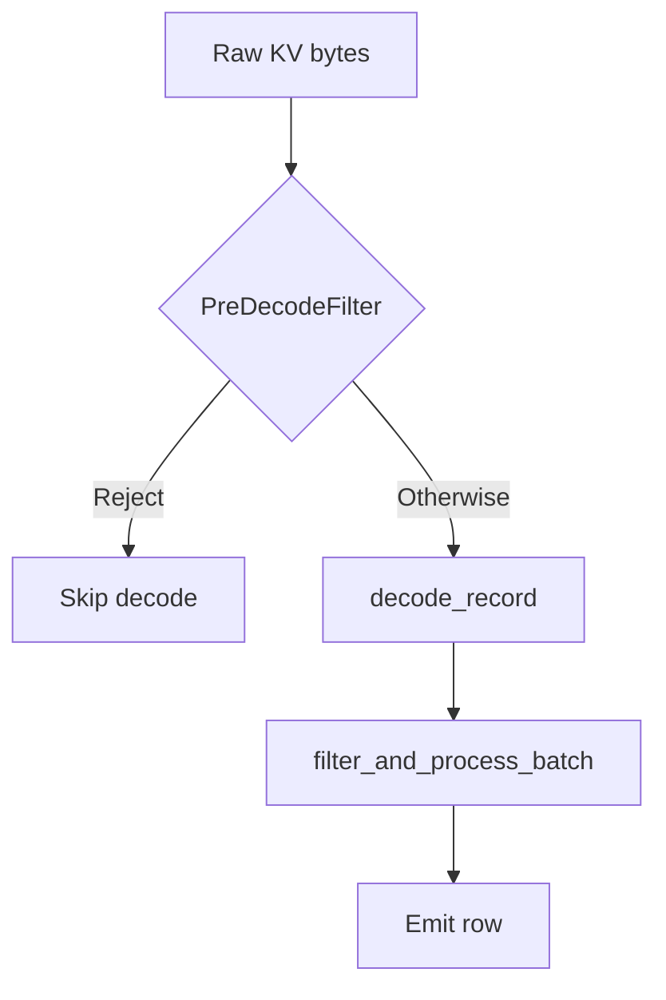

# exec/ — Query Execution Engine

This module is SurrealDB's query execution engine. The bytecode VM (`vm/`) executes every statement (`doc/adr/0007-one-engine-the-bytecode-vm.md`). Every closure invocation runs the body as a unit lowered for the invoking frame and `VERSION` stamp — inside a running program the unit the run holds or links on a fault, outside one the unit loaded from the compile cache. A stored expression evaluated per row outside a statement's program — a permission guard, a computed field, an index's column, a field's `VALUE` or `ASSERT`, an expression reached through `exec::entry` — runs as the unit of a closure that takes no argument (`scalar_unit.rs`). No `PhysicalExpr` tree is evaluated outside the test-build oracle; a build with debug assertions panics where one is (`physical_expr/tree_guard.rs`). The operators in `operators/` are host services the VM calls — storage scans, index iterators, record fetches, sort and aggregation state — and not a second executor. A statement the VM cannot run is an error; nothing falls back to another engine. What compiles a bound plan to a tree of `ExecOperator`s and runs it (`Planner::plan_logical` and the fold beneath it) is compiled only in test builds, as the oracle the VM's parity tests compare its results against.

## Architecture

```
SurrealQL (sql::Expr) ──► lower ──► LogicalOp ──► bind ──► LogicalOp ──► vm::plan (map ► optimize ► lower) ──► Program ──► VM interpreter + async host ──► Results
```

1. **Lowering** (`surrealdb_expr::expr::logical`) turns the surface statement into a tree of operators: a `SELECT` into its relational pipeline, a mutation (`CREATE`, `UPDATE`, `UPSERT`, `DELETE`, `RELATE`, `INSERT`) into a `LogicalOp::Write`, a schema statement (`DEFINE`, `REMOVE`, `REBUILD`, `ALTER`) into a `LogicalOp::Ddl` carrying it whole, every other streaming statement kind (`LET`, `RETURN`, `FOR`, blocks, `INFO`, `SLEEP`, `EXPLAIN`, bare expressions) into its statement operator. Pure: no catalog, no transaction, no caller. Every statement and expression the parser produces has a logical form; `NoLogicalForm` is reserved for a tree only hand-built syntax can express (an `INSERT` whose data clause names no rows), and is an error rather than a hand-off. A root (`@` or a starting expression) written after the first part of a path restarts it.
2. **Binding** (`logical/`) resolves and rewrites that tree for one transaction and one principal — catalog schemas, permissions and computed fields (`resolve`), parameters, constants, then the rule set (`logical/rules/`) driven to a fixpoint: predicate movement, the decorrelation of `IN` / `CONTAINS` subqueries into joins, projection pruning, identity elimination, user-defined function inlining and kind-directed simplification.
3. **VM planning** (`vm/plan`) maps the bound plan to an inert `PhysicalPlan` (`map.rs`, recording the catalog versions it read), rewrites it (`optimize.rs`) and lowers it to a program (`lower.rs`). `planner/` supplies the decisions the mapping consumes: a table source's access path and the pushdowns it admits (`planner/select/`: `decide_access_path`, `decide_count`, `check_locked_read`), the clauses a pipeline collects (`planner/fold.rs`: `collect_pipeline`), the analysis of an aggregation (`planner/aggregate.rs`), the targets of a write (`planner/write.rs`) and the compilation of every scalar (`Planner::physical_expr`). A relational source nested in `FROM` is compiled by recursing into its plan, never by rebuilding the statement. No `expr::Expr` enters the planner.
   A front end may also skip steps 1–2 and emit a plan itself: GQL lowers a `MATCH` query straight to a `LogicalOp::Match`, carried to the executor as a `TopLevelStatement::Plan`, and the SQL front ends (PostgreSQL, MySQL) emit relational plans (`Source`, `Values`, `Subquery`, inner and left `Join`, `UnionAll`, `Filter`, `Aggregate`, `Distinct`, `Sort`, `Limit`, `Project` and the writes). Scalars are `LogicalExpr`, compiled through `Planner::physical_expr` like every other scalar; the mutation operators receive them compiled and evaluate them per binding row. Such a plan has no statement behind it: it compiles and runs, or the query fails with the decline error a statement gets. `vm::plan_front_end` runs a `MATCH` as a program of its own: `planner/match_plan.rs` folds the plan over a `BindingBackend`, and `vm/match_plan.rs` is the backend that builds `PhysicalPlan` nodes, so the binding steps (`vm/binding.rs`: anchor scan, expand, endpoint bind, path and shortest-path expansion, hash join, mutations, drain) run in the VM's pipelines. `TreeBackend`, the backend that builds operators, exists in test builds only. A SQL plan is mapped, optimised and lowered as a statement is: a join is the VM's own `Plan::Join` (a `Source::Join` consumer pipeline fed by a probe pipeline ending in `Sink::JoinProbe`, its build side a child group) and `DISTINCT` its `Plan::Distinct` (`Instr::Distinct`). A plan the mapping or the lowering cannot cover is refused; no operator tree is compiled from it.
4. **Executor** (`dbs::Executor`) builds the execution context and runs the program.
5. The host serves the program's storage reads and the steps it hands over; an operator returns a `ValueBatchStream` — an async stream of `ValueBatch` (Vec\<Value\>).
6. **No fallback.** If lowering, binding or VM planning refuses a statement, the statement fails. A running program is never recompiled. `eval::surql` / `eval::gql` text and a script's `surrealdb.query()` / `surrealdb.value()` text run as nested queries (`compiles::nested_query`), compiled by the executor as a query and program of its own; `eval` makes the same choice for the statement it parses. An input with no logical form — a stored catalog clause, a stored field list, a schema statement's own clause — is lowered from its stored text where it is reached. `exec::entry` (`frame` + `scalar`) is the one route for a caller outside a plan that needs one expression evaluated; a caller does not compile its own expression. An index definition's columns and a `COUNT` index's `WHERE` guard are stored clauses like any other: compiled through `exec::permission::index_entry_physical`, which is what makes a record indexed by a write and one indexed by a build judged alike.

## Predicate processing layers



1. **`pre_decode_filter/`** — Plan-time: compile a supported WHERE shape into a byte-level tree for [`PreDecodeFilter`]. Execute-time (KV table / record-id range scans): may reject rows from raw bytes **before** full record decode. Outcomes other than reject always fall through — see module rustdoc.
2. **Scan pipeline** (`operators/scan/pipeline.rs`) — After decode, `filter_and_process_batch` evaluates the pushed-down WHERE [`PhysicalExpr`] (`scan_predicate`) per surviving row, **authoritatively**, after table permission filtering, computed fields, and field-level SELECT permissions (documented order in that function).
3. **`ExpressionRegistry` + `Compute`** — For SELECT without GROUP BY, deduplicates complex expressions shared by ORDER BY and projection; runs **post-WHERE** on decoded values.

Index access paths may strip conjuncts from the logical WHERE at plan time (`strip_index_conditions`, etc.); that is separate from both layers above.

## Core Traits

| Trait | Purpose |
|-------|---------|
| `ExecOperator` | Physical operator that produces a `ValueBatchStream`. Declares context requirements, access mode, cardinality, ordering. |
| `PhysicalExpr` | Expression evaluation in streaming context. Per-row evaluation via `evaluate()` against an `EvalContext`. |
| `ScalarFunction` | Stateless function (pure, context-aware, or async) producing a single value per invocation. Declares its `EffectSet` — what it does beyond computing its result — from which `is_deterministic` and the rewrite rules read. |
| `AggregateFunction` | Stateful function with an `Accumulator` for GROUP BY aggregation (count, sum, mean, etc.). |
| `ProjectionFunction` | Function that produces field bindings for output objects. |
| `IndexFunction` | Index-backed functions: MATCHES (full-text) and KNN (vector search). |

## Key Types

- **`ValueBatch`** — Batch of values (`Vec<Value>`). Designed for future columnar execution.
- **`ValueBatchStream`** — `Pin<Box<dyn Stream<Item = FlowResult<ValueBatch>> + Send>>`
- **`ExecutionContext`** — Hierarchical: `Root` | `Namespace(ns)` | `Database(ns, db)`. Holds transaction, params, auth, capabilities.
- **`EvalContext`** — Borrowed view for per-row expression evaluation. Carries current value, params, session info, recursion context.
- **`AccessMode`** — `ReadOnly` | `ReadWrite`. Determines transaction mode and dependency ordering barriers.
- **`CardinalityHint`** — `AtMostOne` | `Bounded(n)` | `Unbounded`. Drives buffering strategy selection.
- **`OutputOrdering`** — `Unordered` | `Sorted(...)`. Enables sort elimination when input is already ordered.
- **`FlowResult<T>`** — `Result<T, ControlFlow>` supporting return/break/continue/error signals through the operator tree.

## Module Layout

### Root files

| File | Purpose |
|------|---------|
| `mod.rs` | Core traits (`ExecOperator`, `ValueBatch`, `ValueBatchStream`), WASM-compat helpers |
| `planner.rs` | Entry point: `Planner::bind()` resolves a `LogicalOp` against the catalog; `plan_statement_inner` hands it to `vm::plan_checked`, which returns the `Arc<dyn ExecOperator>` that runs the program; `Planner::physical_expr()` compiles a `LogicalExpr` → `Arc<dyn PhysicalExpr>`. `Planner::plan_logical()` (test builds only) compiles a plan to an operator tree |
| `context.rs` | `ExecutionContext` hierarchy, `SessionInfo`, `ContextLevel`, `Parameters` |
| `access_mode.rs` | `AccessMode` enum and combine logic |
| `analyzer_function.rs` | The engine's implementation of an analyzer's `FUNCTION` clause: `fn::<name>($input)` compiled once per indexing or query operation and evaluated per piece of text |
| `cardinality.rs` | `CardinalityHint` for buffering decisions |
| `entry.rs` | Entering the engine from outside a plan: the `ExecutionContext` a caller holding `FrozenContext`/`Options` runs in, and the route that evaluates one expression in it |
| `ordering.rs` | `OutputOrdering` for sort elimination |
| `buffer.rs` | Stream buffering strategies based on cardinality and access mode |
| `metrics.rs` | `OperatorMetrics` and `monitor_stream` for EXPLAIN ANALYZE; a checked caller is shown no metrics beneath a permission filter, a layer or a permission join |
| `expression_registry.rs` | Expression deduplication for SELECT pipelines |
| `pre_decode_filter/` | Pre-decode [`PreDecodeFilter`] on revision-encoded KV bytes (reject-only; scan operators) |
| `field_path_convert.rs` | Pure field paths (no execution, used for sort/extraction metadata) |
| `index.rs` | Index analysis and access path selection |
| `logical/` | Binding passes over the `LogicalOp` plan (`surrealdb_expr::expr::logical`): `bind()` runs catalog resolution (schemas, permissions, computed fields), parameter resolution, constant folding, then `optimise` — the driver over the rules in `logical/rules/` (filter pushdown through projections, the filter split beneath a layer chain, filter pushdown through joins, projection pruning, identity elimination, decorrelation of an `IN` / `CONTAINS` subquery into a semi or anti `Join` in the predicate's frame, user-defined function inlining, kind-directed simplification), applied bottom-up at every node to a fixpoint. `logical/functions.rs` gathers what inlining reads from the node-level function cache; `logical/reads.rs` answers what an expression reads off the row for the rules and the planner alike. Every pass walks a scalar with `visit_binding`/`visit_binding_mut`, which stop at a closure body — the body stays lowered and is compiled by the planner with none of the creating statement's transaction, principal or version; `logical/reads.rs` still descends into it, since what a closure reads is part of what the statement reads |
| `permission.rs` | Runtime permission resolution for sources the analyzer left unresolved |

### `planner/` — Query Planning

The decisions the VM's mapping consumes, the compilation of scalars, and — in test builds only — the compilation of a plan to an operator tree. The operator-compiling halves are marked `#[cfg(test)]`: `fold` and its helpers, `select/`'s `compile_pipeline`, `plan_source` and `plan_sources`, `write.rs`'s `plan_write`, and `match_plan.rs`'s `TreeBackend`. Key submodules:

- `fold.rs` — `collect_pipeline`, the walk that gathers a relational pipeline's clauses down to its leaf, and, in test builds, the bottom-up fold over `LogicalOp` that compiles it: relational pipelines are handed to `select/`; a chain of `PermissionFilter`, layer and pushed-filter nodes over a table source is planned as one access path (`chain_offer`), the chain's filter becoming the scan predicate where no table permission stands over it, and the pipeline's LIMIT/START reaching the scan beneath layers alone, and only where the layers withhold no ORDER BY (a layer drops no row; a permission node does, and a Sort the chain withholds runs above the scan); when a permission predicate of the chain joins the offer, the permission nodes record it so a checked caller's `EXPLAIN` prints `<permission>` in place of the scan's index, bound and record id
- `select/` — access-path selection, the count and fast-path decisions the mapping reads, and, in test builds, the SELECT pipeline's operator compilation (FROM → WHERE → SPLIT → GROUP → ORDER → LIMIT → FETCH → PROJECT → TIMEOUT)
- `write.rs` — a mutation's targets and the classification of its subjects the mapping reads; in test builds, the operator compilation of the orders the statement runs and its clauses compiled once for the statement
- `match_plan.rs` — GQL `MATCH` plans: the fold over `LogicalOp::Match`, generic over the `BindingBackend` of `match_backend.rs` (`TreeBackend`, in test builds, builds operators; the VM's `VmBackend` in `vm/match_plan.rs` builds plan nodes), so both build one plan
- `aggregate.rs` — GROUP BY and aggregate function extraction
- `source.rs` — Source planning (table lookup, index selection, record ID scan)
- `path.rs` — Path → physical step compilation (`Step`, `Broadcast`, lookup fusion, recursion bodies)
- `util/` — Literal conversion, condition resolution, parameter resolution

### `operators/` — Physical Operators

Each file implements `ExecOperator`. What non-test code reaches is a host service of the VM or state a program keeps: the graph, reference and count iterators, the bitmap and KNN helpers, sort and aggregation state, the hash-join build table, the row writers of `Project` and `Omit`, the fetch parts, `ExplainPlan` and `AnalyzePlan`, `RecursionOp`, the write operator's per-record stages and the mutation row handling. The operators that only a compiled tree ran are compiled in test builds only (`#[cfg(test)]` in `operators.rs`): the scans (`TableScan`, `IndexScan`, `RecordIdScan`, `FullTextScan`, `KnnScan`, `DynamicScan`, `UnionIndexScan`, `LightweightEdgeScan`, `EmptyScan`, `CountScan`, `BitmapResolve`), `PermissionFilterExec`, `ProjectLayer`, `Fetch`, `Distinct`, `DistinctRecords`, `KnnTopK`, `HashJoin`, `LookupJoin`, `Bind`, the graph operators (`Expand`, `PathExpand`, `ShortestPathExpand`, `EndpointBind`, `DistinctEdges`), the mutation binding operators (`UpdateBinding`, `DeleteBinding`, `InsertGraph`, `SingleRowScan`, `DrainSink`), `SourceExpr`, `Timeout`, `UnwrapExactlyOne` and `VersionScope`. They are the oracle: the parity tests (`vm/tests_scan_parity.rs`, `tests_plain_data.rs`, `tests_enforced.rs`, `tests_front_end.rs`) run a bound plan on both and compare the rows, and the planner's and the operators' own unit tests drive them directly. A statement operator (`LET`, `RETURN`, `FOR`, a block, `INFO`, `SLEEP`, a schema statement, a bare expression) has no operator form: the VM lowers those statements.

- **Scan**: `scan/table.rs`, `scan/index.rs`, `scan/record_id.rs`, `scan/fulltext.rs`, `scan/knn.rs`, `scan/graph.rs`, `scan/reference.rs`, `scan/dynamic.rs`, `scan/count.rs`, `scan/index_count.rs`, `scan/union_index.rs`, `scan/resolved.rs`
- **Pipeline**: `filter.rs`, `project.rs`, `project_value.rs`, `limit.rs`, `sort.rs`, `aggregate.rs`, `split.rs`, `fetch.rs`, `timeout.rs`, `union.rs`, `knn_topk.rs`
- **Schema**: `permission_filter.rs` (table `PERMISSIONS FOR select`), `layer.rs` (a projection layer: computed fields and field `SELECT` permissions as columns set on the row)
- **Join**: `join/hash_join.rs` (the right side built once, and only after the probe has yielded a row, so an empty probe builds nothing: GQL `MATCH` binding rows keyed on shared bindings, or document rows keyed by expressions and merged under an alias), `join/lookup_join.rs` (`LookupJoin`: the right side read by record id, one batched get per left batch, over a `RecordBatchFetch` leaf). A join lifted from a permission predicate carries a `JoinFrame`; from a checked caller's EXPLAIN it hides its right side (`ExecOperator::explain_children`), its keys, residual, table and alias, and the metrics of every operator beneath it (`ExecOperator::hides_metrics_beneath`)
- **Recursion**: `recursion.rs` — graph traversal with BFS discovery + bottom-up assembly
- **Explain**: `explain.rs` — EXPLAIN / EXPLAIN ANALYZE output
- **Write**: `write/` — the write operator: one `ExecOperator` holding an ordered list of per-record stages (`write/plan.rs` for the orders and the branch/retry control flow, `write/stages/` for the stage bodies, `write/clauses.rs` for the statement's clauses compiled once and shared by every record). See `doc/adr/0001-streaming-write-path.md`
- **Frame**: `exec/frame.rs` — the `Options` a Surrealism module function and a stored expression run with, derived from the frame of the `ExecutionContext` they are reached from
- **Mutation**: `mutate.rs` — the row handling (`update_row`, `delete_row`, `insert_row`) the VM's mutation steps share, generic over how an expression is evaluated; the GQL mutation operators built on it are test-only

Scan operators share a common record-processing pipeline in `scan/pipeline.rs` and common iterator logic in `scan/common.rs`.

### `vm/` — Physical Plan and Bytecode VM

What a scan does with the clauses above it is part of the program and is shown on the scan by `EXPLAIN` (`vm/explain.rs`): a `Limit` over a table scan, or over a B-tree scan whose key range reaches each record once, beneath layers alone, is the scan's `limit` and `offset` (the pipeline stops reading once the page is full); a `Filter` directly over an unenforced table scan whose whole predicate compares static field paths with literals (`PreDecodeShape`) is the scan's `predicate` with `pre_decode_filter: yes` (`Source::Scan::prefilter`: a scan whose body does not run in place judges each record's stored bytes before decoding it, and the body's filter still judges the records that remain); and a `Filter` directly over a B-tree scan whose key range answers every conjunct is shown as the scan alone, the filter being the scan's own check of each record it fetches (an index over an array lists a record under each of its elements, so the key range never proves a conjunct). A last graph hop paged by an integer `LIMIT`/`START` reads only the adjacency entries the page reaches (`LookupSpec::page`).

`plan_statement_inner` hands each bound plan to `vm::plan`. The VM maps the plan to an inert `PhysicalPlan` (`map.rs`, recording the catalog versions it read), rewrites it (`optimize.rs`), lowers it to a register program (`lower.rs`), and runs it as one synchronous per-row loop per pipeline (`interp.rs`) under an async host that reads storage and takes the steps a body hands it (`host.rs`). A plan holding a node it does not cover, or an expression its instructions do not answer, fails the statement with an error that names it; which plan shapes those are is stated in `map.rs`. A program's pipelines evaluate no expression through an operator-tree form: a projection-layer column or guard with no instructions, such as one holding a statement that reads the table it is a column of, fails its statement too, and a closure body the host lowers no unit of fails each invocation. The contract it keeps is `doc/executor/PHYSICAL_PLAN_REQUIREMENTS.md`; the design is `doc/executor/VM_TARGET.md`.

Pre-emption is a property of the VM (`vm/fuel.rs`). Every unit of a program's work — a row entering a body, a backward jump, a host step, an element a host service walks (a sort run and its merge, a group finished, a join built, a graph walked, a recursion depth) — draws on one meter, the thread's, refilled with `vm_quantum` units. When it is spent the interpreter answers `Step::Yield` and a host service reaches `fuel::yield_point`, the only place the VM yields: it checks cancellation, the deadline and the memory threshold, then yields through the host's `exec::scheduler::Scheduler`. `run_body` matches `Step` with no wildcard and hands its callers a narrower `Ended`, so no driver can drop a yield. A body run inside the storage cursor holds no backward jump; its cursor counts records against the fuel left instead. A new loop in a host service charges the meter (`fuel::tick`) rather than calling `yield_now!` or `check_cancelled`, and a storage read in one asks for no more than `fuel::batch` entries. A builtin whose work grows with its input is a walk: an `async fn` in `surrealdb-runtime` that charges `surrealdb_runtime::fuel` a stretch at a time, named with `metered:` in `define_pure_function!`; its synchronous form drives the same walk with `fuel::now`.

A statement under `VERSION` is read as of one stamp, and everything it plans and lowers is read as of that stamp: `Planner::under_version` derives the planner from the clause (a datetime literal, or a parameter bound to a datetime), and the statements its expressions hold, the bodies of the functions it calls and the nested lowerings all inherit it. Under a stamp the records are read at the stamp and no access path is answered from an index entry, because an entry is unstamped — it holds the state the last write left, so a key lookup or range, an order or a limit an index supplies, a bitmap, an index count and an ANN search would each answer for now. The table is scanned at the stamp, and an approximate KNN operator (`<|k, ef|>`) over a field an ANN index declared at the stamp is ranked as the brute-force operator over that index's distance (`Planner::exact_knn_at_stamp`). A `MATCHES` has no evaluation but its full-text index, which is unstamped like the rest, so it is the one index a read at a stamp still uses: the full-text scan answers the match from the current index, whatever the stamp, and reads each record it names at the stamp. Beside that, a user-defined function is the definition stored at the stamp (no unit is kept by the node, and the binder inlines no body), and a graph hop reads its edge table's permission at the stamp when it runs. A clause only the run can evaluate names no stamp to plan against: the table is scanned, and a call of a user-defined function, or a KNN or `WITH` index operator, fails the statement; a `MATCHES` is answered from the full-text index the table declares now. `VERSION` over a statement in `FROM` is refused.

A GQL `MATCH` is a chain of binding steps (`vm/binding.rs`, `Plan::Step`): a step turns one binding row into rows. A `Bind` is an instruction (`Instr::BindRow`) of the pipeline that produces the row, which replaces the row with the binding object; every other step lowers to a split (`Sink::Split`, `SplitKind::Step`) whose rows run through the pipeline below it. A read-only program with such a split reads its scan on a task of its own, as the operator tree does. A step that must see every row before it answers (a mutation, applied in `finish_step` once the pipeline above has finished) or that batches (the endpoint bind, which fetches nodes a batch of rows at a time) is a buffering step, and its remainder is delivered when its source finishes. A join whose build side writes runs its build when the pipeline reading its probe rows starts (`SplitSpec::build_before`), so those rows read what it wrote. Path expansion flushes at `scan_batch_size` as the operator does, so a LIMIT below stops exploration. `vm/match_plan.rs` builds the plan; the result of every `MATCH` equals the operator tree's.

### `physical_expr/` — Expression Evaluation

Implements `PhysicalExpr` for all expression types:

- `literal.rs` — Constants, parameters, mock expressions
- `path.rs` — Paths: `Step` (a run of parts over a root), `Broadcast` (array continuation), `Current`, `FoldedPath` (a constant field chain resolved at plan time)
- `record_id.rs` — Record ID construction
- `ops.rs` — Binary, unary, postfix operators
- `conditional.rs` — IF/ELSE expressions
- `control_flow.rs` — BREAK, CONTINUE, THROW
- `collections.rs` — Array, object, set literals
- `matches.rs` — MATCHES operator (full-text search)
- `subquery.rs` — Scalar subqueries: `ScalarSubquery` runs a statement planned as a VM program when the scalar is compiled; `UnplannedSubquery` stands for it, unevaluated, where the compiling planner holds no transaction: what holds it runs as a VM unit lowered over one (`scalar_unit.rs`)
- `function/` — All function call types (builtin, closure, JS, ML model, user-defined, index, projection, Surrealism modules)

### `function/` — Function System

- `registry.rs` — `FunctionRegistry`: lookup by name, supports scalar + aggregate + projection + index functions
- `builtin/` — ~30 modules implementing scalar functions (math, string, array, object, record, type, geo, vector, search, crypto, http, time, duration, etc.)
- `builtin/aggregates.rs` — Aggregate functions (count, math::sum, math::mean, array::group, etc.)
- `aggregate.rs` — `AggregateFunction` trait and `Accumulator`
- `projection.rs` — `ProjectionFunction` trait
- `index.rs` — `IndexFunction` trait, `MatchesContext`, `KnnContext`
- `signature.rs` — Function signatures with argument types
- `method.rs` — Method-style call descriptors

### `parts/` — Physical Part Expressions

Evaluate one path step each (field access, array indexing, etc.), chained by `physical_expr/path.rs`:

- `field.rs`, `index.rs`, `lookup.rs`, `filter.rs`, `array_ops.rs`, `destructure.rs`, `optional.rs`, `recurse.rs`, `method.rs`

### `index/` — Index Support

- `access_path.rs` — `AccessPath`, `BTreeAccess`, index selection logic
- `analysis.rs` — `IndexAnalyzer`, `IndexCandidate` for query optimization
- `iterator/` — Index iterator implementations

## Design Rules

1. **No `compute()` calls** — All evaluation goes through `PhysicalExpr` and the VM's instructions. An input with no compiled form is lowered from its stored text where it is reached (step 6 above); a new route is added there, not invented at a call site. A caller outside a plan evaluates through `exec::entry`. The write operator reads the write-refusing frames off `ExecutionContext::root()` itself, because a stage reaching through another module would run a user expression under a frame other than the operator's own. `expr::Expr` is the stored and wire form of a statement and is never executed.
2. **WASM compatibility** — use `target_family = "wasm"` cfgs to cover executor mechanics (`spawn_local` instead of `tokio::spawn`, no rayon offload or `spawn_blocking`), Browser-wasm-only mechanisms (e.g. asserting `Send` on JS-backed futures) must be gated on `all(target_arch = "wasm32", any(target_os = "unknown", target_os = "none"), not(target_feature = "atomics")`.
3. **Access mode propagation** — Every operator and expression must correctly report its `AccessMode`. A SELECT with a mutating subquery must return `ReadWrite`.
4. **Context level validation** — Operators declare minimum `ContextLevel` (Root/Namespace/Database). The executor validates before execution.
5. **Batched processing** — Operators work with `ValueBatch`, not individual values. This amortizes per-record overhead and enables future columnar execution.

## SELECT Pipeline

The operator tree the oracle compiles for a SELECT is:

```
Scan/Union (FROM)
    → Filter (WHERE)
    → Split (SPLIT BY)
    → Aggregate (GROUP BY)
    → Sort (ORDER BY)
    → Limit (LIMIT/START)
    → Fetch (FETCH)
    → Project (SELECT fields)
    → Timeout (TIMEOUT)
```

Sort elimination: if the scan already produces ordered output (e.g., index scan), the planner checks `OutputOrdering` and skips the Sort operator. The VM's pipelines (`vm/`) take the same decisions from the plan `map.rs` builds.

## Entry Points

- **`Planner::bind(op)`** then **`vm::plan_checked(planner, &bound, unbound)`** — Bind a lowered `LogicalOp` against the catalog and plan it as a VM program wrapped as an `ExecOperator`, or fail with the decline error of a statement; `plan_statement_inner` does both, `plan_logical_inner` plans a plan a front end emitted, unbound, the same way. `Planner::plan_logical` compiles an operator tree and exists in test builds only, for the parity tests
- **`Planner::with_txn(ctx, registry, txn, ns, db)`** — Planner with transaction for index resolution at plan time
- **`plan.execute(&exec_ctx)`** — Execute operator tree, returns `ValueBatchStream`
- **`Executor::execute_operator_plan(plan, txn)`** — Full execution: build context, run plan, collect results
- **`Planner::physical_expr(expr)`** / **`compile_expr(expr, ctx, registry, txn, auth, depth)`** — Compile a `LogicalExpr` to a `PhysicalExpr`
