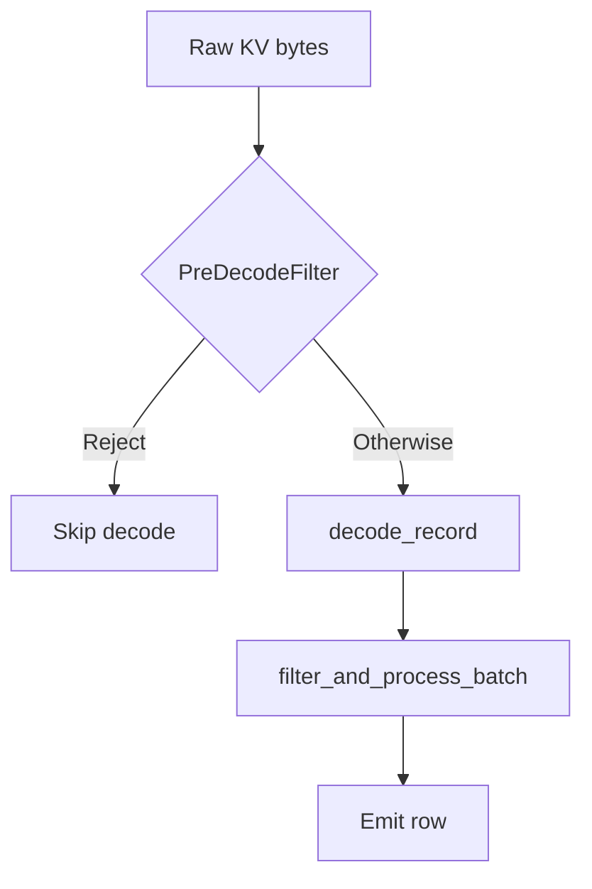

# exec/ — Query Execution Engine

This module is SurrealDB's query execution engine. The bytecode VM (`vm/`) executes every statement (`doc/adr/0007-one-engine-the-bytecode-vm.md`). Every closure invocation runs the body as a unit lowered for the invoking frame and `VERSION` stamp — inside a running program the unit the run holds or links on a fault, outside one the unit loaded from the compile cache. A stored expression evaluated per row outside a statement's program — a permission guard, a computed field, an index's column, a field's `VALUE` or `ASSERT`, an expression reached through `exec::entry` — runs as the unit of a closure that takes no argument (`scalar_unit.rs`). A stored expression is held as a `Clause` (`clause.rs`), whose metadata derives from the logical expression and whose evaluator is a VM unit; no expression is evaluated as a tree of nodes. The operators in `operators/` are host services the VM calls — storage scans, index iterators, record fetches, sort and aggregation state — and not a second executor. A statement the VM cannot run is an error; nothing falls back to another engine, and nothing compiles a bound plan to a tree of `ExecOperator`s: an `ExecOperator` is what a plan's `EXPLAIN` renders and what the host runs.

## Architecture

```
SurrealQL (expr::Expr) ──► lower ──► LogicalOp ──► bind ──► LogicalOp ──► vm::plan (map ► optimize ► lower) ──► Program ──► VM interpreter + async host ──► Results
```

1. **Lowering** (`surrealdb_expr::expr::logical`) turns the surface statement into a tree of operators: a `SELECT` into its relational pipeline, a mutation (`CREATE`, `UPDATE`, `UPSERT`, `DELETE`, `RELATE`, `INSERT`) into a `LogicalOp::Write`, a schema statement (`DEFINE`, `REMOVE`, `REBUILD`, `ALTER`) into a `LogicalOp::Ddl` carrying it whole, every other streaming statement kind (`LET`, `RETURN`, `FOR`, blocks, `INFO`, `SLEEP`, `EXPLAIN`, bare expressions) into its statement operator. Pure: no catalog, no transaction, no caller. Every statement and expression the parser produces has a logical form; `NoLogicalForm` is reserved for a tree only hand-built syntax can express (an `INSERT` whose data clause names no rows), and is an error rather than a hand-off. A root (`@` or a starting expression) written after the first part of a path restarts it.
2. **Binding** (`logical/`) resolves that tree for one transaction and one principal — catalog schemas, permissions and computed fields (`resolve`), parameters, constants. The rewrites a statement is owed run on the IR: the binder recognises the memberships of a filter that run once as a join (`ir/build/membership/lift.rs`) and binds the body of an inlinable user-defined function beneath its call (`ir/build/inline.rs`), and the loop optimiser's passes (`ir/passes`) fold, move filters into subqueries and beneath layers, prune layer columns and run function bodies in the caller (the layer push judges a conjunct over a record-id component's key column as the read of `id[i]`).
3. **VM planning** (`vm/plan`) maps the bound plan to an inert `PhysicalPlan` (`map.rs`, recording the catalog versions it read), rewrites it (`optimize.rs`) and lowers it to a program (`lower.rs`). `planner/` supplies the decisions the mapping consumes: a table source's access path and the pushdowns it admits (`planner/select/`: `decide_access_path`, `decide_count`, `check_locked_read`), the clauses a pipeline collects (`planner/fold.rs`: `collect_pipeline`), the analysis of an aggregation (`planner/aggregate.rs`), the targets of a write (`planner/write.rs`) and the description of every scalar (`Planner::scalar_metadata`, held as a `Clause`). A relational source nested in `FROM` is compiled by recursing into its plan, never by rebuilding the statement. No `expr::Expr` enters the planner.
   A front end may also skip steps 1–2 and emit a plan itself: GQL lowers a `MATCH` query straight to a `LogicalOp::Match`, carried to the executor as a `TopLevelStatement::Plan`, and the SQL front ends (PostgreSQL, MySQL) emit relational plans (`Source`, `Values`, `Subquery`, inner and left `Join`, `UnionAll`, `Filter`, `Aggregate`, `Window`, `Distinct`, `Sort`, `Limit`, `Project` and the writes). Scalars are `LogicalExpr`, described through `Planner::scalar_metadata` like every other scalar; the mutation operators receive them compiled and evaluate them per binding row. Such a plan has no statement behind it: it compiles and runs, or the query fails with the decline error a statement gets. `vm::plan_front_end` runs a `MATCH` as a program of its own: `planner/match_plan.rs` folds the plan over a `BindingBackend`, and `vm/match_plan.rs` is the backend that builds `PhysicalPlan` nodes, so the binding steps (`vm/binding.rs`: anchor scan, expand, endpoint bind, path and shortest-path expansion, hash join, mutations, drain) run in the VM's pipelines. A SQL plan is mapped, optimised and lowered as a statement is: a join is the VM's own `Plan::Join` (a `Source::Join` consumer pipeline fed by a probe pipeline ending in `Sink::JoinProbe`, its build side a child group) and `DISTINCT` its `Plan::Distinct` (`Instr::Distinct`). A plan the mapping or the lowering cannot cover is refused.
4. **Executor** (`dbs::Executor`) builds the execution context and runs the program.
5. The host serves the program's storage reads and the steps it hands over; an operator returns a `ValueBatchStream` — an async stream of `ValueBatch` (Vec\<Value\>).
6. **No fallback.** If lowering, binding or VM planning refuses a statement, the statement fails. A running program is never recompiled. `eval::surql` / `eval::gql` text and a script's `surrealdb.query()` / `surrealdb.value()` text run as nested queries (`compiles::nested_query`), compiled by the executor as a query and program of its own; `eval` makes the same choice for the statement it parses. An input with no logical form — a stored catalog clause, a stored field list, a schema statement's own clause — is lowered from its stored text where it is reached. `exec::entry` (`frame` + `scalar`) is the one route for a caller outside a plan that needs one expression evaluated; a caller does not compile its own expression. An index definition's columns and a `COUNT` index's `WHERE` guard are stored clauses like any other: compiled through `exec::permission::index_entry_physical`, which is what makes a record indexed by a write and one indexed by a build judged alike.

## Predicate processing layers



1. **`pre_decode_filter/`** — Plan-time: compile a supported WHERE shape into a byte-level tree for [`PreDecodeFilter`]. Execute-time (KV table / record-id range scans): may reject rows from raw bytes **before** full record decode. Outcomes other than reject always fall through — see module rustdoc.
2. **Scan pipeline** (`operators/scan/pipeline.rs`) — After decode, `filter_and_process_batch` evaluates the pushed-down WHERE [`Clause`] (`scan_predicate`) per surviving row, **authoritatively**, after table permission filtering, computed fields, and field-level SELECT permissions (documented order in that function).
3. **`ExpressionRegistry` + `Compute`** — For SELECT without GROUP BY, deduplicates complex expressions shared by ORDER BY and projection; runs **post-WHERE** on decoded values.

Index access paths may strip conjuncts from the logical WHERE at plan time (`strip_index_conditions`, etc.); that is separate from both layers above. A key-range access (below) strips none: its ranges are a superset and the whole predicate is judged again over every row they yield.

## Core Traits

| Trait | Purpose |
|-------|---------|
| `ExecOperator` | A node of the plan EXPLAIN renders, and the host's handle on a program. Declares its name, attributes, children, context requirements and access mode. |
| `ScalarFunction` | Stateless function (pure, context-aware, or async) producing a single value per invocation. Declares its `EffectSet` — what it does beyond computing its result — from which `is_deterministic` and the rewrite rules read. |
| `AggregateFunction` | Stateful function with an `Accumulator` for GROUP BY aggregation (count, sum, mean, etc.). |
| `ProjectionFunction` | Function that produces field bindings for output objects. |
| `IndexFunction` | Index-backed functions: MATCHES (full-text) and KNN (vector search). |

## Key Types

- **`ValueBatch`** — Batch of values (`Vec<Value>`). Designed for future columnar execution.
- **`ValueBatchStream`** — `Pin<Box<dyn Stream<Item = FlowResult<ValueBatch>> + Send>>`
- **`ExecutionContext`** — Hierarchical: `Root` | `Namespace(ns)` | `Database(ns, db)`. Holds transaction, params, auth, capabilities.
- **`EvalContext`** — Borrowed view for per-row expression evaluation. Carries current value, params, session info, recursion context.
- **`AccessMode`** — `ReadOnly` | `ReadWrite`. Determines transaction mode and dependency ordering barriers.
- **`CardinalityHint`** — `AtMostOne` | `Unbounded`. Drives buffering strategy selection.
- **`OutputOrdering`** — `Unordered` | `Sorted(...)`. Enables sort elimination when input is already ordered.
- **`FlowResult<T>`** — `Result<T, ControlFlow>` supporting return/break/continue/error signals through the host services and the VM's steps.

## Module Layout

### Root files

| File | Purpose |
|------|---------|
| `mod.rs` | Core traits (`ExecOperator`, `ValueBatch`, `ValueBatchStream`), WASM-compat helpers |
| `planner.rs` | Entry point: `Planner::bind()` resolves a `LogicalOp` against the catalog; `plan_statement_inner` hands it to `vm::plan_checked`, which returns the `Arc<dyn ExecOperator>` that runs the program; `Planner::scalar_metadata()` describes a `LogicalExpr`, and `Clause::of` makes the `Clause` whose VM unit evaluates it |
| `context.rs` | `ExecutionContext` hierarchy, `SessionInfo`, `ContextLevel`, `Parameters` |
| `access_mode.rs` | `AccessMode` enum and combine logic |
| `analyzer_function.rs` | The engine's implementation of an analyzer's `FUNCTION` clause: `fn::<name>($input)` compiled once per indexing or query operation and evaluated per piece of text |
| `cardinality.rs` | `CardinalityHint` for buffering decisions |
| `entry.rs` | Entering the engine from outside a plan: the `ExecutionContext` a caller holding `FrozenContext`/`Options` runs in, and the route that evaluates one expression in it |
| `ordering.rs` | `OutputOrdering` for sort elimination |
| `buffer.rs` | Stream buffering strategies based on cardinality and access mode |
| `metrics.rs` | `OperatorMetrics` and `monitor_stream` for EXPLAIN ANALYZE; a checked caller is shown no metrics beneath a permission filter, a layer or a permission join |
| `expression_registry.rs` | Expression deduplication for SELECT pipelines |
| `pre_decode_filter/` | Pre-decode [`PreDecodeFilter`] on a record's stored KV bytes, in the stored-value encoding or the `revision` one (reject-only; scan operators) |
| `field_path_convert.rs` | Pure field paths (no execution, used for sort/extraction metadata) |
| `index.rs` | Index analysis and access path selection |
| `logical/` | Binding passes over the `LogicalOp` plan (`surrealdb_expr::expr::logical`): `bind()` runs catalog resolution (schemas, permissions, computed fields) and parameter resolution; no rewrite rule runs over the logical plan, the IR's passes and the binder's membership recogniser make the rewrites. `logical/reads.rs` answers what an expression reads off the row for the planner and the IR alike. Every pass walks a scalar with `visit_binding`/`visit_binding_mut`, which stop at a closure body — the body stays lowered and is compiled by the planner with none of the creating statement's transaction, principal or version; `logical/reads.rs` still descends into it, since what a closure reads is part of what the statement reads |
| `permission.rs` | Runtime permission resolution for sources the analyzer left unresolved |

### `planner/` — Query Planning

The decisions the VM's mapping consumes and the description of scalars. The planner compiles no plan to a tree of operators. Key submodules:

- `fold.rs` — `collect_pipeline`, the walk that gathers a relational pipeline's clauses down to its leaf, and `chain_offer`, which says what a chain of `PermissionFilter`, layer, pushed-filter and permission-join nodes over a table source offers its access path: the pipeline's conjuncts and order keys that read no layer column (a column of a named record id's component is the exception: the read is offered as `id[i]`, with an order key resolved against the projection's aliases first), the chain's own filters, and the table permission predicates where no part of the offer is evaluated per row (`AccessOffer::permissioned`, which a checked caller's `EXPLAIN` reads to print `<permission>` in place of the scan's index, bound and record id)
- `select/` — access-path selection and the count and fast-path decisions the mapping reads
- `write.rs` — a mutation's targets and the classification of its subjects the mapping reads
- `match_plan.rs` — GQL `MATCH` plans: the fold over `LogicalOp::Match`, generic over the `BindingBackend` of `match_backend.rs`, whose implementation `VmBackend` in `vm/match_plan.rs` builds plan nodes
- `aggregate.rs` — GROUP BY and aggregate function extraction
- `source.rs` — Source planning (table lookup, index selection, record ID scan)
- `path.rs` — Path → physical step compilation (`Step`, `Broadcast`, lookup fusion, recursion bodies)
- `util/` — Literal conversion, condition resolution, parameter resolution

### `operators/` — Host Services

What lives here is a host service of the VM or state a program keeps: the graph, reference and count iterators, the bitmap and KNN helpers, sort and aggregation state, the hash-join build table, the row writers of `Project` and `Omit`, the fetch parts, the recursion strategies, the write per-record stages and the mutation row handling. No module here is an executor, and none builds a tree of operators: a statement operator (`LET`, `RETURN`, `FOR`, a block, `INFO`, `SLEEP`, a schema statement, a bare expression) has no operator form, and the VM lowers those statements.

- **Scan**: `scan/` — record decoding and the per-record pipeline (`pipeline.rs`, `common.rs`), record-id lookups (`record_id.rs`), full-text hits (`fulltext.rs`), KNN helpers (`knn.rs`), the bitmap fusion of index branches (`bitmap.rs`), graph and reference adjacency (`graph.rs`, `graph_keys.rs`, `reference.rs`, `lightweight.rs`), counts (`count.rs`, `index_count.rs`), the union-index merge (`union_index.rs`), the byte ranges of a key-range scan (`key_range.rs`: `record_key_ranges`) and the plan-time enforcement mode of a table source (`resolved.rs`)
- **Pipeline state**: `project.rs` and `layer.rs` (the row writers of a projection and of a projection layer's columns), `limit.rs` (paging counts), `sort.rs` (the ordering), `aggregate.rs` (the names of a group's output row), `split.rs`, `fetch.rs` (the fetch parts and the record-link walk), `distinct.rs` (the seen set), `knn_topk.rs` (the bounded heap of brute-force KNN)
- **Schema**: `permission_filter.rs` (the permission frame a table's `PERMISSIONS FOR select` predicate is judged in), `layer.rs` (a projection layer: computed fields and field `SELECT` permissions as columns set on the row)
- **Join**: `join/hash_join.rs` — the row conventions of a join (GQL `MATCH` binding rows keyed on shared bindings, or document rows keyed by expressions and merged under an alias) and the in-memory `BuildTable`
- **Graph**: `graph/` — the single-hop, quantified and shortest-path traversals and the endpoint and distinct-edge steps of GQL `MATCH` binding rows
- **Recursion**: `recursion.rs` — the recursion strategies, BFS discovery with bottom-up assembly
- **Explain**: `explain.rs` — EXPLAIN / EXPLAIN ANALYZE output
- **Write**: `write/` — the write's per-record helpers: `write/plan.rs` for the orders and the branch/retry control flow the VM's write lowering follows, `write/stages/` for the stage bodies, `write/scope.rs` and `write/ctx.rs` for what a statement resolves once per table. See `doc/adr/0001-streaming-write-path.md`
- **Frame**: `exec/frame.rs` — the `Options` a Surrealism module function and a stored expression run with, derived from the frame of the `ExecutionContext` they are reached from
- **Mutation**: `mutate.rs` — the row handling (`update_row`, `delete_row`, `insert_row`) the VM's mutation steps share, generic over how an expression is evaluated

Scan modules share a common record-processing pipeline in `scan/pipeline.rs` and common iterator logic in `scan/common.rs`.

### `vm/` — Physical Plan and Bytecode VM

What a scan does with the clauses above it is part of the program and is shown on the scan by `EXPLAIN` (`vm/explain.rs`): a `Limit` over a table scan, or over a B-tree scan whose key range reaches each record once, beneath layers alone, is the scan's `limit` and `offset` (the pipeline stops reading once the page is full); a `Filter` directly over an unenforced table scan whose whole predicate compares static field paths with literals (`PreDecodeShape`) is the scan's `predicate` with `pre_decode_filter: yes` (`Source::Scan::prefilter`: a scan whose body does not run in place judges each record's stored bytes before decoding it, and the body's filter still judges the records that remain); and a `Filter` directly over a B-tree scan whose key range answers every conjunct is shown as the scan alone, the filter being the scan's own check of each record it fetches (an index over an array lists a record under each of its elements, so the key range never proves a conjunct). A last graph hop paged by an integer `LIMIT`/`START` reads only the adjacency entries the page reaches (`LookupSpec::page`).

A table whose `id` names its components (`DEFINE FIELD id ON reading TYPE [city: string, time: datetime]`, `doc/adr/0008-named-record-id-components.md`) reads a predicate over its leading components as record-key ranges: `Plan::KeyRangeScan` (`vm/plan.rs`), which lowers to `Source::Scan { range: Some(ScanRange) }` (`vm/program.rs`; every other scan has `range: None`, and every match on `Source::Scan` handles the field: `host.rs`, `leaf.rs`, `region.rs`, `lower.rs`, `lower_block.rs`, `program.rs`). The host evaluates the bounds each time the scan opens (`scan_key_ranges` in `vm/host.rs`), builds the ranges with `record_key_ranges` and reads them range by range in the plan's direction. The access is a superset of the rows the predicate admits and the predicate stays above the scan (`residual: yes`); a bound whose value its component cannot hold widens its side and never raises. `EXPLAIN` shows `table`, `key` (the pinned components), `range`, `ranges` (the product of `IN` sizes, when above one), `direction`, `ordered` (`exact`, or `second` for a datetime component), `granularity: second` where a datetime bound widens, `residual: yes`, and `topk_cutoff: second` where the sort bounds the scan; `key`, `range` and `ranges` are in `ACCESS_PATH_ATTRS` (`operators/explain.rs`) and read `<permission>` for a checked caller beneath a permission. A datetime component orders its keys by the whole second only, so the `Sort` over it stays, and under a `LIMIT` the `CoarseCutoffSort` rule (`vm/optimize.rs`) has the scan stop past the last kept row's second (`CoarseGate` in `vm/host.rs`); `DeliveredOrder` removes a `Sort` only over a component that orders exactly (`key_range_delivers`) and never delivers `ORDER BY id` over a key with a datetime component (`Plan::TableScan.id_order`). `scan_orders_by_id` (`vm/map.rs`) reads the structure of whatever structures the keys, an aggregated view's group columns as much as a named `id` field's components (`KeyOrigin`), because the two encode a key the same way; a view's column holds a kind only where its group expression fixes one (a cast), so `ORDER BY id` over a view grouped by a bare field read keeps its `Sort`. The structure that answers is the one the state being read was written under rather than the one the catalog holds now, since a record id's names can be removed while the keys written under them stay: a read under a `VERSION` reads the structure as of its stamp, and a stamp only the run can evaluate names no state to read it at, so the scan delivers no `id` order at all.

`plan_statement_inner` hands each bound plan to `vm::plan`. The VM maps the plan to an inert `PhysicalPlan` (`map.rs`, recording the catalog versions it read), rewrites it (`optimize.rs`), lowers it to a register program (`lower.rs`), and runs it as one synchronous per-row loop per pipeline (`interp.rs`) under an async host that reads storage and takes the steps a body hands it (`host.rs`). A plan holding a node it does not cover, or an expression its instructions do not answer, fails the statement with an error that names it; which plan shapes those are is stated in `map.rs`. A program's pipelines evaluate every expression as instructions: a projection-layer column or guard with no instructions, such as one holding a statement that reads the table it is a column of, fails its statement too, and a closure body the host lowers no unit of fails each invocation. The contract it keeps is `doc/executor/PHYSICAL_PLAN_REQUIREMENTS.md`; the design is `doc/executor/VM_TARGET.md`.

Pre-emption is a property of the VM (`vm/fuel.rs`). Every unit of a program's work — a row entering a body, a backward jump, a host step, an element a host service walks (a sort run and its merge, a group finished, a join built, a graph walked, a recursion depth) — draws on one meter, the thread's, refilled with `vm_quantum` units. When it is spent the interpreter answers `Step::Yield` and a host service reaches `fuel::yield_point`, the only place the VM yields: it checks cancellation, the deadline and the memory threshold, then yields through the host's `exec::scheduler::Scheduler`. `run_body` matches `Step` with no wildcard and hands its callers a narrower `Ended`, so no driver can drop a yield. A body run inside the storage cursor holds no backward jump; its cursor counts records against the fuel left instead. A new loop in a host service charges the meter (`fuel::tick`) rather than calling `yield_now!` or `check_cancelled`, and a storage read in one asks for no more than `fuel::batch` entries. A builtin whose work grows with its input is a walk: an `async fn` in `surrealdb-runtime` that charges `surrealdb_runtime::fuel` a stretch at a time, named with `metered:` in `define_pure_function!`; its synchronous form drives the same walk with `fuel::now`.

Memory is bounded per query (`exec/memory`). The datastore holds one `MemoryGovernor` (a host may supply its own; otherwise a `FairGovernor` sized by `memory_limit`) and one `TempStore` (a host's, or files in the temporary directory). A query's breakers draw on one `Lease`: a guaranteed minimum that includes the spill headroom — one buffer (a part and a block) to write a run, one per run a merge reads — and a grant above it the governor may lower while the query runs. A breaker charges what it holds to a `Reservation`, which reserves from the lease in chunks, and at each flush spills once the lease refuses it or a lowered grant leaves the query over it: a sort writes a sorted run, an aggregate grouped by a key writes every group's saved state (`Accumulator::save`) in key order. Runs are merged through the runtime's loser tree, no more at once than the query's fan-in, in several passes otherwise (`vm/spill.rs`), so a breaker's answer is the one it gives in memory. A random order spills by giving each row a random key. A GQL `DISTINCT` (`vm/distinct_spill.rs`) and a GQL hash join with keys (`vm/join_spill.rs`) spill too, deferring the rows that arrive after the spill and handing them on, once their input is finished, in the order the in-memory step gives. A gathered result (a subquery's rows), a transaction's change-feed and live-event buffers, and a breaker with no store cannot spill: they are held through `QueryMemory::insist`, which grows the lease, waits (at most `memory_wait`) for other queries to give memory back, or grants the bytes past the limit and records an overcommit, and never fails the query for want of memory. A new breaker charges its lease the same way; a sort a limit bounds takes nothing from its lease within a chunk, and no account at all where there is no temporary store; `GROUP ALL` holds none.

A statement under `VERSION` is read as of one stamp, and everything it plans and lowers is read as of that stamp: `Planner::under_version` derives the planner from the clause (a datetime literal, or a parameter bound to a datetime), and the statements its expressions hold, the bodies of the functions it calls and the nested lowerings all inherit it. Under a stamp the records are read at the stamp and no access path is answered from an index entry, because an entry is unstamped — it holds the state the last write left, so a key lookup or range, an order or a limit an index supplies, a bitmap, an index count and an ANN search would each answer for now. The table is scanned at the stamp, and an approximate KNN operator (`<|k, ef|>`) over a field an ANN index declared at the stamp is ranked as the brute-force operator over that index's distance (`Planner::exact_knn_at_stamp`). A `MATCHES` has no evaluation but its full-text index, which is unstamped like the rest, so it is the one index a read at a stamp still uses: the full-text scan answers the match from the current index, whatever the stamp, and reads each record it names at the stamp. Beside that, a user-defined function is the definition stored at the stamp (no unit is kept by the node, and the binder inlines no body), and a graph hop reads its edge table's permission at the stamp when it runs. A clause only the run can evaluate names no stamp to plan against: the table is scanned, and a call of a user-defined function, or a KNN or `WITH` index operator, fails the statement; a `MATCHES` is answered from the full-text index the table declares now. `VERSION` over a statement in `FROM` is refused.

A GQL `MATCH` is a chain of binding steps (`vm/binding.rs`, `Plan::Step`): a step turns one binding row into rows. A `Bind` is an instruction (`Instr::BindRow`) of the pipeline that produces the row, which replaces the row with the binding object; every other step lowers to a split (`Sink::Split`, `SplitKind::Step`) whose rows run through the pipeline below it. A read-only program with such a split reads its scan on a task of its own. A step that must see every row before it answers (a mutation, applied in `finish_step` once the pipeline above has finished) or that batches (the endpoint bind, which fetches nodes a batch of rows at a time) is a buffering step, and its remainder is delivered when its source finishes. A join whose build side writes runs its build when the pipeline reading its probe rows starts (`SplitSpec::build_before`), so those rows read what it wrote. Path expansion flushes at `scan_batch_size`, so a LIMIT below stops exploration. `vm/match_plan.rs` builds the plan.

### `clause.rs` — Stored Expressions

`Clause` is the one concrete type every holder of a stored expression keeps (an index column, a permission guard, a computed field, a scan predicate, a range bound, a write's value). It is cheap to clone, and offers `evaluate`, `evaluate_batch` and `ToSql`. A clause is one of: a constant (`Clause::literal`, evaluated without reading the context); a unit (`Clause::of`, or `Clause::predicate` for a permission predicate), the expression run as the VM unit of a closure taking no argument (`scalar_unit.rs`) and described by the `ScalarMetadata` that `planner/scalar_metadata.rs` derives from the logical expression; a `ComputedFieldGuard` (`permission.rs`), a clause judged over a row whose computed fields are derived first; or an uncompilable clause (`Clause::uncompilable`), which fails with the reason when evaluated and is read-only. No expression is evaluated as a tree of nodes.

- `vm/matches.rs` — the MATCHES registration helpers the mapping reads (`collect_cond_matches`, `first_unregistered_cond_matches`)

### `function/` — Function System

- `registry.rs` — `FunctionRegistry`: lookup by name, supports scalar + aggregate + projection + index functions
- `builtin/` — ~30 modules implementing scalar functions (math, string, array, object, record, type, geo, vector, search, crypto, http, time, duration, etc.)
- `builtin/aggregates.rs` — Aggregate functions (count, math::sum, math::mean, array::group, etc.)
- `aggregate.rs` — `AggregateFunction` trait and `Accumulator`
- `projection.rs` — `ProjectionFunction` trait
- `index.rs` — `IndexFunction` trait, `MatchesContext`, `KnnContext`
- `signature.rs` — Function signatures with argument types
- `method.rs` — Method-style call descriptors

### `parts/` — Lookup Directions

`lookup.rs` holds `LookupDirection`, the direction of a graph lookup, and `recurse.rs` the recursion body helpers the VM's path lowering shares; the path steps themselves are VM instructions (`vm/access/`).

### `index/` — Index Support

- `access_path.rs` — `AccessPath`, `BTreeAccess`, index selection logic
- `analysis.rs` — `IndexAnalyzer`, `IndexCandidate` for query optimization
- `key_range.rs` — `plan_key_range`, the pure rule that turns the conjuncts and ordering offered to a table source into a key-range access (`KeyRangeAccess`: the pinned run, the range on the next component, the direction and the order delivered), over a `KeyStructure` from an `id` that names its components or from an aggregated view
- `derived_columns.rs` — index columns that read a component of a named record id: the `id[i]` spelling every evaluation uses, and the whole-second widening of a range over a datetime component (one switch, `derived_datetime_index_needs_widening`)
- `iterator/` — Index iterator implementations

## Named record-id components

`KeyStructure` (`surrealdb/catalog/src/schema/key.rs`) says what each element of an array record id holds and how its stored encoding orders (`ComponentKind`, `ComponentOrder`). It is runtime-only, is built from the `id` field's type (names stored in the field's kind text) or from an aggregated view (`table_key`), and is read through `FieldDefinition::live_key`. Code in `exec/` keeps these rules:

- **A component is a virtual field.** `fields_from_stored` appends one read-only computed definition per name after `id` (`key_part = Some(i)`, body `id[i]`, full `select` permission). It has no stored form. Code that acts on definitions (INFO, export, GraphQL inputs, DDL consumers) skips it; a gate that exists only for speed treats it as reading `id` alone, which every decode sets from the key; nothing writes a field list entry back. A table whose id names nothing gets the same `Arc` of definitions.
- **The binder frames a component's column with `EvalFrame::key_part()`.** `EXPLAIN` prints it as `@key` (`layer_attrs` in `vm/explain.rs`), and a checked caller sees `<computed>` in place of the expression. A component is never re-derived beneath a field guard, because it reads `id` alone and a field `SELECT` permission on a named `id` is refused (`IdFieldSelectPermission`, `field_rules.rs`).
- **Component matching is canonical where an access path is chosen.** `plan_key_range`, `path_matches_column` and `idiom_matches_column_in` map a component's name and `id[i]` to one spelling (`KeyStructure::canonical_column`), because a mutation's `WHERE` never passes through the logical rule that substitutes `id[i]` for a key column. A bare component name is never read as a stored field of such a table.
- **A key range is never the whole answer.** The residual is kept, so a range that is wider than it needs to be (a datetime's whole second, an exclusive bound read inclusively) costs reads and never rows. A bound is a literal the component can hold or a deferred scalar that reads no row and has no effect; under a permissioned offer only literals (`AccessOffer::permissioned`). A conjunct that reads the clock bounds no key range, which is built from literals and clock-free expressions (ADR 0006; `read_condition` in `vm/map.rs` leaves one out of a keyed write's read). It is not planned under `VERSION`, a `WITH` hint, `MATCHES`, a KNN operator or `AssumeRestricted`.
- **Stored bytes hold no component.** A reader of a record's stored bytes (`PreDecodeShape`, the top-k pushdown in `topk_pushdown.rs`, the inline payload a graph hop's key condition reads in `ir/phys/hop_key.rs`) declines a path rooted at a component name (`reads_key_component`); the key condition declines every edge table whose record ids name components.
- **A component is written through the id.** `DataInstr::SettleKeyFields` (`vm/write_data.rs`, body `settle_key_fields` in `operators/write/stages/data.rs`) is emitted only for a table whose id names components; it verifies the component fields of the post-image against the key and cuts them. The key of a create is built in `settle_record_id` and `coerce_elements` from the components, the explicit id or the `id` `DEFAULT`; no random id is drawn.
- **A mutation reads a component from the key.** Where the components are a table's only computed fields and the caller's reads are unchecked, the snapshot a mutation's `WHERE` and data clause read is derived by `DataInstr::SnapshotKeyParts` (`vm/write_data.rs`, chosen by `deriving_snapshot` in `vm/ir_lower/stage.rs`): each component is the key's element, coerced to its kind and written onto the image in place, with no host pipeline run and no copy of the record. It must stay equal to what the field view's pipeline derives; an image whose `id` is no record id is left to that pipeline.
- **A component name is a plain identifier.** `KeyStructure::is_plain_name` (checked by `field_rules::id_field_restrictions`, `IdComponentNameUnsupported`) admits a name exactly when `Idiom::to_raw_string` renders it unchanged, because the computed-field paths key a record's fields by that rendering.
- **Defining the names validates what exists.** `ddl/key_scan.rs` holds the clash, dependents and conversion checks and `validate_record_keys` (a fuel-metered scan inside the defining transaction), run by both statement routes: the resolved apply in `ddl/` and the lowered program (`StoreInstr::ValidateRecordKeys`, `StoreInstr::RefuseNamedIdConversion`, hosted by `vm/schema_host.rs`). The dependents check (`first_reader`) judges each stored clause with `record_reads`, which fails closed: a clause that reads the record by a computed name, hands the record whole to a call, method, closure or cast, or calls a user-defined, script, module or silo function where the record is its document, may read any name (`Via::Unresolved`, `IdComponentReadUnresolved` / `IdComponentReadByExistingUnresolved`); function bodies are not read. A view that selects `*` and holds a row reads every name (`Via::Wildcard`, `IdComponentsUnderWildcardView`). Because that reads rows, the lowered route judges the dependents of `DEFINE FIELD id`, `ALTER FIELD id` and `REMOVE FIELD id` when the statement runs (`FieldCheck::KeyComponents`, `FieldCheck::IdUnread`), never at plan time: a block can change the rows before it. Unseen, review-only: reads through a record link, a graph hop or another table's statement, and what a function body reads of a record handed to it as anything but the record or the document. A new refusal there is a `FieldRefusal` variant too (`vm/program.rs`), or the lowered route declines the statement.
- **The structure is not dropped under the records it orders.** A statement that leaves a table with no key structure scans it when the structure it drops is not `all_exactly_ordered` (`refuse_dropping_unordered_keys`, run from `refuse_removing_field` for `REMOVE FIELD id` and beside `validate_record_keys` for `DEFINE`/`ALTER`, in both routes). Each record id is compared with the one before it in stored key order and the first disagreeing pair is refused (`IdComponentsOutOfOrderWithoutNames`), because `scan_orders_by_id` reads the structure the catalog holds now while the keys it judges were written earlier. It is scanned where `validate_record_keys` is, once the statement is known to store its definition, so a statement that replaces nothing — an `IF NOT EXISTS` or a duplicate `DEFINE` meeting the stored `id` — reads no record. The two record scans are exclusive: a statement that keeps a structure validates conformance instead.

## Design Rules

1. **No `compute()` calls** — All evaluation goes through `Clause` and the VM's instructions. An input with no compiled form is lowered from its stored text where it is reached (step 6 above); a new route is added there, not invented at a call site. A caller outside a plan evaluates through `exec::entry`. The write operator reads the write-refusing frames off `ExecutionContext::root()` itself, because a stage reaching through another module would run a user expression under a frame other than the operator's own. `expr::Expr` is the stored and wire form of a statement and is never executed.
2. **WASM compatibility** — use `target_family = "wasm"` cfgs to cover executor mechanics (`spawn_local` instead of `tokio::spawn`, no rayon offload or `spawn_blocking`), Browser-wasm-only mechanisms (e.g. asserting `Send` on JS-backed futures) must be gated on `all(target_arch = "wasm32", any(target_os = "unknown", target_os = "none"), not(target_feature = "atomics")`.
3. **Access mode propagation** — Every operator and expression must correctly report its `AccessMode`. A SELECT with a mutating subquery must return `ReadWrite`.
4. **Context level validation** — Operators declare minimum `ContextLevel` (Root/Namespace/Database). The executor validates before execution.
5. **Batched processing** — Operators work with `ValueBatch`, not individual values. This amortizes per-record overhead and enables future columnar execution.

## SELECT Pipeline

The stages of a SELECT, which `vm/map.rs` maps and the VM runs as pipelines, are:

```
Scan/Union (FROM)
    → Filter (WHERE)
    → Split (SPLIT BY)
    → Aggregate (GROUP BY)
    → Window (OVER, SQL front ends only)
    → Sort (ORDER BY)
    → Limit (LIMIT/START)
    → Fetch (FETCH)
    → Project (SELECT fields)
    → Timeout (TIMEOUT)
```

Sort elimination: if the scan already produces ordered output (e.g., index scan), the mapping omits the sort; the VM's pipelines (`vm/`) take that decision from the plan `map.rs` builds.

## Entry Points

- **`Planner::bind(op)`** then **`vm::plan_checked(planner, &bound, unbound)`** — Bind a lowered `LogicalOp` against the catalog and plan it as a VM program wrapped as an `ExecOperator`, or fail with the decline error of a statement; `plan_statement_inner` does both, `plan_logical_inner` plans a plan a front end emitted, unbound, the same way
- **`Planner::with_txn(ctx, registry, txn, ns, db)`** — Planner with transaction for index resolution at plan time
- **`plan.execute(&exec_ctx)`** — Run the program the plan holds, returns `ValueBatchStream`
- **`Executor::execute_operator_plan(plan, txn)`** — Full execution: build context, run plan, collect results
- **`Planner::scalar_metadata(expr)`** / **`compile_unit_expr(expr, exec, auth, depth, bound)`** — Describe a `LogicalExpr` as a scalar, and compile one to a `Clause` from inside a running query
