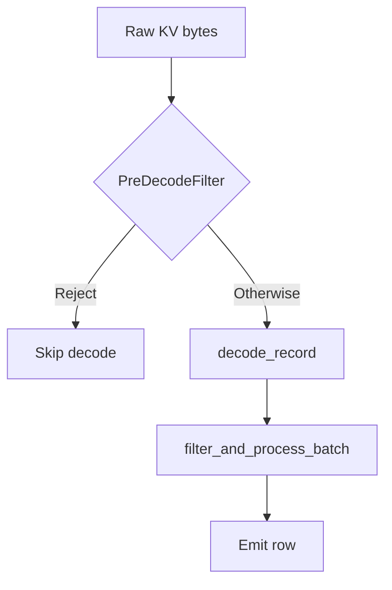

# exec/ — Streaming Query Execution Engine

This module implements SurrealDB's streaming query execution engine. It replaces the legacy recursive `compute()` path with a push-based, batched operator pipeline.

## Architecture

```
SurrealQL (sql::Expr) ──► lower ──► LogicalOp ──► bind ──► LogicalOp ──► Planner ──► ExecOperator tree ──► ValueBatchStream ──► Results
```

1. **Lowering** (`surrealdb_expr::expr::logical`) turns the surface statement into a tree of operators: a `SELECT` into its relational pipeline, every other streaming statement kind (`LET`, `RETURN`, `FOR`, blocks, `INFO`, `SLEEP`, `EXPLAIN`, bare expressions) into its statement operator. Pure: no catalog, no transaction, no caller. A statement with no logical form (a write, DDL) is declined here and runs on the legacy engine.
2. **Binding** (`logical/`) resolves and rewrites that tree for one transaction and one principal — catalog schemas, permissions and computed fields (`resolve`), parameters, constants, then the rule set (`logical/rules/`) driven to a fixpoint: predicate movement, the decorrelation of `IN` / `CONTAINS` subqueries into joins, projection pruning, identity elimination, user-defined function inlining and kind-directed simplification.
3. **Planner** compiles the bound plan into a tree of `Arc<dyn ExecOperator>` as a bottom-up fold over the operators (`planner/fold.rs`), choosing access paths and pushdowns. A relational source nested in `FROM` is compiled by recursing into its plan, never by rebuilding the statement. No `expr::Expr` enters the planner.
   A front end may also skip steps 1–2 and emit a plan itself: GQL lowers a `MATCH` query straight to a `LogicalOp::Match`, carried to the executor as a `TopLevelStatement::Plan`. Its scalars are `LogicalExpr`, compiled through `Planner::physical_expr` like every other scalar; the mutation operators receive them compiled and evaluate them per binding row. Such a plan has no statement behind it, so step 6's fallback does not apply to it — it compiles and runs, or the query fails.
4. **Executor** (`dbs::Executor::execute_operator_plan()`) builds an `ExecutionContext` and calls `plan.execute()`
5. Each operator returns a `ValueBatchStream` — an async stream of `ValueBatch` (Vec\<Value\>)
6. If lowering declines, or binding/planning returns `PlannerUnsupported`, the executor converts the surface statement to `expr::Expr` and runs it on the legacy engine. `eval::surql` is a statement boundary of its own and makes the same choice for the statement it parses. Inside a plan there is no other fallback: the one legacy bridge is `operators/legacy_bridge.rs` (GQL mutations, closure values the streaming engine did not compile, the statement `eval` declines, `exec::permission::LegacyClause` — a stored catalog clause with no logical form, evaluated by a scan enforcing at runtime — and a user-defined function body with no logical form or whose plan the planner declines). Every one of them takes its `Options` from `legacy_bridge::legacy_options_for_frame`, the one place a legacy evaluation inside a plan derives its frame (permission predicate, computed field, `VERSION` stamp).

## Predicate processing layers



1. **`pre_decode_filter/`** — Plan-time: compile a supported WHERE shape into a byte-level tree for [`PreDecodeFilter`]. Execute-time (KV table / record-id range scans): may reject rows from raw bytes **before** full record decode. Outcomes other than reject always fall through — see module rustdoc.
2. **Scan pipeline** (`operators/scan/pipeline.rs`) — After decode, `filter_and_process_batch` evaluates the pushed-down WHERE [`PhysicalExpr`] (`scan_predicate`) per surviving row, **authoritatively**, after table permission filtering, computed fields, and field-level SELECT permissions (documented order in that function).
3. **`ExpressionRegistry` + `Compute`** — For SELECT without GROUP BY, deduplicates complex expressions shared by ORDER BY and projection; runs **post-WHERE** on decoded values.

Index access paths may strip conjuncts from the logical WHERE at plan time (`strip_index_conditions`, etc.); that is separate from both layers above.

## Core Traits

| Trait | Purpose |
|-------|---------|
| `ExecOperator` | Physical operator that produces a `ValueBatchStream`. Declares context requirements, access mode, cardinality, ordering. |
| `PhysicalExpr` | Expression evaluation in streaming context. Per-row evaluation via `evaluate()` against an `EvalContext`. |
| `ScalarFunction` | Stateless function (pure, context-aware, or async) producing a single value per invocation. Declares its `EffectSet` — what it does beyond computing its result — from which `is_deterministic` and the rewrite rules read. |
| `AggregateFunction` | Stateful function with an `Accumulator` for GROUP BY aggregation (count, sum, mean, etc.). |
| `ProjectionFunction` | Function that produces field bindings for output objects. |
| `IndexFunction` | Index-backed functions: MATCHES (full-text) and KNN (vector search). |

## Key Types

- **`ValueBatch`** — Batch of values (`Vec<Value>`). Designed for future columnar execution.
- **`ValueBatchStream`** — `Pin<Box<dyn Stream<Item = FlowResult<ValueBatch>> + Send>>`
- **`ExecutionContext`** — Hierarchical: `Root` | `Namespace(ns)` | `Database(ns, db)`. Holds transaction, params, auth, capabilities.
- **`EvalContext`** — Borrowed view for per-row expression evaluation. Carries current value, params, session info, recursion context.
- **`AccessMode`** — `ReadOnly` | `ReadWrite`. Determines transaction mode and dependency ordering barriers.
- **`CardinalityHint`** — `AtMostOne` | `Bounded(n)` | `Unbounded`. Drives buffering strategy selection.
- **`OutputOrdering`** — `Unordered` | `Sorted(...)`. Enables sort elimination when input is already ordered.
- **`FlowResult<T>`** — `Result<T, ControlFlow>` supporting return/break/continue/error signals through the operator tree.

## Module Layout

### Root files

| File | Purpose |
|------|---------|
| `mod.rs` | Core traits (`ExecOperator`, `ValueBatch`, `ValueBatchStream`), WASM-compat helpers |
| `planner.rs` | Entry point: `Planner::bind()` + `Planner::plan_logical()` convert a `LogicalOp` → `Arc<dyn ExecOperator>`; `Planner::physical_expr()` a `LogicalExpr` → `Arc<dyn PhysicalExpr>` |
| `context.rs` | `ExecutionContext` hierarchy, `SessionInfo`, `ContextLevel`, `Parameters` |
| `access_mode.rs` | `AccessMode` enum and combine logic |
| `cardinality.rs` | `CardinalityHint` for buffering decisions |
| `ordering.rs` | `OutputOrdering` for sort elimination |
| `buffer.rs` | Stream buffering strategies based on cardinality and access mode |
| `metrics.rs` | `OperatorMetrics` and `monitor_stream` for EXPLAIN ANALYZE; a checked caller is shown no metrics beneath a permission filter, a layer or a permission join |
| `expression_registry.rs` | Expression deduplication for SELECT pipelines |
| `pre_decode_filter/` | Pre-decode [`PreDecodeFilter`] on revision-encoded KV bytes (reject-only; scan operators) |
| `field_path_convert.rs` | Pure field paths (no execution, used for sort/extraction metadata) |
| `index.rs` | Index analysis and access path selection |
| `logical/` | Binding passes over the `LogicalOp` plan (`surrealdb_expr::expr::logical`): `bind()` runs catalog resolution (schemas, permissions, computed fields), parameter resolution, constant folding, then `optimise` — the driver over the rules in `logical/rules/` (filter pushdown through projections, the filter split beneath a layer chain, filter pushdown through joins, projection pruning, identity elimination, decorrelation of an `IN` / `CONTAINS` subquery into a semi or anti `Join` in the predicate's frame, user-defined function inlining, kind-directed simplification), applied bottom-up at every node to a fixpoint. `logical/functions.rs` gathers what inlining reads from the node-level function cache; `logical/reads.rs` answers what an expression reads off the row for the rules and the planner alike. Every pass walks a scalar with `visit_binding`/`visit_binding_mut`, which stop at a closure body — the body stays lowered and is compiled by the planner with none of the creating statement's transaction, principal or version; `logical/reads.rs` still descends into it, since what a closure reads is part of what the statement reads |
| `permission.rs` | Runtime permission resolution for sources the analyzer left unresolved |

### `planner/` — Query Planning

Converts Logical Plan into operator trees. Key submodules:

- `fold.rs` — the bottom-up fold over `LogicalOp`: statement operators compile directly, relational pipelines are collected and handed to `select/`; a chain of `PermissionFilter`, layer and pushed-filter nodes over a table source is planned as one access path (`chain_offer`), the chain's filter becoming the scan predicate where no table permission stands over it, and the pipeline's LIMIT/START reaching the scan beneath layers alone, and only where the layers withhold no ORDER BY (a layer drops no row; a permission node does, and a Sort the chain withholds runs above the scan); when a permission predicate of the chain joins the offer, the permission nodes record it so a checked caller's `EXPLAIN` prints `<permission>` in place of the scan's index and bound
- `select/` — SELECT pipeline planning (FROM → WHERE → SPLIT → GROUP → ORDER → LIMIT → FETCH → PROJECT → TIMEOUT), access-path selection and the fast paths
- `match_plan.rs` — GQL `MATCH` plans, compiled whole
- `aggregate.rs` — GROUP BY and aggregate function extraction
- `source.rs` — Source planning (table lookup, index selection, record ID scan)
- `path.rs` — Path → physical step compilation (`Step`, `Broadcast`, lookup fusion, recursion bodies)
- `util/` — Literal conversion, condition resolution, parameter resolution

### `operators/` — Physical Operators

Each file implements `ExecOperator`:

- **Scan**: `scan/table.rs`, `scan/index.rs`, `scan/record_id.rs`, `scan/fulltext.rs`, `scan/knn.rs`, `scan/graph.rs`, `scan/reference.rs`, `scan/dynamic.rs`, `scan/count.rs`, `scan/index_count.rs`, `scan/union_index.rs`, `scan/resolved.rs`
- **Pipeline**: `filter.rs`, `project.rs`, `project_value.rs`, `limit.rs`, `sort.rs`, `aggregate.rs`, `split.rs`, `fetch.rs`, `timeout.rs`, `union.rs`, `knn_topk.rs`
- **Schema**: `permission_filter.rs` (table `PERMISSIONS FOR select`), `layer.rs` (a projection layer: computed fields and field `SELECT` permissions as columns set on the row)
- **Join**: `join/hash_join.rs` (the right side built once, and only after the probe has yielded a row, so an empty probe builds nothing: GQL `MATCH` binding rows keyed on shared bindings, or document rows keyed by expressions and merged under an alias), `join/lookup_join.rs` (`LookupJoin`: the right side read by record id, one batched get per left batch, over a `RecordBatchFetch` leaf). A join lifted from a permission predicate carries a `JoinFrame`; from a checked caller's EXPLAIN it hides its right side (`ExecOperator::explain_children`), its keys, residual, table and alias, and the metrics of every operator beneath it (`ExecOperator::hides_metrics_beneath`)
- **Control flow**: `foreach.rs`, `sequence.rs`, `return.rs`, `let_plan.rs`
- **Info**: `info/` — ROOT/NS/DB/TABLE/INDEX/USER info statements
- **Recursion**: `recursion.rs` — graph traversal with BFS discovery + bottom-up assembly
- **Explain**: `explain.rs` — EXPLAIN / EXPLAIN ANALYZE output
- **Bridge**: `legacy_bridge.rs` — the one legacy evaluator bridge (GQL mutations, non-compiled closure values, the statement `eval` declines, stored clauses and user-defined function bodies with no logical form); `mutate.rs` — GQL mutations

Scan operators share a common record-processing pipeline in `scan/pipeline.rs` and common iterator logic in `scan/common.rs`.

### `physical_expr/` — Expression Evaluation

Implements `PhysicalExpr` for all expression types:

- `literal.rs` — Constants, parameters, mock expressions
- `path.rs` — Paths: `Step` (a run of parts over a root), `Broadcast` (array continuation), `Current`, `FoldedPath` (a constant field chain resolved at plan time)
- `record_id.rs` — Record ID construction
- `ops.rs` — Binary, unary, postfix operators
- `conditional.rs` — IF/ELSE expressions
- `control_flow.rs` — BREAK, CONTINUE, THROW
- `collections.rs` — Array, object, set literals
- `matches.rs` — MATCHES operator (full-text search)
- `subquery.rs` — Scalar subqueries
- `function/` — All function call types (builtin, closure, JS, ML model, user-defined, index, projection, Surrealism modules)

### `function/` — Function System

- `registry.rs` — `FunctionRegistry`: lookup by name, supports scalar + aggregate + projection + index functions
- `builtin/` — ~30 modules implementing scalar functions (math, string, array, object, record, type, geo, vector, search, crypto, http, time, duration, etc.)
- `builtin/aggregates.rs` — Aggregate functions (count, math::sum, math::mean, array::group, etc.)
- `aggregate.rs` — `AggregateFunction` trait and `Accumulator`
- `projection.rs` — `ProjectionFunction` trait
- `index.rs` — `IndexFunction` trait, `MatchesContext`, `KnnContext`
- `signature.rs` — Function signatures with argument types
- `method.rs` — Method-style call descriptors

### `parts/` — Physical Part Expressions

Evaluate one path step each (field access, array indexing, etc.), chained by `physical_expr/path.rs`:

- `field.rs`, `index.rs`, `lookup.rs`, `filter.rs`, `array_ops.rs`, `destructure.rs`, `optional.rs`, `recurse.rs`, `method.rs`

### `index/` — Index Support

- `access_path.rs` — `AccessPath`, `BTreeAccess`, index selection logic
- `analysis.rs` — `IndexAnalyzer`, `IndexCandidate` for query optimization
- `iterator/` — Index iterator implementations

## Design Rules

1. **No `compute()` calls** — All evaluation goes through `PhysicalExpr` and `ExecOperator`. The only bridge to the legacy evaluator is `operators/legacy_bridge.rs`, used for GQL mutations, closure values the streaming engine did not compile, the statement `eval` declines, and stored clauses and user-defined function bodies with no logical form; its `legacy_options_for_frame` is the one place a legacy evaluation inside a plan derives its `Options`. `expr::Expr` is the legacy engine's input and never the streaming engine's.
2. **WASM compatibility** — use `target_family = "wasm"` cfgs to cover executor mechanics (`spawn_local` instead of `tokio::spawn`, no rayon offload or `spawn_blocking`), Browser-wasm-only mechanisms (e.g. asserting `Send` on JS-backed futures) must be gated on `all(target_arch = "wasm32", any(target_os = "unknown", target_os = "none"), not(target_feature = "atomics")`.
3. **Access mode propagation** — Every operator and expression must correctly report its `AccessMode`. A SELECT with a mutating subquery must return `ReadWrite`.
4. **Context level validation** — Operators declare minimum `ContextLevel` (Root/Namespace/Database). The executor validates before execution.
5. **Batched processing** — Operators work with `ValueBatch`, not individual values. This amortizes per-record overhead and enables future columnar execution.

## SELECT Pipeline

The standard SELECT pipeline is:

```
Scan/Union (FROM)
    → Filter (WHERE)
    → Split (SPLIT BY)
    → Aggregate (GROUP BY)
    → Sort (ORDER BY)
    → Limit (LIMIT/START)
    → Fetch (FETCH)
    → Project (SELECT fields)
    → Timeout (TIMEOUT)
```

Sort elimination: if the scan already produces ordered output (e.g., index scan), the planner checks `OutputOrdering` and skips the Sort operator.

## Entry Points

- **`Planner::bind(op)`** then **`Planner::plan_logical(op)`** — Bind a lowered `LogicalOp` against the catalog and compile it into an operator tree; `plan_statement_inner` does both, `plan_logical_inner` compiles an already-bound plan
- **`Planner::with_txn(ctx, registry, txn, ns, db)`** — Planner with transaction for index resolution at plan time
- **`plan.execute(&exec_ctx)`** — Execute operator tree, returns `ValueBatchStream`
- **`Executor::execute_operator_plan(plan, txn)`** — Full execution: build context, run plan, collect results
- **`Planner::physical_expr(expr)`** / **`compile_expr(expr, ctx, registry, txn, auth, depth)`** — Compile a `LogicalExpr` to a `PhysicalExpr`
